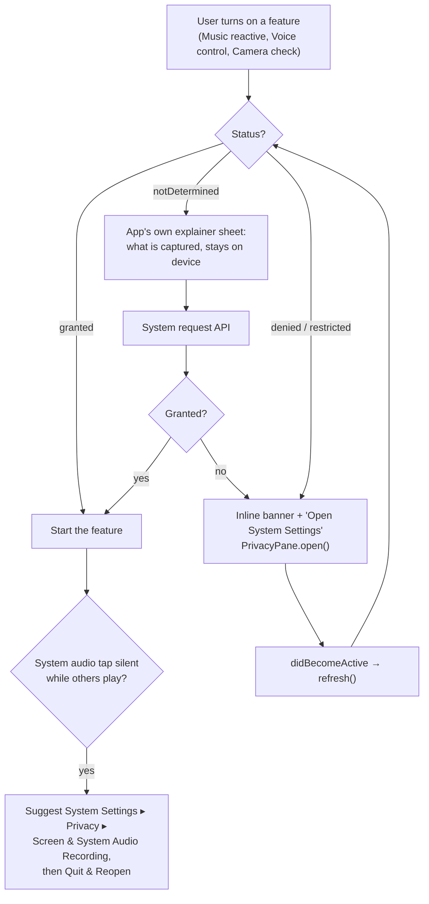

# Prism: macOS Media & AI Integration Reference

*Research date: 2026-11-06.*

| Item | Value |
|---|---|
| Target | macOS 14.0+, with newer APIs behind `@available` / `#available` |
| Toolchain | Xcode 26.x (Swift 6.2/6.3 compiler) |
| Language mode | `swift-tools-version:5.10`, so Swift 5 language mode |
| Distribution | Non-sandboxed, ad-hoc signed |

**Sources**

- macOS **26.5 SDK** headers and `.swiftinterface` files, read directly: CoreAudio (+ Swift overlay), AVFAudio, AVFoundation capture, ScreenCaptureKit, CoreMedia overlay, Speech, FoundationModels.
- Apple developer documentation and WWDC23–25 sessions.
- Open-source implementations:
  - [insidegui/AudioCap](https://github.com/insidegui/AudioCap) (process taps)
  - [makeusabrew/audiotee](https://github.com/makeusabrew/audiotee)
  - the MiniMeters process-tap gist (sudara)
  - karlstav/cava issues
- Official OpenAI, Anthropic and Google Gemini API docs, fetched November 2026.

**Legend**

- ✅ Verified against the SDK or official docs.
- ⚠️ UNVERIFIED: behaviour reported by third parties or inferred. Test it on real hardware before relying on it.

**Conventions used in every code sample**

- **Language mode.** Samples compile in Swift 5 mode with the Xcode 26 compiler, and are written to remain valid under Swift 6 strict concurrency.
- **Isolation.**
  - Objects driven by Core Audio, ScreenCaptureKit or AVCapture callback threads are `final class …: @unchecked Sendable` and guard mutable state with a lock.
  - UI-facing coordinators are `@MainActor`.
- **Closures that run on audio or IO threads are created in `static` (non-isolated) factory functions, or are explicitly `@Sendable`.**
  - A closure literal written inside a `@MainActor` method inherits main-actor isolation. In Swift 6 mode the runtime then traps ("Incorrect actor executor assumption") when Core Audio calls it on its own thread.
  - The SDK does **not** mark `AVAudioNodeTapBlock`, `AVAudioSinkNodeReceiverBlock`, `AudioDeviceIOBlock` or the `SFSpeechRecognizer.requestAuthorization` handler as `@Sendable` (✅ checked in the 26.5 headers), so the compiler will not warn you.
  - `AVAudioConverterInputBlock` and `AVSpeechSynthesizerDelegate` *are* `NS_SWIFT_SENDABLE`.
- **Enums.** Non-frozen SDK enums get an `@unknown default`.

---

## 0. TL;DR

### 0.1 Feature matrix

| Feature | API | Min macOS | Info.plist key | Granted by the user in System Settings ▸ Privacy & Security |
|---|---|---|---|---|
| System audio (primary) | Core Audio **process tap** + private aggregate device | **14.2** | `NSAudioCaptureUsageDescription` | **Screen & System Audio Recording ▸ "System Audio Recording Only"** (macOS 15+). There is no public status API. |
| System audio (fallback) | ScreenCaptureKit `SCStream` audio | 13.0 | none | Screen & System Audio Recording (upper list). Check with `CGPreflightScreenCaptureAccess()` |
| Mic / line-in | `AVAudioEngine` (`AVAudioSinkNode` or `installTap`) | 10.15 | `NSMicrophoneUsageDescription` | Microphone |
| Wake word / commands (any macOS) | `SFSpeechRecognizer`, on-device | 10.15 | `NSSpeechRecognitionUsageDescription` **and** `NSMicrophoneUsageDescription` | Speech Recognition + Microphone |
| Transcription (new) | `SpeechAnalyzer` + `SpeechTranscriber` / `DictationTranscriber` | **26.0** | `NSMicrophoneUsageDescription` only | Microphone |
| Spoken confirmations | `AVSpeechSynthesizer` | 10.14 | none | none |
| On-device LLM | FoundationModels | **26.0**, plus an eligible Apple-silicon Mac with Apple Intelligence turned on | none | (Apple Intelligence & Siri settings) |
| Cloud LLM | `URLSession` REST | any | none (non-sandboxed, so no network entitlement is needed) | none |
| Camera | `AVCaptureSession` + `AVCaptureVideoDataOutput` | 10.7. The `.external` and `.continuityCamera` device types need 14.0 | `NSCameraUsageDescription` (+ `NSCameraUseContinuityCameraDeviceType`) | Camera |

### 0.2 Recommended pipeline

```
Music reactivity : SystemAudioTap (14.2+) ─fallback→ ScreenCaptureAudioSource ─fallback→ MicInputSource (line-in / room mic)
Voice control    : WakeWordListener (SFSpeechRecognizer, 14+)   or   ModernTranscriber (SpeechAnalyzer, 26+)
                   → OnDeviceLightingInterpreter (FoundationModels, 26+)
                   → CloudLightingInterpreter (user-supplied API key)
                   → RuleBasedLightingParser (always available)
                   (LightingCommandInterpreter in §3.5 runs this chain)
Feedback         : Speaker (AVSpeechSynthesizer) · CameraManager + RegionColor (+ optional cloud vision check)
```

### 0.3 Build & packaging notes (read first)

1. **TCC needs a real `.app` bundle with an Info.plist.**
   - macOS attributes privacy prompts to the *responsible process* and reads usage strings from its Info.plist.
   - A bare SwiftPM executable started from Terminal is attributed to Terminal. Prompts say "Terminal would like…" and the grants go to Terminal.
   - CI must assemble `Prism.app/Contents/{MacOS/Prism, Info.plist, Resources/…}` with a stable `CFBundleIdentifier`, then sign the bundle.
   - Requesting camera, microphone or speech access **without** the matching usage string makes TCC kill the process (✅ documented behaviour). Always ship all the keys below.

   ```xml
   <key>NSMicrophoneUsageDescription</key>
   <string>Prism listens for voice commands and can follow music from a microphone or line-in.</string>
   <key>NSSpeechRecognitionUsageDescription</key>
   <string>Prism turns your voice commands into lighting changes on this Mac.</string>
   <key>NSAudioCaptureUsageDescription</key>
   <string>Prism analyzes the audio your Mac is playing (Spotify, YouTube, …) so the lights can follow the music. Audio is never recorded or uploaded.</string>
   <key>NSCameraUsageDescription</key>
   <string>Prism uses a camera to check that the light on set matches what you asked for.</string>
   <key>NSCameraUseContinuityCameraDeviceType</key>
   <true/>
   ```

   Screen Recording (ScreenCaptureKit) has **no** usage-string key.

2. **Optional, development only: embed the Info.plist into the bare binary** so `swift run` has a bundle ID and usage strings. When the binary is launched from Terminal, prompts may still be attributed to Terminal. Test permissions with `open Prism.app`.

   ```swift
   // Package.swift (sketch — do not apply blindly)
   import Foundation
   let infoPlist = URL(fileURLWithPath: #filePath).deletingLastPathComponent()
       .appendingPathComponent("Sources/PrismApp/Info.plist").path
   // in .executableTarget(name: "PrismApp", …):
   //   exclude: ["Info.plist"],
   //   linkerSettings: [ …, .unsafeFlags(["-Xlinker", "-sectcreate", "-Xlinker", "__TEXT",
   //                                       "-Xlinker", "__info_plist", "-Xlinker", infoPlist]) ]
   ```

3. **Ad-hoc signing resets privacy grants on every build.**
   - Why: an ad-hoc signature's *designated requirement* (DR) is its `cdhash`, which changes with every build. TCC stores the DR with each grant.
   - Effect after each update, for camera, mic and speech: macOS treats Prism as a new app and **asks again**.
   - Effect for Screen Recording and System Audio Recording: the list can show a stale, enabled-looking entry that no longer matches. The user must remove it with "–" and re-add it (or you reset it with `tccutil`).
   - Options:
     - a. **Recommended: sign with a stable self-signed code-signing certificate.**
       1. Create the certificate once in Keychain Access ▸ Certificate Assistant ▸ Create a Certificate… ▸ type *Code Signing*.
       2. Export it as a `.p12` and store it as a CI secret.
       3. In CI, import it into a temporary keychain and run `codesign --force --sign "Prism Local Signing" Prism.app`.
       - The DR then pins the certificate rather than the cdhash, so grants survive updates. Gatekeeper still needs the first-launch override, exactly as with ad-hoc signing.
       - **Do not** add `--options runtime` (hardened runtime) unless you also add the `com.apple.security.device.audio-input` and `com.apple.security.device.camera` entitlements. Without them the hardened runtime blocks the mic and camera.
     - b. ⚠️ UNVERIFIED hack: ad-hoc sign with an explicit requirement: `codesign -s - -i com.example.prism -r='designated => identifier "com.example.prism"' Prism.app`. This should keep grants but is trivially spoofable. Test it before relying on it.
     - c. During development, reset grants:

   ```bash
   BID=com.example.prism              # your CFBundleIdentifier
   tccutil reset Microphone        "$BID"
   tccutil reset Camera            "$BID"
   tccutil reset SpeechRecognition "$BID"
   tccutil reset ScreenCapture     "$BID"
   tccutil reset AudioCapture      "$BID"   # ⚠️ service name inferred from kTCCServiceAudioCapture
   tccutil reset All               "$BID"   # everything for this bundle id
   ```

4. **FoundationModels must be weak-linked.**
   - Problem: `import FoundationModels` emits an autolink entry, and `FoundationModels.framework` does not exist on macOS 14 or 15. A strong `LC_LOAD_DYLIB` makes dyld abort at launch on those systems.
   - The linker weakens a framework automatically when *every* referenced symbol is weak, which holds when all uses are behind `@available(macOS 26, *)`. Make it explicit anyway, and verify it in CI:

   ```swift
   // PrismApp target, linkerSettings (unsafeFlags are allowed in the root package):
   .unsafeFlags(["-Xlinker", "-weak_framework", "-Xlinker", "FoundationModels"]),
   ```

   ```bash
   # CI guard: the FoundationModels line must end in ", weak)"
   otool -L Prism.app/Contents/MacOS/Prism | grep FoundationModels
   otool -l Prism.app/Contents/MacOS/Prism | grep -B1 -A3 FoundationModels   # expect cmd LC_LOAD_WEAK_DYLIB
   ```

   The new Speech APIs (`SpeechAnalyzer` etc.) live in `Speech.framework`, which exists on macOS 14, so symbol-level weak references are enough there. Nothing special is needed.

5. **The `@Generable` / `@Guide` macros need full Xcode.** The `FoundationModelsMacros` compiler plugin ships inside Xcode, not the Command Line Tools. On CI, build with `DEVELOPER_DIR=/Applications/Xcode_26.x.app/Contents/Developer`. ⚠️ Verify once that plain `swift build` resolves the plugin on the runner. If it doesn't, build with `xcodebuild -scheme PrismApp`.

6. **ScreenCaptureKit**: `import ScreenCaptureKit` autolinks it, and it exists on 12.3+, so no weak linking is needed. Adding `.linkedFramework("ScreenCaptureKit")` is harmless.

7. **Speech SDK gap.** Apple's online docs mention `AnalyzerInputConverter`, `CaptureInputSequenceProvider` and `AssetInputSequenceProvider`. These are **not in the macOS 26.5 SDK** (✅ checked the swiftinterface), so the sample in §2.2 converts audio itself with `AVAudioConverter`.

---

## 1. System audio capture (react to Spotify / YouTube / any app)

### 1.0 Which source to use

| | Core Audio process tap (§1.2) | ScreenCaptureKit (§1.3) | Mic / line-in (§1.4) |
|---|---|---|---|
| macOS | 14.2+ | 13.0+ for audio | any |
| Permission | "System Audio Recording Only" (`NSAudioCaptureUsageDescription`) | Screen Recording. The prompt is scarier, and macOS 15+ re-confirms periodically | Microphone |
| Can the app read the permission status? | ❌ No public API. Use the silence heuristic or private SPI (§1.2.3) | ✅ `CGPreflightScreenCaptureAccess()` | ✅ `AVCaptureDevice.authorizationStatus(for: .audio)` |
| Pipeline cost | Audio only, one HAL IO cycle of latency | Needs a (tiny) video stream as well | Audio only |
| What it hears | The mix of all processes' output, except the ones you exclude | All audio the display's apps play | The room or the line input |
| Best for | Default choice on 14.2+ | macOS 14.0–14.1, or when the tap stays silent | DJ mixer / line-in, or when nothing is playing on the Mac |

### 1.1 Shared helpers (`AudioSupport.swift`)

```swift
import AudioToolbox
import CoreAudio
import Foundation
import os

/// Receives mono Float32 audio on a capture thread or queue.
/// Copy what you need (e.g. into a ring buffer) and return quickly:
/// no allocation, no locks shared with the UI, no `await`.
/// - samples: valid only for the duration of the call.
/// - hostTime: `mach_absolute_time()` ticks of the first frame, or 0 if unknown.
public typealias MonoSampleHandler = @Sendable (_ samples: UnsafeBufferPointer<Float>,
                                                _ sampleRate: Double,
                                                _ hostTime: UInt64) -> Void

/// Preallocated scratch memory that realtime closures can capture (kept alive by the capture).
public final class ScratchBuffer: @unchecked Sendable {
    public let pointer: UnsafeMutablePointer<Float>
    public let capacity: Int

    public init(capacity: Int = 16_384) {
        self.capacity = capacity
        pointer = .allocate(capacity: capacity)
        pointer.initialize(repeating: 0, count: capacity)
    }

    deinit { pointer.deallocate() }
}

public enum AudioMixdown {
    /// Averages every channel of a Float32 AudioBufferList into `out`.
    /// Works for interleaved buffers, non-interleaved buffers, and mixtures of both.
    /// Returns the number of frames written (≤ capacity). Realtime-safe: no allocation, no locks.
    @inline(__always)
    public static func mono(_ buffers: UnsafeMutableAudioBufferListPointer,
                            into out: UnsafeMutablePointer<Float>,
                            capacity: Int) -> Int {
        var frames = Int.max
        var totalChannels = 0
        for buffer in buffers where buffer.mData != nil && buffer.mNumberChannels > 0 {
            let channels = Int(buffer.mNumberChannels)
            frames = min(frames, Int(buffer.mDataByteSize) / (MemoryLayout<Float>.size * channels))
            totalChannels += channels
        }
        guard totalChannels > 0, frames != Int.max else { return 0 }
        frames = min(frames, capacity)
        guard frames > 0 else { return 0 }

        out.update(repeating: 0, count: frames)
        for buffer in buffers {
            guard let data = buffer.mData, buffer.mNumberChannels > 0 else { continue }
            let channels = Int(buffer.mNumberChannels)
            let src = data.assumingMemoryBound(to: Float.self)
            if channels == 1 {
                for f in 0..<frames { out[f] += src[f] }
            } else {
                for f in 0..<frames {
                    var sum: Float = 0
                    let base = f * channels
                    for c in 0..<channels { sum += src[base + c] }
                    out[f] += sum
                }
            }
        }
        let gain = 1 / Float(totalChannels)
        for f in 0..<frames { out[f] *= gain }
        return frames
    }
}

public enum CoreAudioError: Error, CustomStringConvertible {
    case status(OSStatus, call: String)
    case unsupportedFormat(formatID: UInt32, flags: UInt32, bitsPerChannel: UInt32)
    case notFound(String)

    public var description: String {
        switch self {
        case let .status(code, call):
            return "\(call) failed with \(code) \(fourCC(code))"
        case let .unsupportedFormat(id, flags, bits):
            return "Unsupported stream format \(fourCC(OSStatus(bitPattern: id))) flags=\(flags) bits=\(bits)"
        case let .notFound(what):
            return "\(what) not found"
        }
    }
}

/// Renders an OSStatus as a printable four-char code when possible ('nope', '!hog', 'who?').
public func fourCC(_ status: OSStatus) -> String {
    let n = UInt32(bitPattern: status)
    let bytes = [UInt8(n >> 24 & 0xFF), UInt8(n >> 16 & 0xFF), UInt8(n >> 8 & 0xFF), UInt8(n & 0xFF)]
    guard bytes.allSatisfy({ (0x20..<0x7F).contains($0) }) else { return "" }
    return "'" + String(decoding: bytes, as: UTF8.self) + "'"
}

@inline(__always)
func check(_ status: OSStatus, _ call: @autoclosure () -> String) throws {
    guard status == noErr else { throw CoreAudioError.status(status, call: call()) }
}

/// Thin helpers over the AudioObject property API.
public enum CA {
    public static let systemObject = AudioObjectID(kAudioObjectSystemObject)
    public static let unknown = AudioObjectID(kAudioObjectUnknown)

    public static func propertyAddress(_ selector: AudioObjectPropertySelector,
                                       scope: AudioObjectPropertyScope = kAudioObjectPropertyScopeGlobal,
                                       element: AudioObjectPropertyElement = kAudioObjectPropertyElementMain)
        -> AudioObjectPropertyAddress {
        AudioObjectPropertyAddress(mSelector: selector, mScope: scope, mElement: element)
    }

    /// Reads a fixed-size property (AudioObjectID, UInt32, pid_t, AudioStreamBasicDescription, …).
    public static func get<T>(_ object: AudioObjectID, _ selector: AudioObjectPropertySelector,
                              initial: T) throws -> T {
        var address = propertyAddress(selector)
        var size = UInt32(MemoryLayout<T>.size)
        var value = initial
        try check(AudioObjectGetPropertyData(object, &address, 0, nil, &size, &value),
                  "AudioObjectGetPropertyData(\(fourCC(OSStatus(bitPattern: selector))))")
        return value
    }

    /// Reads a CFString property. The HAL returns it +1, hence `takeRetainedValue()`.
    public static func getString(_ object: AudioObjectID, _ selector: AudioObjectPropertySelector) throws -> String {
        var address = propertyAddress(selector)
        var size = UInt32(MemoryLayout<Unmanaged<CFString>?>.size)
        var value: Unmanaged<CFString>?
        try check(AudioObjectGetPropertyData(object, &address, 0, nil, &size, &value),
                  "AudioObjectGetPropertyData(\(fourCC(OSStatus(bitPattern: selector))))")
        guard let string = value?.takeRetainedValue() else { throw CoreAudioError.notFound("string property") }
        return string as String
    }

    /// pid → Core Audio process object (macOS 14.2+ selector 'id2p'). nil if the process has no audio object.
    public static func processObject(for pid: pid_t) -> AudioObjectID? {
        var address = propertyAddress(kAudioHardwarePropertyTranslatePIDToProcessObject)
        var qualifier = pid
        var object = unknown
        var size = UInt32(MemoryLayout<AudioObjectID>.size)
        let status = AudioObjectGetPropertyData(systemObject, &address,
                                                UInt32(MemoryLayout<pid_t>.size), &qualifier, &size, &object)
        return (status == noErr && object != unknown) ? object : nil
    }

    /// Device UID → AudioObjectID ('uidd', macOS 11+).
    public static func deviceID(forUID uid: String) -> AudioObjectID? {
        var address = propertyAddress(kAudioHardwarePropertyTranslateUIDToDevice)
        var cfUID = uid as CFString
        var device = unknown
        var size = UInt32(MemoryLayout<AudioObjectID>.size)
        let status = withUnsafeMutablePointer(to: &cfUID) { uidPointer in
            AudioObjectGetPropertyData(systemObject, &address,
                                       UInt32(MemoryLayout<CFString>.size), uidPointer, &size, &device)
        }
        return (status == noErr && device != unknown) ? device : nil
    }

    public static func defaultOutputDeviceUID() throws -> String {
        let device = try get(systemObject, kAudioHardwarePropertyDefaultOutputDevice, initial: unknown)
        return try getString(device, kAudioDevicePropertyDeviceUID)
    }

    /// True if any *other* process currently has audio output running ('piro', macOS 14.2+).
    /// Note: some players keep their output IO running while paused.
    public static func anyOtherProcessIsPlayingAudio() -> Bool {
        var address = propertyAddress(kAudioHardwarePropertyProcessObjectList)
        var size: UInt32 = 0
        guard AudioObjectGetPropertyDataSize(systemObject, &address, 0, nil, &size) == noErr, size > 0 else {
            return false
        }
        var processes = [AudioObjectID](repeating: unknown, count: Int(size) / MemoryLayout<AudioObjectID>.size)
        guard AudioObjectGetPropertyData(systemObject, &address, 0, nil, &size, &processes) == noErr else {
            return false
        }
        let myPID = getpid()
        return processes.contains { process in
            let pid = (try? get(process, kAudioProcessPropertyPID, initial: pid_t(0))) ?? 0
            let running = (try? get(process, kAudioProcessPropertyIsRunningOutput, initial: UInt32(0))) ?? 0
            return pid != myPID && running != 0
        }
    }
}

/// Remembers whether a capture stream ever delivered a non-zero sample (permission-denial heuristic).
public final class SilenceMonitor: @unchecked Sendable {
    private struct State {
        var startedAt: UInt64 = 0
        var callbacks = 0
        var sawSignal = false
    }
    private let state = OSAllocatedUnfairLock(initialState: State())

    public init() {}

    public func reset() {
        let now = DispatchTime.now().uptimeNanoseconds
        state.withLock { $0 = State(startedAt: now) }
    }

    /// Call this from the capture callback. It is cheap: the scan stops at the first non-zero sample.
    public func observe(_ samples: UnsafeBufferPointer<Float>) {
        let hasSignal = samples.contains { $0 != 0 }
        state.withLock {
            $0.callbacks += 1
            if hasSignal { $0.sawSignal = true }
        }
    }

    public var snapshot: (seconds: Double, callbacks: Int, sawSignal: Bool) {
        let s = state.withLock { $0 }
        guard s.startedAt != 0 else { return (0, s.callbacks, s.sawSignal) }
        return (Double(DispatchTime.now().uptimeNanoseconds &- s.startedAt) / 1e9, s.callbacks, s.sawSignal)
    }
}
```

### 1.2 Core Audio process tap (macOS 14.2+), the primary source

#### 1.2.1 How it works (✅ 26.5 headers, AudioCap, audiotee, MiniMeters)

1. **Describe the tap.** Build a `CATapDescription`. The class exists since macOS 12; *creating* taps needs 14.2.
   - Swift overlay initializers (✅ in the overlay):
     - `init(stereoMixdownOfProcesses: [AudioObjectID])`
     - `init(monoMixdownOfProcesses:)`
     - `init(stereoGlobalTapButExcludeProcesses: [AudioObjectID])`
     - `init(monoGlobalTapButExcludeProcesses:)`
     - `init(processes:deviceUID:stream:)`
     - `init(excludingProcesses:deviceUID:stream:)`
   - Properties:
     - `name`, `uuid`
     - `processes: [AudioObjectID]`, `isExclusive` (true = "everything except `processes`"), `isMixdown`, `isMono`
     - `isPrivate`, `muteBehavior` (`.unmuted` / `.muted` / `.mutedWhenTapped`)
     - `deviceUID`, `stream: UInt?`
   - macOS 26 additions:
     - `bundleIDs: [String]`, to tap or exclude by bundle ID
     - `isProcessRestoreEnabled`, which re-adds tapped bundle IDs when those apps relaunch
2. **Create the tap.** Call `AudioHardwareCreateProcessTap(description, &tapID)`. Read its ASBD with `kAudioTapPropertyFormat` ('tfmt').
3. **Wrap it in a private aggregate device.** Call `AudioHardwareCreateAggregateDevice(dict, &aggregateID)` with:
   - `kAudioAggregateDeviceTapListKey` ("taps") = `[[kAudioSubTapUIDKey: tapUUID, kAudioSubTapDriftCompensationKey: true]]`
   - `kAudioAggregateDeviceIsPrivateKey: true`
4. **Start IO.** Call `AudioDeviceCreateIOProcIDWithBlock(&procID, aggregateID, queue, block)`, then `AudioDeviceStart`. The tap audio arrives as the block's *input* `AudioBufferList`.
   - If you pass a dispatch queue, the HAL dispatches the block onto it **synchronously**: the IO thread waits for it.
   - If you pass `nil`, the block runs directly on the realtime IO thread. Keep it cheap either way.
5. **Clean up in this order:** `AudioDeviceStop` → `AudioDeviceDestroyIOProcID` → `AudioHardwareDestroyAggregateDevice` → `AudioHardwareDestroyProcessTap`.

**Design choice: a *tap-only* aggregate** (as used by MiniMeters in production and by audiotee). `TapAutoStart` is false and there are no sub-devices.

The alternative is AudioCap's approach (§1.2.4), which adds the default output device as the main sub-device with `TapAutoStart = true`. `kAudioAggregateDeviceTapAutoStartKey` makes `AudioDeviceStart` **block until a tapped process produces audio** (✅ header). That is fine when recording one specific app, but wrong for an always-on global analyzer.

#### 1.2.2 `SystemAudioTap.swift`

```swift
import AudioToolbox
import CoreAudio
import Foundation

/// Captures everything the Mac is playing through a Core Audio process tap wrapped in a
/// private, tap-only aggregate device. Delivers mono Float32 blocks to `handler`.
///
/// Usage:
///     let tap = SystemAudioTap { samples, rate, hostTime in analyzer.push(samples, rate) }
///     try tap.start()          // first call shows the system consent prompt
///     …
///     tap.stop()
///
/// Do not call `stop()` from inside the handler (it would wait on the IO cycle it is running in).
@available(macOS 14.2, *)
public final class SystemAudioTap: @unchecked Sendable {

    public struct Options: Sendable {
        /// Exclude Prism's own audio (UI sounds, previews) from the tap.
        /// AVSpeechSynthesizer output may be rendered by a system process (⚠️) — also gate analysis while speaking.
        public var excludeOwnProcess = true
        /// Rebuild when the default output device changes (sample rate / channel layout can change).
        /// ⚠️ Whether a global tap strictly needs this is unverified; it is cheap insurance.
        public var followDefaultOutputDevice = true
        public init() {}
    }

    private let options: Options
    private let handler: MonoSampleHandler
    private let onFailure: (@Sendable (Error) -> Void)?
    private let scratch = ScratchBuffer(capacity: 16_384)
    private let monitor = SilenceMonitor()
    private let ioQueue = DispatchQueue(label: "prism.system-audio.io", qos: .userInteractive)
    private let listenerQueue = DispatchQueue(label: "prism.system-audio.listener")
    private let controlQueue = DispatchQueue(label: "prism.system-audio.control")
    private let lock = NSLock()

    // Guarded by `lock`.
    private var tapID = CA.unknown
    private var aggregateID = CA.unknown
    private var ioProcID: AudioDeviceIOProcID?
    private var running = false
    private var currentSampleRate: Double = 0
    private var outputListener: AudioObjectPropertyListenerBlock?
    private var pendingRestart: DispatchWorkItem?

    /// - Parameter onFailure: called on a private queue if an automatic rebuild (after a device change) fails.
    public init(options: Options = Options(),
                onFailure: (@Sendable (Error) -> Void)? = nil,
                handler: @escaping MonoSampleHandler) {
        self.options = options
        self.onFailure = onFailure
        self.handler = handler
    }

    deinit {
        // No other strong references exist at this point, so locking is unnecessary.
        pendingRestart?.cancel()
        removeOutputListener()
        teardown()
    }

    public var isRunning: Bool { lock.withLock { running } }
    public var sampleRate: Double { lock.withLock { currentSampleRate } }

    /// Creates tap + aggregate and starts IO. Idempotent.
    /// - Throws: `CoreAudioError` naming the failing call and its OSStatus.
    public func start() throws {
        lock.lock(); defer { lock.unlock() }
        guard !running else { return }
        try build()
        running = true
        installOutputListener()
    }

    public func stop() {
        lock.lock(); defer { lock.unlock() }
        pendingRestart?.cancel()
        pendingRestart = nil
        removeOutputListener()
        teardown()
        running = false
    }

    /// ⚠️ Heuristic. Denied (or never-answered) consent raises no error: IO runs normally but every
    /// sample is exactly 0.0. Returns true if we have run for ≥ `seconds`, never saw signal, and some
    /// other process has output IO running. Treat a `true` result as a soft hint ("No audio — check
    /// permission"), not a hard error: some players keep IO running while paused.
    public func looksLikePermissionDenied(after seconds: Double = 3) -> Bool {
        guard isRunning else { return false }
        let s = monitor.snapshot
        guard s.seconds >= seconds, s.callbacks > 0, !s.sawSignal else { return false }
        return CA.anyOtherProcessIsPlayingAudio()
    }

    // MARK: - Graph construction (call with `lock` held)

    private func build() throws {
        do {
            // 1. Stereo mix of every process except (optionally) Prism itself.
            var excluded: [AudioObjectID] = []
            if options.excludeOwnProcess, let me = CA.processObject(for: getpid()) {
                excluded.append(me)
            }
            let description = CATapDescription(stereoGlobalTapButExcludeProcesses: excluded)
            description.name = "Prism System Audio"
            description.uuid = UUID()
            description.isPrivate = true          // visible only to this process
            description.muteBehavior = .unmuted   // keep playing to the speakers

            // 2. Tap object.
            var newTap = CA.unknown
            try check(AudioHardwareCreateProcessTap(description, &newTap), "AudioHardwareCreateProcessTap")
            tapID = newTap

            // 3. Tap format: normally Float32 stereo at the output device's nominal rate.
            let format = try CA.get(newTap, kAudioTapPropertyFormat, initial: AudioStreamBasicDescription())
            guard format.mFormatID == kAudioFormatLinearPCM,
                  format.mFormatFlags & kAudioFormatFlagIsFloat != 0,
                  format.mBitsPerChannel == 32 else {
                throw CoreAudioError.unsupportedFormat(formatID: format.mFormatID,
                                                       flags: format.mFormatFlags,
                                                       bitsPerChannel: format.mBitsPerChannel)
            }
            currentSampleRate = format.mSampleRate

            // 4. Private aggregate device whose only input is the tap.
            let aggregate: [String: Any] = [
                kAudioAggregateDeviceNameKey: "Prism System Audio Tap",
                kAudioAggregateDeviceUIDKey: "com.prism.system-audio-tap.\(UUID().uuidString)", // must be unique
                kAudioAggregateDeviceIsPrivateKey: true,
                kAudioAggregateDeviceIsStackedKey: false,
                kAudioAggregateDeviceTapAutoStartKey: false,
                kAudioAggregateDeviceTapListKey: [
                    [
                        kAudioSubTapUIDKey: description.uuid.uuidString,
                        kAudioSubTapDriftCompensationKey: true,
                    ] as [String: Any],
                ],
            ]
            var newAggregate = CA.unknown
            try check(AudioHardwareCreateAggregateDevice(aggregate as CFDictionary, &newAggregate),
                      "AudioHardwareCreateAggregateDevice")
            aggregateID = newAggregate

            // 5. IO block → mono mixdown → handler.
            let block = Self.makeIOBlock(handler: handler, scratch: scratch, monitor: monitor,
                                         sampleRate: format.mSampleRate)
            var procID: AudioDeviceIOProcID?
            try check(AudioDeviceCreateIOProcIDWithBlock(&procID, newAggregate, ioQueue, block),
                      "AudioDeviceCreateIOProcIDWithBlock")
            ioProcID = procID

            // 6. Start IO. The first start for this app shows the "System Audio Recording" consent prompt.
            monitor.reset()
            try check(AudioDeviceStart(newAggregate, procID), "AudioDeviceStart")
        } catch {
            teardown()
            throw error
        }
    }

    /// Static so that the block can never inherit actor isolation. Captures only thread-safe objects.
    private static func makeIOBlock(handler: @escaping MonoSampleHandler,
                                    scratch: ScratchBuffer,
                                    monitor: SilenceMonitor,
                                    sampleRate: Double) -> AudioDeviceIOBlock {
        return { _, inputData, inputTime, _, _ in
            let buffers = UnsafeMutableAudioBufferListPointer(UnsafeMutablePointer(mutating: inputData))
            let frames = AudioMixdown.mono(buffers, into: scratch.pointer, capacity: scratch.capacity)
            guard frames > 0 else { return }
            let samples = UnsafeBufferPointer(start: scratch.pointer, count: frames)
            monitor.observe(samples)
            let time = inputTime.pointee
            handler(samples, sampleRate, time.mFlags.contains(.hostTimeValid) ? time.mHostTime : 0)
        }
    }

    /// Order matters: stop IO → destroy IO proc → destroy aggregate → destroy tap.
    private func teardown() {
        if aggregateID != CA.unknown {
            if let procID = ioProcID {
                _ = AudioDeviceStop(aggregateID, procID)
                _ = AudioDeviceDestroyIOProcID(aggregateID, procID)
            }
            _ = AudioHardwareDestroyAggregateDevice(aggregateID)
        }
        if tapID != CA.unknown {
            _ = AudioHardwareDestroyProcessTap(tapID)
        }
        ioProcID = nil
        aggregateID = CA.unknown
        tapID = CA.unknown
    }

    // MARK: - Default-output-device changes

    private func installOutputListener() {
        guard options.followDefaultOutputDevice, outputListener == nil else { return }
        // Keep the block object: removal requires the *identical* block.
        // Never take `lock` inside it — stop() holds the lock while removing the listener.
        let listener: AudioObjectPropertyListenerBlock = { [weak self] _, _ in
            guard let self else { return }
            self.controlQueue.async { [weak self] in self?.scheduleRestart() }
        }
        var address = CA.propertyAddress(kAudioHardwarePropertyDefaultOutputDevice)
        if AudioObjectAddPropertyListenerBlock(CA.systemObject, &address, listenerQueue, listener) == noErr {
            outputListener = listener
        }
    }

    private func removeOutputListener() {
        guard let listener = outputListener else { return }
        var address = CA.propertyAddress(kAudioHardwarePropertyDefaultOutputDevice)
        _ = AudioObjectRemovePropertyListenerBlock(CA.systemObject, &address, listenerQueue, listener)
        outputListener = nil
    }

    /// Runs on controlQueue. Debounces bursts of device notifications.
    private func scheduleRestart() {
        lock.lock(); defer { lock.unlock() }
        guard running else { return }
        pendingRestart?.cancel()
        let work = DispatchWorkItem { [weak self] in self?.rebuild() }
        pendingRestart = work
        controlQueue.asyncAfter(deadline: .now() + 0.5, execute: work)
    }

    private func rebuild() {
        lock.lock(); defer { lock.unlock() }
        guard running else { return }
        pendingRestart = nil
        teardown()
        do {
            try build()
        } catch {
            running = false          // listener stays installed until stop()/deinit; it is inert now
            onFailure?(error)
        }
    }
}
```

Choosing the source at the call site:

```swift
func startMusicInput(analyzer: AudioAnalyzer) async {
    if #available(macOS 14.2, *) {
        let tap = SystemAudioTap { samples, rate, hostTime in analyzer.push(samples, sampleRate: rate, hostTime: hostTime) }
        do {
            try tap.start()
            self.systemTap = tap
            try? await Task.sleep(for: .seconds(4))
            if tap.looksLikePermissionDenied() { showSystemAudioPermissionHint() }  // see §6
            return
        } catch {
            log("Process tap failed: \(error) — falling back to ScreenCaptureKit")
        }
    }
    // macOS 14.0/14.1, or the tap failed: ScreenCaptureKit (§1.3), then the mic (§1.4).
}
```

#### 1.2.3 Permission behaviour

- **Info.plist:** `NSAudioCaptureUsageDescription` is required (✅ AudioCap). No entitlement is needed for a non-sandboxed app.
- **When the prompt appears:** the system prompt is shown the first time IO starts on an aggregate device that contains a tap (`AudioDeviceStart`). It is **not** shown on creation (✅ AudioCap notes).
- **Denial is silent:** no API returns an error. The IO block keeps running and delivers zeros (✅ AudioCap; same for "not yet answered"). Hence `looksLikePermissionDenied()`. `kAudioDevicePermissionsError` ('!hog') is *not* a reliable signal (⚠️).
- **Where the user grants it:**
  - macOS 15+: **System Settings ▸ Privacy & Security ▸ Screen & System Audio Recording**, in the lower list **"System Audio Recording Only"**.
  - ⚠️ Per user reports (cava issue tracker), enabling the app only in the upper "Screen & System Audio Recording" list does not grant taps.
  - ⚠️ On macOS 14.2–14.x the exact UI location is unverified.
- **No re-prompt:** after a denial the prompt never reappears. Deep-link to the pane (§6) and ask the user to re-enable Prism, then `stop()` + `start()` the tap (relaunch if it stays silent ⚠️).
- **Ad-hoc builds:** every new build is a "new app" for TCC (§0.3). Expect stale entries in the list.
- **Optional private status probe** (same technique as AudioCap). ⚠️ Private API: it may break in any update and must never be used for the App Store. The return mapping is inferred, not documented.

```swift
import Foundation   // Darwin (dlopen/dlsym) + CoreFoundation (CFString, `as CFString` bridging)

/// ⚠️ PRIVATE TCC SPI. Inferred mapping: 0 = authorized, 1 = denied, anything else = not determined.
enum AudioCaptureTCCProbe {
    private typealias PreflightFn = @convention(c) (CFString, CFDictionary?) -> Int32

    nonisolated(unsafe) private static let preflight: PreflightFn? = {
        guard let handle = dlopen("/System/Library/PrivateFrameworks/TCC.framework/Versions/A/TCC", RTLD_NOW),
              let symbol = dlsym(handle, "TCCAccessPreflight") else { return nil }
        return unsafeBitCast(symbol, to: PreflightFn.self)
    }()

    /// nil if the SPI is unavailable.
    static func rawStatus() -> Int32? { preflight?("kTCCServiceAudioCapture" as CFString, nil) }
}
```

#### 1.2.4 Variants & gotchas

- **AudioCap-style aggregate** (real output device as the clock source). It records one app reliably but blocks in `AudioDeviceStart` until audio arrives:

  ```swift
  let outputUID = try CA.defaultOutputDeviceUID()
  let aggregate: [String: Any] = [
      kAudioAggregateDeviceNameKey: "Prism Tap",
      kAudioAggregateDeviceUIDKey: UUID().uuidString,
      kAudioAggregateDeviceMainSubDeviceKey: outputUID,
      kAudioAggregateDeviceIsPrivateKey: true,
      kAudioAggregateDeviceIsStackedKey: false,
      kAudioAggregateDeviceTapAutoStartKey: true,
      kAudioAggregateDeviceSubDeviceListKey: [[kAudioSubDeviceUIDKey: outputUID]],
      kAudioAggregateDeviceTapListKey: [[kAudioSubTapDriftCompensationKey: true,
                                         kAudioSubTapUIDKey: description.uuid.uuidString] as [String: Any]],
  ]
  ```

  The output device's own input streams (e.g. a headset mic) then also appear in the IO block's input list. `AudioMixdown` would mix them in. Prefer the tap-only aggregate.
- **Tap one app** (e.g. only Spotify): find its process object in `kAudioHardwarePropertyProcessObjectList`, matching on `kAudioProcessPropertyBundleID` ('pbid'). Then use `CATapDescription(stereoMixdownOfProcesses: [spotifyObject])`.
  - The process object exists only while the app is running.
  - On macOS 26, set `bundleIDs = ["com.spotify.client"]` and `isProcessRestoreEnabled = true` so the tap survives app relaunches (✅ header).
- **The aggregate UID must be unique.** Reusing a UID returns `'nope'` (`kAudioHardwareIllegalOperationError`).
- **Multichannel outputs:** ⚠️ the MiniMeters developer reports that while a global tap is active, output devices with more than 2 channels play at reduced (halved) volume. That report also covers ScreenCaptureKit audio since 14.2. Test with your audio interfaces.
- **Pre- or post-volume:** ⚠️ unverified whether tapped audio is independent of the system volume slider. Normalize levels adaptively (AGC) rather than relying on absolute dBFS.
- **macOS 15+ Swift wrappers:** the overlay has `AudioHardwareSystem.shared.makeProcessTap(description:)`, `makeAggregateDevice(description:)`, `AudioHardwareTap.format`, and so on (✅ `@available(macOS 15.0, *)`). This doc uses the C API so that one code path covers 14.2+.

### 1.3 ScreenCaptureKit audio, the fallback (macOS 13+)

```swift
import CoreGraphics
import CoreMedia
import ScreenCaptureKit

/// System audio through ScreenCaptureKit. Requires Screen Recording permission.
public final class ScreenCaptureAudioSource: NSObject, SCStreamOutput, SCStreamDelegate, @unchecked Sendable {
    public enum SourceError: Error {
        /// The prompt was shown, or access is denied: enable Prism in Settings, then relaunch.
        case permissionRequired
        case noDisplay
    }

    private let handler: MonoSampleHandler
    private let onStop: (@Sendable (Error?) -> Void)?
    private let scratch = ScratchBuffer(capacity: 16_384)
    private let audioQueue = DispatchQueue(label: "prism.sck.audio", qos: .userInteractive)
    private let videoQueue = DispatchQueue(label: "prism.sck.video", qos: .utility)
    private let lock = NSLock()
    private var stream: SCStream?

    public init(onStop: (@Sendable (Error?) -> Void)? = nil, handler: @escaping MonoSampleHandler) {
        self.handler = handler
        self.onStop = onStop
        super.init()
    }

    public func start() async throws {
        if !CGPreflightScreenCaptureAccess() {
            _ = CGRequestScreenCaptureAccess()   // shows the system prompt (first time only) and returns immediately
            throw SourceError.permissionRequired // after granting, SCK typically only works after a relaunch
        }
        let content = try await SCShareableContent.excludingDesktopWindows(false, onScreenWindowsOnly: true)
        guard let display = content.displays.first else { throw SourceError.noDisplay }

        let filter = SCContentFilter(display: display, excludingApplications: [], exceptingWindows: [])
        let config = SCStreamConfiguration()
        config.capturesAudio = true
        config.excludesCurrentProcessAudio = true      // don't analyze Prism's own sounds
        config.sampleRate = 48_000
        config.channelCount = 2
        // A video stream is mandatory; make it as cheap as possible.
        config.width = 2
        config.height = 2
        config.minimumFrameInterval = CMTime(value: 1, timescale: 1)   // 1 fps
        config.showsCursor = false

        let stream = SCStream(filter: filter, configuration: config, delegate: self)
        try stream.addStreamOutput(self, type: .audio, sampleHandlerQueue: audioQueue)
        // Also consume .screen, otherwise SCK logs "stream output NOT found. Dropping frame" constantly.
        try stream.addStreamOutput(self, type: .screen, sampleHandlerQueue: videoQueue)
        try await stream.startCapture()
        lock.withLock { self.stream = stream }
    }

    public func stop() async {
        let current: SCStream? = lock.withLock {
            let s = self.stream
            self.stream = nil
            return s
        }
        try? await current?.stopCapture()
    }

    // MARK: SCStreamOutput
    public func stream(_ stream: SCStream, didOutputSampleBuffer sampleBuffer: CMSampleBuffer,
                       of type: SCStreamOutputType) {
        guard type == .audio, sampleBuffer.isValid, sampleBuffer.numSamples > 0,
              let asbd = sampleBuffer.formatDescription?.audioStreamBasicDescription,
              asbd.mFormatID == kAudioFormatLinearPCM,
              asbd.mFormatFlags & kAudioFormatFlagIsFloat != 0,
              asbd.mBitsPerChannel == 32 else { return }   // SCK delivers Float32 (non-interleaved in practice)

        // SCK timestamps use the host-time clock (⚠️ verify); convert to mach ticks.
        let hostTime = CMClockConvertHostTimeToSystemUnits(sampleBuffer.presentationTimeStamp)
        try? sampleBuffer.withAudioBufferList { buffers, _ in
            let frames = AudioMixdown.mono(buffers, into: scratch.pointer, capacity: scratch.capacity)
            guard frames > 0 else { return }
            handler(UnsafeBufferPointer(start: scratch.pointer, count: frames), asbd.mSampleRate, hostTime)
        }
    }

    // MARK: SCStreamDelegate
    public func stream(_ stream: SCStream, didStopWithError error: Error) {
        lock.withLock { self.stream = nil }
        onStop?(error)   // e.g. the user revoked permission or a display was disconnected
    }
}
```

Notes:

- ✅ APIs:
  - `SCShareableContent.excludingDesktopWindows(_:onScreenWindowsOnly:)` (async)
  - `SCContentFilter(display:excludingApplications:exceptingWindows:)`
  - `SCStreamConfiguration.capturesAudio` / `sampleRate` / `channelCount` / `excludesCurrentProcessAudio` (13.0)
  - `SCStreamOutputType.audio` (13.0)
  - `CMSampleBuffer.withAudioBufferList(blockBufferMemoryAllocator:flags:body:)`
  - `formatDescription?.audioStreamBasicDescription`
  - macOS 15 adds `captureMicrophone` and `.microphone`, which we don't need.
- **Permission:**
  - `CGPreflightScreenCaptureAccess()` / `CGRequestScreenCaptureAccess()`. There is no usage-string key.
  - On macOS 15+ the system periodically re-asks the user to confirm continued screen-capture access. The cadence is unpublished (⚠️ weekly at 15.0, monthly later, per press reports).
  - Prefer the process tap whenever possible.
- **Alternative without TCC:** `SCContentSharingPicker` (macOS 14) lets the user pick content per session, and no Screen Recording grant is needed. This is clunky for an always-on lighting app.

### 1.4 Microphone / line-in (AVAudioEngine)

Low-latency path: `AVAudioSinkNode` (10.15). Its receiver block runs on the realtime IO thread and gets every IO cycle.
- ✅ Block type: `(UnsafePointer<AudioTimeStamp>, AVAudioFrameCount, UnsafePointer<AudioBufferList>) -> OSStatus`.
- A sink node **cannot convert formats**. Connect it with the input node's hardware format.

```swift
import AVFoundation
import AudioToolbox
import CoreAudio

public final class MicInputSource: @unchecked Sendable {
    public enum MicError: Error { case noInputDevice, deviceNotFound(String) }

    private let engine = AVAudioEngine()
    private let handler: MonoSampleHandler
    private let scratch = ScratchBuffer(capacity: 16_384)
    private let lock = NSLock()
    private var sink: AVAudioSinkNode?
    private var deviceUID: String?
    private var configObserver: NSObjectProtocol?

    public init(handler: @escaping MonoSampleHandler) { self.handler = handler }

    deinit {
        if let configObserver { NotificationCenter.default.removeObserver(configObserver) }
        engine.stop()
    }

    /// - Parameter deviceUID: Core Audio device UID (== `AVCaptureDevice.uniqueID` of a `.microphone`
    ///   device). nil = system default input.
    public func start(deviceUID: String? = nil) throws {
        lock.lock(); defer { lock.unlock() }
        self.deviceUID = deviceUID
        try startEngine()
        if configObserver == nil {
            // Posted when the input device or its sample rate / channel count changes; the engine has
            // already stopped itself. The notification arrives on an internal queue — hop off it.
            configObserver = NotificationCenter.default.addObserver(
                forName: .AVAudioEngineConfigurationChange, object: engine, queue: nil
            ) { [weak self] _ in
                DispatchQueue.global(qos: .userInitiated).async { self?.restart() }
            }
        }
    }

    public func stop() {
        lock.lock(); defer { lock.unlock() }
        engine.stop()
        if let sink { engine.detach(sink) }
        sink = nil
    }

    private func restart() {
        lock.lock(); defer { lock.unlock() }
        guard sink != nil else { return }        // stopped meanwhile
        engine.stop()
        do { try startEngine() } catch { NSLog("Mic restart failed: \(error)") }
    }

    /// Call with `lock` held.
    private func startEngine() throws {
        if let uid = deviceUID { try Self.selectInputDevice(uid: uid, engine: engine) }
        let input = engine.inputNode
        let format = input.outputFormat(forBus: 0)   // hardware format (Float32, often non-interleaved)
        guard format.sampleRate > 0, format.channelCount > 0 else { throw MicError.noInputDevice }

        if let old = sink { engine.detach(old) }
        let newSink = Self.makeSink(handler: handler, scratch: scratch, sampleRate: format.sampleRate)
        engine.attach(newSink)
        engine.connect(input, to: newSink, format: format)
        sink = newSink
        engine.prepare()
        try engine.start()
    }

    /// Realtime thread: no allocation, locks, logging, or Swift concurrency inside.
    private static func makeSink(handler: @escaping MonoSampleHandler, scratch: ScratchBuffer,
                                 sampleRate: Double) -> AVAudioSinkNode {
        AVAudioSinkNode { timestamp, frameCount, inputData in
            let buffers = UnsafeMutableAudioBufferListPointer(UnsafeMutablePointer(mutating: inputData))
            let frames = AudioMixdown.mono(buffers, into: scratch.pointer,
                                           capacity: min(scratch.capacity, Int(frameCount)))
            if frames > 0 {
                let t = timestamp.pointee
                handler(UnsafeBufferPointer(start: scratch.pointer, count: frames), sampleRate,
                        t.mFlags.contains(.hostTimeValid) ? t.mHostTime : 0)
            }
            return noErr
        }
    }

    /// Selects a specific input device. Must happen before the engine starts.
    static func selectInputDevice(uid: String, engine: AVAudioEngine) throws {
        guard var deviceID = CA.deviceID(forUID: uid) else { throw MicError.deviceNotFound(uid) }
        guard let unit = engine.inputNode.audioUnit else { throw MicError.noInputDevice }
        try check(AudioUnitSetProperty(unit, kAudioOutputUnitProperty_CurrentDevice, kAudioUnitScope_Global, 0,
                                       &deviceID, UInt32(MemoryLayout<AudioObjectID>.size)),
                  "AudioUnitSetProperty(CurrentDevice)")
    }

    /// Input devices for a picker. `uniqueID` is the Core Audio device UID.
    public static func availableInputs() -> [AVCaptureDevice] {
        AVCaptureDevice.DiscoverySession(deviceTypes: [.microphone], mediaType: .audio,
                                         position: .unspecified).devices
    }
}
```

Simpler but coarser alternative: a tap.
- The buffer size is a *request*. ✅ The header documents the supported range as 100–400 ms, so blocks are coarse. Use the sink node for beat-accurate lighting.

```swift
let input = engine.inputNode
let format = input.outputFormat(forBus: 0)
input.installTap(onBus: 0, bufferSize: 4_800, format: format) { buffer, _ in   // build in a nonisolated context!
    guard let channels = buffer.floatChannelData else { return }
    let frames = Int(buffer.frameLength)
    let left = UnsafeBufferPointer(start: channels[0], count: frames)
    // … analyze `left` (or average channels) …
}
try engine.start()
```

**Voice processing is for the speech mic path only.** Never use it on the music-analysis input, because it removes music by design. It gives echo cancellation, so wake-word detection survives Prism's own TTS and room music.

```swift
let input = engine.inputNode
try input.setVoiceProcessingEnabled(true)                      // engine must be stopped; throws on failure
input.voiceProcessingOtherAudioDuckingConfiguration =          // macOS 14+: don't duck the user's music
    AVAudioVoiceProcessingOtherAudioDuckingConfiguration(enableAdvancedDucking: false, duckingLevel: .min)
// After enabling, re-read input.outputFormat(forBus: 0); the format changes (often mono).
```

⚠️ On macOS, voice processing creates a hidden aggregate with the default output device. Format and latency side effects vary by hardware, so test with USB interfaces.

---

## 2. Speech: wake word, commands, spoken confirmations

### 2.0 Choosing an engine

| | `SFSpeechRecognizer` (§2.1) | `SpeechAnalyzer` (§2.2) |
|---|---|---|
| macOS | 10.15+ (on-device). Works on every Prism target | 26.0+ |
| Permissions | Speech Recognition **and** Microphone | Microphone only. ✅ Apple: the speech-recognition authorization "applies only to SFSpeechRecognizer"; analyzer modules run on-device |
| Custom vocabulary | `contextualStrings` (≤ 100 phrases recommended) | `AnalysisContext.contextualStrings[.general]` (⚠️ effect on `SpeechTranscriber` unclear; it may only bias `DictationTranscriber`) |
| Long sessions | Restart the task periodically (~50 s) and after every final result | Designed for long-form, continuous input |
| Model management | Automatic (Siri / Dictation assets) | `AssetInventory` download per locale |

Neither framework has a true low-power keyword spotter like "Hey Siri". The wake phrase is detected by matching transcripts. Keep the mic hot only while "voice control" is enabled. The orange mic indicator is shown the whole time.

### 2.1 `WakeWordListener` (SFSpeechRecognizer, any macOS)

✅ APIs:
- `SFSpeechRecognizer(locale:)` (failable), `supportsOnDeviceRecognition`, `isAvailable`
- `queue` (an `OperationQueue`; result handlers and delegate calls run there, default `.main`)
- `SFSpeechAudioBufferRecognitionRequest`, with `requiresOnDeviceRecognition`, `shouldReportPartialResults`, `contextualStrings`, `taskHint`, `addsPunctuation` (13+), `append(_:)` and `endAudio()`
- `recognitionTask(with:resultHandler:)`, plus `cancel()` / `finish()` on the task

```swift
import AVFoundation
import Speech

/// Thread-safe holder for the *current* request: the audio tap (render thread) appends buffers,
/// the main actor swaps requests whenever the recognition task restarts.
final class RecognitionRequestBox: @unchecked Sendable {
    private let lock = NSLock()
    private var request: SFSpeechAudioBufferRecognitionRequest?

    func set(_ newValue: SFSpeechAudioBufferRecognitionRequest?) {
        lock.lock(); request = newValue; lock.unlock()
    }

    func append(_ buffer: AVAudioPCMBuffer) {
        lock.lock(); let current = request; lock.unlock()
        current?.append(buffer)
    }
}

/// Always-on, on-device wake-phrase listener.
/// "Hey Prism, teal on the left and brighten the key" → onCommand("teal on the left and brighten the key")
@MainActor
final class WakeWordListener: NSObject, SFSpeechRecognizerDelegate {
    enum ListenerError: Error { case recognizerUnavailable, onDeviceUnsupported, notAuthorized, noMicrophone }

    /// Text after the wake phrase (normalized, lowercase). May be "" if the user only said the wake phrase.
    var onCommand: ((String) -> Void)?
    /// Live transcript, for UI feedback.
    var onPartial: ((String) -> Void)?
    private(set) var isListening = false

    /// Fixture names, colors, etc. Biases recognition through `contextualStrings`.
    var vocabulary: [String]
    let wakePhrases: [String]

    private let recognizer: SFSpeechRecognizer
    private let engine = AVAudioEngine()
    private let box = RecognitionRequestBox()
    private var request: SFSpeechAudioBufferRecognitionRequest?
    private var task: SFSpeechRecognitionTask?
    private var generation = 0                  // invalidates callbacks from cancelled tasks
    private var paused = false
    private var pendingCommand: String?
    private var maxDurationTimer: Timer?
    private var silenceTimer: Timer?
    private var errorBackoff: TimeInterval = 0.5

    private let maxTaskDuration: TimeInterval = 50     // restart long-running tasks before they degrade
    private let endOfCommandSilence: TimeInterval = 1.2

    init(locale: Locale = Locale(identifier: "en-US"),
         wakePhrases: [String] = ["hey prism", "ok prism", "okay prism"],
         vocabulary: [String] = []) throws {
        guard let recognizer = SFSpeechRecognizer(locale: locale) else { throw ListenerError.recognizerUnavailable }
        // false until the on-device model for this language is present (Settings ▸ Keyboard ▸ Dictation).
        guard recognizer.supportsOnDeviceRecognition else { throw ListenerError.onDeviceUnsupported }
        self.recognizer = recognizer
        self.wakePhrases = wakePhrases.map(Self.normalize)
        self.vocabulary = vocabulary
        super.init()
        recognizer.queue = .main        // result handler + delegate on the main thread (default; made explicit)
        recognizer.delegate = self
    }

    func start() throws {
        guard !isListening else { return }
        guard SFSpeechRecognizer.authorizationStatus() == .authorized,
              AVCaptureDevice.authorizationStatus(for: .audio) == .authorized else {
            throw ListenerError.notAuthorized
        }
        let input = engine.inputNode
        let format = input.outputFormat(forBus: 0)
        guard format.sampleRate > 0, format.channelCount > 0 else { throw ListenerError.noMicrophone }
        input.installTap(onBus: 0, bufferSize: 1024, format: format, block: Self.makeTapBlock(box: box))
        engine.prepare()
        do {
            try engine.start()
        } catch {
            input.removeTap(onBus: 0)
            throw error
        }
        isListening = true
        paused = false
        startTask()
    }

    func stop() {
        guard isListening else { return }
        isListening = false
        endTask()
        engine.inputNode.removeTap(onBus: 0)
        engine.stop()
    }

    /// Stop recognizing (e.g. while Prism is talking) but keep the audio engine running.
    func pause() {
        paused = true
        endTask()
    }

    func resume() {
        guard isListening, paused else { return }
        paused = false
        startTask()
    }

    // MARK: - Task lifecycle

    /// Built outside main-actor isolation: AVAudioEngine calls the tap on its render thread.
    nonisolated private static func makeTapBlock(box: RecognitionRequestBox) -> AVAudioNodeTapBlock {
        return { buffer, _ in box.append(buffer) }
    }

    private func startTask() {
        guard isListening, !paused else { return }
        generation += 1
        let gen = generation

        let request = SFSpeechAudioBufferRecognitionRequest()
        request.requiresOnDeviceRecognition = true    // private, offline, and no 1-minute server limit
        request.shouldReportPartialResults = true
        request.taskHint = .search                    // short commands rather than dictation
        request.addsPunctuation = false
        request.contextualStrings = Array((["Prism", "Hey Prism"] + vocabulary).prefix(100))
        self.request = request
        box.set(request)

        task = recognizer.recognitionTask(with: request) { [weak self] result, error in
            // recognizer.queue == .main, so this always runs on the main thread.
            let text = result?.bestTranscription.formattedString
            let isFinal = result?.isFinal ?? false
            MainActor.assumeIsolated {
                self?.handle(text: text, isFinal: isFinal, error: error, generation: gen)
            }
        }

        maxDurationTimer = Timer.scheduledTimer(withTimeInterval: maxTaskDuration, repeats: false) { [weak self] _ in
            MainActor.assumeIsolated { self?.restartTask() }
        }
    }

    private func handle(text: String?, isFinal: Bool, error: Error?, generation gen: Int) {
        guard gen == generation else { return }              // stale callback from an ended task
        if let text {
            errorBackoff = 0.5
            onPartial?(text)
            if let command = Self.command(afterWakePhraseIn: text, wakePhrases: wakePhrases) {
                pendingCommand = command
                if !isFinal {
                    // Wake phrase heard: finish the utterance after a short pause in speech.
                    silenceTimer?.invalidate()
                    silenceTimer = Timer.scheduledTimer(withTimeInterval: endOfCommandSilence,
                                                        repeats: false) { [weak self] _ in
                        MainActor.assumeIsolated { self?.finishUtterance(generation: gen) }
                    }
                }
            }
        }
        if isFinal {
            if let command = pendingCommand { onCommand?(command) }
            restartTask()                                    // fresh transcript for the next command
        } else if let error {
            // e.g. "no speech detected" after long silence (⚠️ kAFAssistantErrorDomain 1110), service hiccups,
            // SFSpeechErrorCode.timeout (12). Back off so a persistent failure can't spin.
            NSLog("Speech task ended: \(error.localizedDescription)")
            let delay = errorBackoff
            errorBackoff = min(errorBackoff * 2, 8)
            endTask()
            DispatchQueue.main.asyncAfter(deadline: .now() + delay) { [weak self] in
                MainActor.assumeIsolated { self?.startTask() }
            }
        }
    }

    /// Stop feeding audio so the recognizer produces a final result for the command.
    private func finishUtterance(generation gen: Int) {
        guard gen == generation else { return }
        box.set(nil)
        request?.endAudio()
    }

    private func restartTask() {
        endTask()
        startTask()
    }

    private func endTask() {
        generation += 1
        maxDurationTimer?.invalidate(); maxDurationTimer = nil
        silenceTimer?.invalidate(); silenceTimer = nil
        pendingCommand = nil
        box.set(nil)
        request?.endAudio()
        request = nil
        task?.cancel()       // its error callback is ignored thanks to `generation`
        task = nil
    }

    // MARK: - SFSpeechRecognizerDelegate

    nonisolated func speechRecognizer(_ speechRecognizer: SFSpeechRecognizer, availabilityDidChange available: Bool) {
        Task { @MainActor [weak self] in
            guard let self, self.isListening, !self.paused else { return }
            if available { self.restartTask() } else { self.endTask() }
        }
    }

    // MARK: - Wake phrase matching

    /// Words after the *last* wake phrase, or nil if no wake phrase occurs (whole-word match).
    nonisolated static func command(afterWakePhraseIn transcript: String, wakePhrases: [String]) -> String? {
        let padded = " " + normalize(transcript) + " "
        var best: Range<String.Index>?
        for phrase in wakePhrases {
            guard let range = padded.range(of: " \(phrase) ", options: .backwards) else { continue }
            if best == nil || range.lowerBound > best!.lowerBound { best = range }
        }
        guard let match = best else { return nil }
        return String(padded[match.upperBound...]).trimmingCharacters(in: .whitespaces)
    }

    /// "Hey, Prism!" → "hey prism". Lowercases, strips diacritics and punctuation, collapses spaces.
    nonisolated static func normalize(_ text: String) -> String {
        let folded = text.folding(options: [.caseInsensitive, .diacriticInsensitive], locale: nil).lowercased()
        let mapped = folded.unicodeScalars.map { CharacterSet.alphanumerics.contains($0) ? Character($0) : " " }
        return String(mapped).split(separator: " ").joined(separator: " ")
    }
}
```

Notes:

- **Restart policy.** The engine and tap stay up. Only the request and task are replaced:
  - after every final result,
  - after an error (with backoff),
  - and every ~50 s.
  The `generation` counter makes stale callbacks harmless, because `cancel()` triggers an error callback later.
- **Misrecognitions.** Add aliases the recognizer actually produces ("hey prisma", "hey prison", "a prism"). Log `onPartial` output during testing to collect them.
- **Pause around TTS** (§2.3): `speaker.onSpeakingChanged = { $0 ? listener.pause() : listener.resume() }`.
- **Hand the command to the interpreter.** Pass the command to §3 (on-device LLM) and §4 (cloud), with a rule-based parser as the last resort.
- **Error domains.** `SFSpeechErrorDomain` codes are public (✅ `SFErrors.h`, macOS 14):
  - 1 internalServiceError
  - 2 audioReadFailed
  - 7 undefinedTemplateClassName
  - 8 malformedSupplementalModel
  - 12 timeout
  - 13 missingParameter
  The common runtime errors come from the private `kAFAssistantErrorDomain` (⚠️ observed codes: 1110 "no speech detected", 216/301 "request canceled"). Never switch on those for correctness; just restart.

Authorization must be requested from a non-isolated context. The handler is called on an arbitrary queue: ✅ the header states it "does not use" `recognizer.queue`.

```swift
import AVFoundation
import Speech

enum SpeechPermissions {
    static func requestSpeechRecognition() async -> SFSpeechRecognizerAuthorizationStatus {
        await withCheckedContinuation { continuation in
            // Explicitly @Sendable ⇒ never main-actor-isolated, even if called from @MainActor code.
            SFSpeechRecognizer.requestAuthorization { @Sendable status in continuation.resume(returning: status) }
        }
    }

    static func requestMicrophone() async -> Bool {
        await AVCaptureDevice.requestAccess(for: .audio)
    }
}
```

### 2.2 `ModernTranscriber` (SpeechAnalyzer, macOS 26+)

✅ API (26.5 swiftinterface):

- **`SpeechAnalyzer`** is an `actor`.
  - Setup: `init(modules:options:)`, `prepareToAnalyze(in:)`, `setContext(_:)`.
  - Input: `start(inputSequence:)`, where `Element == AnalyzerInput`. It returns once analysis is running.
  - Shutdown: `finalizeAndFinishThroughEndOfInput()`, `cancelAndFinishNow()`.
  - Format: `static bestAvailableAudioFormat(compatibleWith:) async -> AVAudioFormat?`.
  - Options: `Options(priority:modelRetention:)`, where `modelRetention` is `.whileInUse`, `.lingering` or `.processLifetime`.
- **`AnalyzerInput(buffer:)`** and `AnalyzerInput(buffer:bufferStartTime:)`.
- **`SpeechTranscriber`**
  - `init(locale:preset:)`, where `Preset` is `.transcription`, `.transcriptionWithAlternatives`, `.timeIndexedTranscriptionWithAlternatives`, `.progressiveTranscription` or `.timeIndexedProgressiveTranscription`.
  - `static isAvailable`, `static supportedLocale(equivalentTo:) async`, `supportedLocales`, `installedLocales`.
  - `results`: an async sequence of `Result` (`text: AttributedString`, `alternatives`, `range`, `isFinal`).
- **`DictationTranscriber`** (the fallback when `SpeechTranscriber.isAvailable == false`).
  - `init(locale:preset:)`, where `Preset` is `.phrase`, `.shortDictation`, `.progressiveShortDictation`, `.longDictation`, `.progressiveLongDictation` or `.timeIndexedLongDictation`.
  - `ContentHint` is `.shortForm`, `.farField` or `.atypicalSpeech`. Use it through the long initializer.
- **`AssetInventory`**
  - `status(forModules:)`, returning `.unsupported`, `.supported`, `.downloading` or `.installed`.
  - `assetInstallationRequest(supporting:) async throws -> AssetInstallationRequest?`, which has `progress` and `downloadAndInstall()`.
  - `reserve(locale:)` / `release(reservedLocale:)`.
- **`AnalysisContext`**: `contextualStrings[.general]`.
- **`SpeechDetector(detectionOptions: .init(sensitivityLevel: .medium), reportResults: false)`**: voice-activity gating, added as an extra module next to a transcriber.

```swift
#if canImport(Speech)
import AVFoundation
import Speech

@available(macOS 26.0, *)
@MainActor
final class ModernTranscriber {
    enum TranscriberError: Error { case localeNotSupported(Locale), noAudioFormat, noMicrophone, converterUnavailable }

    /// (text, isFinal). Volatile results (isFinal == false) are superseded by later results for the same audio.
    var onResult: ((String, Bool) -> Void)?

    private let engine = AVAudioEngine()
    private var analyzer: SpeechAnalyzer?
    private var continuation: AsyncStream<AnalyzerInput>.Continuation?
    private var resultsTask: Task<Void, Never>?

    func start(locale: Locale = Locale(identifier: "en-US"), contextualStrings: [String] = []) async throws {
        await stop()
        do {
            try await startPipeline(locale: locale, contextualStrings: contextualStrings)
        } catch {
            await stop()
            throw error
        }
    }

    func stop() async {
        engine.inputNode.removeTap(onBus: 0)
        engine.stop()
        continuation?.finish()                 // end of input…
        continuation = nil
        if let analyzer {
            try? await analyzer.finalizeAndFinishThroughEndOfInput()   // …then flush final results
        }
        analyzer = nil
        resultsTask = nil                      // its loop ends when the results sequence finishes
    }

    private func startPipeline(locale: Locale, contextualStrings: [String]) async throws {
        // 1. Module: SpeechTranscriber (new long-form model) where available, else DictationTranscriber.
        let module: any SpeechModule
        if SpeechTranscriber.isAvailable, let supported = await SpeechTranscriber.supportedLocale(equivalentTo: locale) {
            let transcriber = SpeechTranscriber(locale: supported, preset: .progressiveTranscription)
            module = transcriber
            resultsTask = Task { [weak self] in
                do {
                    for try await result in transcriber.results {
                        self?.onResult?(String(result.text.characters), result.isFinal)
                    }
                } catch {
                    NSLog("SpeechTranscriber results failed: \(error)")
                }
            }
        } else if let supported = await DictationTranscriber.supportedLocale(equivalentTo: locale) {
            let transcriber = DictationTranscriber(locale: supported, preset: .progressiveShortDictation)
            module = transcriber
            resultsTask = Task { [weak self] in
                do {
                    for try await result in transcriber.results {
                        self?.onResult?(String(result.text.characters), result.isFinal)
                    }
                } catch {
                    NSLog("DictationTranscriber results failed: \(error)")
                }
            }
        } else {
            throw TranscriberError.localeNotSupported(locale)
        }
        let modules: [any SpeechModule] = [module]

        // 2. Ensure the on-device model for this locale is installed (one-time download).
        if let installation = try await AssetInventory.assetInstallationRequest(supporting: modules) {
            // installation.progress is a Foundation.Progress you can show in the UI.
            try await installation.downloadAndInstall()
        }

        // 3. Formats: the analyzer's preferred format vs. the mic's hardware format.
        guard let analyzerFormat = await SpeechAnalyzer.bestAvailableAudioFormat(compatibleWith: modules) else {
            throw TranscriberError.noAudioFormat
        }
        let input = engine.inputNode
        let micFormat = input.outputFormat(forBus: 0)
        guard micFormat.sampleRate > 0, micFormat.channelCount > 0 else { throw TranscriberError.noMicrophone }
        guard let converter = AVAudioConverter(from: micFormat, to: analyzerFormat) else {
            throw TranscriberError.converterUnavailable
        }

        // 4. Analyzer fed by an AsyncStream.
        let (stream, continuation) = AsyncStream<AnalyzerInput>.makeStream()
        let analyzer = SpeechAnalyzer(modules: modules,
                                      options: SpeechAnalyzer.Options(priority: .userInitiated,
                                                                      modelRetention: .lingering))
        try await analyzer.prepareToAnalyze(in: analyzerFormat)
        if !contextualStrings.isEmpty {
            let context = AnalysisContext()
            context.contextualStrings[.general] = contextualStrings   // ⚠️ may only bias DictationTranscriber
            try await analyzer.setContext(context)
        }
        try await analyzer.start(inputSequence: stream)
        self.analyzer = analyzer
        self.continuation = continuation

        // 5. Microphone → converter → stream.
        input.installTap(onBus: 0, bufferSize: 4096, format: micFormat,
                         block: Self.makeTapBlock(converter: converter, format: analyzerFormat,
                                                  continuation: continuation))
        engine.prepare()
        try engine.start()
    }

    /// Runs on the render thread; built in a nonisolated context.
    nonisolated private static func makeTapBlock(converter: AVAudioConverter, format: AVAudioFormat,
                                                 continuation: AsyncStream<AnalyzerInput>.Continuation)
        -> AVAudioNodeTapBlock {
        return { buffer, _ in
            guard let converted = convert(buffer, using: converter, to: format) else { return }
            continuation.yield(AnalyzerInput(buffer: converted))
        }
    }

    /// Streams one buffer through a persistent converter. `.noDataNow` (not `.endOfStream`) keeps the
    /// resampler state valid between calls. The output is a fresh buffer, safe to hand off.
    nonisolated static func convert(_ buffer: AVAudioPCMBuffer, using converter: AVAudioConverter,
                                    to format: AVAudioFormat) -> AVAudioPCMBuffer? {
        let ratio = format.sampleRate / buffer.format.sampleRate
        let capacity = AVAudioFrameCount((Double(buffer.frameLength) * ratio).rounded(.up)) + 32
        guard let output = AVAudioPCMBuffer(pcmFormat: format, frameCapacity: capacity) else { return nil }
        let feed = ConverterFeed(buffer)
        var error: NSError?
        let status = converter.convert(to: output, error: &error) { _, inputStatus in
            guard let next = feed.take() else {
                inputStatus.pointee = .noDataNow
                return nil
            }
            inputStatus.pointee = .haveData
            return next
        }
        guard status != .error, error == nil, output.frameLength > 0 else { return nil }
        return output
    }
}

/// One-shot holder used inside AVAudioConverter's input block. That block type is NS_SWIFT_SENDABLE,
/// so it may not mutate captured local vars; it is called synchronously within convert(to:error:withInputFrom:).
final class ConverterFeed: @unchecked Sendable {
    private var buffer: AVAudioPCMBuffer?
    init(_ buffer: AVAudioPCMBuffer) { self.buffer = buffer }
    func take() -> AVAudioPCMBuffer? {
        defer { buffer = nil }
        return buffer
    }
}
#endif
```

Wake word on macOS 26:
- Feed `onResult` text into the same `WakeWordListener.command(afterWakePhraseIn:wakePhrases:)` matcher.
- With `.progressiveTranscription`, the volatile results arrive quickly. Act on the final result, or after ~1 s with no change.
- Unlike `SFSpeechRecognizer`, there's no need to restart sessions periodically.

Choosing at runtime:

```swift
if #available(macOS 26.0, *) {
    let transcriber = ModernTranscriber()
    transcriber.onResult = { text, isFinal in /* wake-phrase matching */ }
    try await transcriber.start(contextualStrings: ["Prism", "key light", "fill", "backlight"])
} else {
    let listener = try WakeWordListener(vocabulary: ["key light", "fill", "backlight"])
    try listener.start()
}
```

### 2.3 `Speaker` (AVSpeechSynthesizer)

```swift
import AVFoundation

@MainActor
final class Speaker: NSObject, AVSpeechSynthesizerDelegate {
    /// true while speaking — pause the wake-word listener and gate audio analysis meanwhile.
    var onSpeakingChanged: ((Bool) -> Void)?

    private let synthesizer = AVSpeechSynthesizer()        // must be retained for speech to continue
    private var continuations: [ObjectIdentifier: CheckedContinuation<Void, Never>] = [:]

    override init() {
        super.init()
        synthesizer.delegate = self
    }

    /// Speaks and returns when the utterance finished or was cancelled.
    func say(_ text: String, voiceIdentifier: String? = nil, rate: Float = AVSpeechUtteranceDefaultSpeechRate) async {
        let utterance = AVSpeechUtterance(string: text)
        utterance.rate = rate
        utterance.voice = voiceIdentifier.flatMap(AVSpeechSynthesisVoice.init(identifier:))
            ?? AVSpeechSynthesisVoice(language: "en-US")
        await withCheckedContinuation { (continuation: CheckedContinuation<Void, Never>) in
            continuations[ObjectIdentifier(utterance)] = continuation
            if continuations.count == 1 { onSpeakingChanged?(true) }
            synthesizer.speak(utterance)
        }
    }

    func stopSpeaking() { synthesizer.stopSpeaking(at: .immediate) }

    /// Best installed English voices first (enhanced/premium voices are downloaded in System Settings ▸ Accessibility ▸ Spoken Content).
    static func preferredVoices(language: String = "en") -> [AVSpeechSynthesisVoice] {
        AVSpeechSynthesisVoice.speechVoices()
            .filter { $0.language.hasPrefix(language) }
            .sorted { $0.quality.rawValue > $1.quality.rawValue }
    }

    // The delegate protocol is NS_SWIFT_SENDABLE and non-isolated: hop to the main actor explicitly.
    nonisolated func speechSynthesizer(_ synthesizer: AVSpeechSynthesizer, didFinish utterance: AVSpeechUtterance) {
        let id = ObjectIdentifier(utterance)
        Task { @MainActor in self.finish(id) }
    }

    nonisolated func speechSynthesizer(_ synthesizer: AVSpeechSynthesizer, didCancel utterance: AVSpeechUtterance) {
        let id = ObjectIdentifier(utterance)
        Task { @MainActor in self.finish(id) }
    }

    private func finish(_ id: ObjectIdentifier) {
        continuations.removeValue(forKey: id)?.resume()
        if continuations.isEmpty { onSpeakingChanged?(false) }
    }
}
```

Notes:
- **Volume and pitch.** `AVSpeechUtterance` also has `pitchMultiplier` (0.5–2.0) and `volume` (0–1).
- **Voice quality.** `AVSpeechSynthesisVoiceQuality` is `.default`, `.enhanced` or `.premium`.
- **Echo into analysis.** TTS output reaches the system-audio tap unless that output comes from Prism's own (excluded) process. ⚠️ It may be rendered by a system speech process, so pause audio-reactive analysis while `onSpeakingChanged(true)`.
- **Echo into the mic.** For a mic-based wake word during playback, enable voice processing on the *speech* engine (§1.4), or simply pause recognition while speaking.

---

## 3. On-device language understanding: Apple Foundation Models (macOS 26+)

### 3.0 Facts (✅ checked against the macOS 26.5 SDK `FoundationModels.swiftinterface`)

| Item | Detail |
|---|---|
| Availability | `SystemLanguageModel.default.availability` is `@frozen enum Availability { case available; case unavailable(UnavailableReason) }`. `UnavailableReason` is **not** frozen: `.deviceNotEligible`, `.appleIntelligenceNotEnabled`, `.modelNotReady` (still downloading). `isAvailable` is a Bool shortcut |
| Hardware | Apple-silicon Mac with Apple Intelligence turned on and a supported language. Intel Macs and GitHub's macOS runner VMs report `.deviceNotEligible` |
| Language | `supportsLocale(_ locale: Locale = .current) -> Bool`, `supportedLanguages: Set<Locale.Language>` |
| Session | `final class LanguageModelSession` (`Observable`, `@unchecked Sendable`). `init(model: = .default, tools: [any Tool] = [], instructions: String? = nil)`; overloads take `Instructions` / an `@InstructionsBuilder` closure / a `Transcript` |
| Request | `respond<Content: Generable>(to: String, generating: Content.Type = Content.self, includeSchemaInPrompt: Bool = true, options: GenerationOptions = GenerationOptions()) async throws -> Response<Content>`. It's `nonisolated(nonsending)`, so it runs on the caller's actor (calling it from `@MainActor` is fine). `Response` has `content`, `rawContent: GeneratedContent` and `transcriptEntries` |
| Options | `GenerationOptions(sampling: .greedy / .random(top:seed:) / .random(probabilityThreshold:seed:), temperature: Double?, maximumResponseTokens: Int?)`. All parameters default to `nil` |
| Warm-up | `prewarm(promptPrefix: Prompt? = nil)` |
| One at a time | `isResponding: Bool`. A second request on a busy session throws `.concurrentRequests` |
| Context window | **4,096 tokens per session.** This covers instructions, tool schemas, every prompt and response so far, and the injected output schema. `SystemLanguageModel.contextSize: Int` is back-deployed (returns 4096 before 26.4). `tokenCount(for:)` (prompt / instructions / tools / schema / transcript entries) is **macOS 26.4+** |
| Errors | `LanguageModelSession.GenerationError` is not frozen: `exceededContextWindowSize`, `assetsUnavailable`, `guardrailViolation`, `unsupportedGuide`, `unsupportedLanguageOrLocale`, `decodingFailure`, `rateLimited`, `concurrentRequests` (each carries a `Context` with `debugDescription`), and `refusal(Refusal, Context)`. `Refusal.explanation` is `get async throws -> Response<String>`. Tools also throw `LanguageModelSession.ToolCallError` (`tool`, `underlyingError`) |
| Macros | `@Generable(description: String? = nil)` on structs and enums. `@Guide(description:)`, `@Guide(description:_ guides: GenerationGuide<T>...)` and a `Regex` variant |
| Guides | `Int` / `Float` / `Double` / `Decimal`: `.minimum`, `.maximum`, `.range`. `String`: `.anyOf([String])`, `.constant`, `.pattern(Regex)`. Arrays: `.minimumCount`, `.maximumCount`, `.count(Int or ClosedRange)`, `.element(guide)` |
| Tool | `protocol Tool<Arguments, Output>: Sendable`. `Arguments: ConvertibleFromGeneratedContent` (in practice a `@Generable` struct). `Output: PromptRepresentable` (`String`, arrays of them, or any `@Generable` type). `description` is required; `name` defaults to the type name; `parameters` is derived from `Arguments`; `includesSchemaInInstructions` defaults to true. Requirement: `@concurrent func call(arguments: Arguments) async throws -> Output` |

### 3.1 Shared command types (macOS 14+, no FoundationModels)

Every interpreter produces the same `LightingCommandList`: on-device (§3.2), cloud (§4) and the rule parser (§3.5). Raw values are the wire format, and the cloud JSON schema is generated from `allCases`.

```swift
// LightingCommand.swift
import Foundation

enum LightTargetID: String, Codable, CaseIterable, Sendable {
    case key, fill, back, left, right, top, bottom, front, background, all
}

enum LightOperationID: String, Codable, CaseIterable, Sendable {
    case setColor          // color = name, "#RRGGBB" or "3200k"; amount 0
    case adjustBrightness  // amount = relative change, -1...1
    case setBrightness     // amount = absolute level, 0...1
    case turnOn, turnOff
}

struct LightingCommand: Codable, Sendable, Equatable {
    var target: LightTargetID
    var operation: LightOperationID
    var color: String      // "" when the color doesn't change
    var amount: Double     // meaning depends on `operation`
}

struct LightingCommandList: Codable, Sendable, Equatable {
    var actions: [LightingCommand]

    /// Clamp numbers, normalize colors, drop no-ops and cap the count.
    /// Apply this to every source: not all schema dialects can enforce numeric ranges (§4).
    func sanitized(maxActions: Int = 12) -> LightingCommandList {
        var result: [LightingCommand] = []
        for var action in actions.prefix(maxActions) {
            action.color = action.color.trimmingCharacters(in: .whitespacesAndNewlines).lowercased()
            switch action.operation {
            case .adjustBrightness: action.amount = min(max(action.amount, -1), 1)
            case .setBrightness: action.amount = min(max(action.amount, 0), 1)
            case .setColor, .turnOn, .turnOff: action.amount = 0
            }
            if action.operation == .setColor && action.color.isEmpty { continue }
            if action.operation == .adjustBrightness && action.amount == 0 { continue }
            result.append(action)
        }
        return LightingCommandList(actions: result)
    }
}

/// Full-intensity color (max channel = 1). Brightness is a separate control.
struct RGB: Sendable, Equatable {
    var r: Double
    var g: Double
    var b: Double
}

enum ColorNameResolver {
    static let table: [String: RGB] = [
        "red": RGB(r: 1, g: 0, b: 0),
        "orange": RGB(r: 1, g: 0.45, b: 0),
        "amber": RGB(r: 1, g: 0.65, b: 0),
        "yellow": RGB(r: 1, g: 0.9, b: 0),
        "lime": RGB(r: 0.6, g: 1, b: 0),
        "green": RGB(r: 0, g: 1, b: 0),
        "teal": RGB(r: 0, g: 1, b: 0.75),
        "cyan": RGB(r: 0, g: 1, b: 1),
        "sky blue": RGB(r: 0.35, g: 0.75, b: 1),
        "blue": RGB(r: 0, g: 0.1, b: 1),
        "purple": RGB(r: 0.55, g: 0, b: 1),
        "violet": RGB(r: 0.7, g: 0, b: 1),
        "magenta": RGB(r: 1, g: 0, b: 1),
        "pink": RGB(r: 1, g: 0.35, b: 0.7),
        "white": RGB(r: 1, g: 1, b: 1),
        "warm white": kelvin(3200),
        "cool white": kelvin(5600),
    ]

    /// Accepts a table name, "#RRGGBB", "<kelvin>k" ("3200k") or "<modifier> <name>" ("deep blue" → blue).
    static func rgb(for spoken: String) -> RGB? {
        let key = spoken.lowercased().trimmingCharacters(in: .whitespacesAndNewlines)
        if let hit = table[key] { return hit }
        if key.hasPrefix("#"), key.count == 7, let value = UInt32(key.dropFirst(), radix: 16) {
            return RGB(r: Double((value >> 16) & 0xFF) / 255,
                       g: Double((value >> 8) & 0xFF) / 255,
                       b: Double(value & 0xFF) / 255)
        }
        if key.hasSuffix("k"), let k = Double(key.dropLast()), (1000...20000).contains(k) { return kelvin(k) }
        if let last = key.split(separator: " ").last, let hit = table[String(last)] { return hit }
        return nil
    }

    /// Tanner Helland's black-body approximation, normalized so the max channel = 1.
    /// Prefer a fixture's native CCT channel when it has one.
    static func kelvin(_ k: Double) -> RGB {
        let t = min(max(k, 1000), 40000) / 100
        let r = t <= 66 ? 255 : 329.698727446 * pow(t - 60, -0.1332047592)
        let g = t <= 66 ? 99.4708025861 * log(t) - 161.1195681661 : 288.1221695283 * pow(t - 60, -0.0755148492)
        let b = t >= 66 ? 255 : (t <= 19 ? 0 : 138.5177312231 * log(t - 10) - 305.0447927307)
        let c = [r, g, b].map { min(max($0, 0), 255) / 255 }
        let peak = max(c[0], c[1], c[2], 0.0001)
        return RGB(r: c[0] / peak, g: c[1] / peak, b: c[2] / peak)
    }
}
```

### 3.2 Guided-generation types (`LightingPlan.swift`, macOS 26+)

```swift
#if canImport(FoundationModels)
import FoundationModels

// Enums without raw values. Enum cases can't carry @Guide, so synonyms go in the type description.
@available(macOS 26.0, *)
@Generable(description: "Which light or group. above/overhead = top, below/floor = bottom, rim/hair/backlight = back, backdrop/wall = background, everything = all")
enum LightTarget {
    case key, fill, back, left, right, top, bottom, front, background, all
}

@available(macOS 26.0, *)
@Generable(description: "What to change")
enum LightOperation {
    case setColor, adjustBrightness, setBrightness, turnOn, turnOff
}

// Properties are generated in declaration order: target first, then operation, then the values.
@available(macOS 26.0, *)
@Generable(description: "One change to one light or group")
struct LightingAction {
    var target: LightTarget
    var operation: LightOperation

    @Guide(description: "Lowercase color name or #RRGGBB for setColor, otherwise an empty string")
    var color: String

    @Guide(description: "adjustBrightness: change from -1 to 1 (a bit 0.15, unspecified 0.25, a lot 0.4, negative to dim). setBrightness: level from 0 to 1. Otherwise 0",
           .range(-1.0...1.0))
    var amount: Double
}

@available(macOS 26.0, *)
@Generable(description: "Every lighting change requested in the sentence, in spoken order")
struct LightingPlan {
    @Guide(description: "One entry per light and per change", .maximumCount(12))
    var actions: [LightingAction]
}

// Exhaustive switches: adding a case on either side becomes a compile error, not a silent mismatch.
@available(macOS 26.0, *)
extension LightTarget {
    var domain: LightTargetID {
        switch self {
        case .key: return .key
        case .fill: return .fill
        case .back: return .back
        case .left: return .left
        case .right: return .right
        case .top: return .top
        case .bottom: return .bottom
        case .front: return .front
        case .background: return .background
        case .all: return .all
        }
    }
}

@available(macOS 26.0, *)
extension LightOperation {
    var domain: LightOperationID {
        switch self {
        case .setColor: return .setColor
        case .adjustBrightness: return .adjustBrightness
        case .setBrightness: return .setBrightness
        case .turnOn: return .turnOn
        case .turnOff: return .turnOff
        }
    }
}

@available(macOS 26.0, *)
extension LightingCommandList {
    init(_ plan: LightingPlan) {
        self.init(actions: plan.actions.map {
            LightingCommand(target: $0.target.domain, operation: $0.operation.domain,
                            color: $0.color, amount: $0.amount)
        })
    }
}
#endif
```

> [!NOTE]
> `@Guide(..., .maximumCount(12))` type-checks even though `T` can't be inferred at the attribute. The SDK ships a hidden `GenerationGuide<[Never]>` overload for exactly this case, and `@Generable` re-emits the guide with the real array type.

### 3.3 `OnDeviceLightingInterpreter`

```swift
import Foundation   // FoundationModels does `public import Foundation`, not `@_exported`: import it yourself for Locale etc.
#if canImport(FoundationModels)
import FoundationModels

@available(macOS 26.0, *)
@MainActor
final class OnDeviceLightingInterpreter {
    enum Outcome: Sendable {
        case plan(LightingCommandList)
        /// The model can't be used right now (show the reason once, then use the fallback).
        case unavailable(reason: String)
        /// This utterance failed; the cloud or rule parser may still succeed.
        case failed(reason: String)
    }

    private let model = SystemLanguageModel.default
    private let tools: [any Tool]
    private var warmSession: LanguageModelSession?

    init(tools: [any Tool] = []) {
        self.tools = tools
    }

    /// nil when usable, otherwise a user-facing explanation. Cheap: re-check before every use.
    var unavailableReason: String? {
        switch model.availability {
        case .available:
            return model.supportsLocale(Locale.current) ? nil : "Apple Intelligence doesn't support the current language."
        case .unavailable(.deviceNotEligible):
            return "This Mac doesn't support Apple Intelligence."
        case .unavailable(.appleIntelligenceNotEnabled):
            return "Turn on Apple Intelligence in System Settings to use on-device commands."
        case .unavailable(.modelNotReady):
            return "The Apple Intelligence model is still downloading."
        case .unavailable:
            return "Apple Intelligence is unavailable."   // future UnavailableReason cases
        }
    }

    /// Call when the wake word is heard, so the model loads while the user is still talking.
    func prepare() {
        guard warmSession == nil, unavailableReason == nil else { return }
        let session = makeSession()
        session.prewarm()
        warmSession = session
    }

    func interpret(_ utterance: String) async -> Outcome {
        if let reason = unavailableReason { return .unavailable(reason: reason) }
        // A fresh session per utterance keeps the 4,096-token window empty and rules out .concurrentRequests.
        let session = warmSession ?? makeSession()
        warmSession = nil
        do {
            let response = try await session.respond(
                to: Self.normalize(utterance),
                generating: LightingPlan.self,
                options: GenerationOptions(sampling: .greedy, maximumResponseTokens: 512))
            return .plan(LightingCommandList(response.content).sanitized())
        } catch let error as LanguageModelSession.GenerationError {
            return Self.outcome(for: error)
        } catch let error as LanguageModelSession.ToolCallError {
            return .failed(reason: "Tool \(error.tool.name) failed: \(error.underlyingError.localizedDescription)")
        } catch {
            return .failed(reason: error.localizedDescription)
        }
    }

    private func makeSession() -> LanguageModelSession {
        LanguageModelSession(model: model, tools: tools, instructions: Self.instructions)
    }

    private static func outcome(for error: LanguageModelSession.GenerationError) -> Outcome {
        switch error {
        case .assetsUnavailable:
            return .unavailable(reason: "Apple Intelligence assets aren't available right now.")
        case .unsupportedLanguageOrLocale:
            return .unavailable(reason: "The on-device model doesn't support this language.")
        case .guardrailViolation, .refusal:
            return .failed(reason: "The on-device model declined this phrasing.")
        case .exceededContextWindowSize:
            return .failed(reason: "The command is too long for the on-device model.")
        case .decodingFailure, .unsupportedGuide:
            return .failed(reason: "The on-device model produced an invalid plan.")
        case .rateLimited, .concurrentRequests:
            return .failed(reason: "The on-device model is busy.")
        @unknown default:
            return .failed(reason: error.localizedDescription)
        }
    }

    /// ⚠️ Precaution: reword stage jargon that might trip the safety guardrails.
    nonisolated static func normalize(_ utterance: String) -> String {
        var text = utterance
        for (from, to) in [("kill", "turn off"), ("black out", "turn off"), ("blackout", "turn off everything")] {
            text = text.replacingOccurrences(of: "\\b\(from)\\b", with: to,
                                             options: [.regularExpression, .caseInsensitive])
        }
        return text
    }

    // Static developer text only; never interpolate user input into instructions.
    static let instructions = """
        You turn a spoken studio-lighting request into lighting actions.
        Positions: key, fill, back, left, right, top, bottom, front, background, all.
        Synonyms: above/overhead = top; below/floor = bottom; rim/hair/backlight = back; \
        backdrop/wall/cyc = background; everything/all lights = all.
        Rules:
        - One action per light per change, in spoken order.
        - setColor: color is a lowercase color name or #RRGGBB; amount 0.
        - adjustBrightness: brighter/up is positive, dimmer/down is negative; a bit/slightly 0.15, \
        unspecified 0.25, a lot 0.4; color "".
        - setBrightness: absolute level, for example half 0.5, full 1, 50 percent 0.5; color "".
        - turnOn / turnOff: color "", amount 0.
        - Only include lights the user named. Never add extra actions.
        Example: "red key, dim the fill a lot" -> key setColor "red" 0; fill adjustBrightness "" -0.4
        """
}
#endif
```

Expected result for *"teal on the left, blue on the right, pink above, brighten the key a bit"*. This is the intended mapping; it hasn't been run on a device, so verify on an Apple-silicon Mac.

```json
{"actions": [
  {"target": "left",  "operation": "setColor",         "color": "teal", "amount": 0},
  {"target": "right", "operation": "setColor",         "color": "blue", "amount": 0},
  {"target": "top",   "operation": "setColor",         "color": "pink", "amount": 0},
  {"target": "key",   "operation": "adjustBrightness", "color": "",     "amount": 0.15}
]}
```

### 3.4 Optional tool: let the model read the current rig state

Only attach tools when a request needs live data, such as "make the right match the left" or "swap left and right". Each tool adds its schema to the instructions, which costs tokens. Each tool call is also an extra model round trip.

```swift
#if canImport(FoundationModels)
import FoundationModels

@available(macOS 26.0, *)
struct LightStateTool: Tool {
    let name = "getLightState"
    let description = "Returns the current color and brightness at a position. Use it only when the request depends on the current state, such as match, swap or same as."

    @Generable
    struct Arguments {
        @Guide(description: "The position to look up")
        var position: LightTarget
    }

    /// Supplied by the app. Called off the main actor, so it must be thread-safe (e.g. read a locked snapshot).
    let describe: @Sendable (LightTargetID) -> String

    // The requirement is `@concurrent`. A plain nonisolated async witness is equivalent in Swift 5 mode.
    // If the target enables NonisolatedNonsendingByDefault or MainActor default isolation, write `@concurrent` here.
    func call(arguments: Arguments) async throws -> String {
        describe(arguments.position.domain)    // e.g. "left: teal at 60%"
    }
}

// Usage:
// let interpreter = OnDeviceLightingInterpreter(tools: [LightStateTool(describe: { rig.snapshotDescription(for: $0) })])
#endif
```

### 3.5 Calling it from the macOS 14 app: fallback chain plus a rule parser

```swift
import Foundation
#if canImport(FoundationModels)
import FoundationModels
#endif

@MainActor
final class LightingCommandInterpreter {
    enum Source: String, Sendable { case onDevice, cloud, rules }

    var cloud: CloudLightingInterpreter?       // §4.2; nil when the user hasn't set up a key
    var preferOnDevice = true
    private var onDevice: AnyObject?           // OnDeviceLightingInterpreter. Stored properties can't be @available-gated

    func wakeWordHeard() {
        #if canImport(FoundationModels)
        if #available(macOS 26.0, *) { onDeviceInterpreter()?.prepare() }
        #endif
    }

    func interpret(_ utterance: String) async -> (plan: LightingCommandList, source: Source)? {
        #if canImport(FoundationModels)
        if #available(macOS 26.0, *), preferOnDevice, let interpreter = onDeviceInterpreter() {
            if case .plan(let plan) = await interpreter.interpret(utterance), !plan.actions.isEmpty {
                return (plan, .onDevice)
            }
        }
        #endif
        if let cloud, let plan = try? await cloud.interpret(utterance), !plan.actions.isEmpty {
            return (plan, .cloud)
        }
        let plan = RuleBasedLightingParser.parse(utterance)
        return plan.actions.isEmpty ? nil : (plan, .rules)
    }

    #if canImport(FoundationModels)
    @available(macOS 26.0, *)
    private func onDeviceInterpreter() -> OnDeviceLightingInterpreter? {
        if let existing = onDevice as? OnDeviceLightingInterpreter { return existing }
        let created = OnDeviceLightingInterpreter()
        guard created.unavailableReason == nil else { return nil }   // re-checked next time (e.g. model finished downloading)
        onDevice = created
        return created
    }
    #endif
}

/// Last resort with no model and no network. Handles "<color> on the <position>", "<position> <color>",
/// "brighten/dim the <position> (a bit | a lot)", "<position> to 50 percent" and "<position> on/off".
enum RuleBasedLightingParser {
    static let targetWords: [String: LightTargetID] = [
        "key": .key, "fill": .fill, "back": .back, "backlight": .back, "rim": .back, "hair": .back,
        "left": .left, "right": .right, "top": .top, "above": .top, "overhead": .top,
        "bottom": .bottom, "below": .bottom, "floor": .bottom, "front": .front,
        "background": .background, "backdrop": .background, "wall": .background,
        "all": .all, "everything": .all,
    ]

    static func parse(_ text: String) -> LightingCommandList {
        var actions: [LightingCommand] = []
        let clauses = text.lowercased()
            .replacingOccurrences(of: " and ", with: ",")
            .split(whereSeparator: { ",;.!?".contains($0) })
        for clause in clauses {
            let words = clause.split(whereSeparator: { !($0.isLetter || $0.isNumber || $0 == "#") }).map(String.init)
            guard let target = words.lazy.compactMap({ targetWords[$0] }).first else { continue }
            let has = { (candidates: [String]) -> Bool in words.contains { candidates.contains($0) } }
            let step = has(["bit", "slightly", "little", "touch"]) ? 0.15 : has(["lot", "much", "way"]) ? 0.4 : 0.25

            if has(["off", "kill", "blackout"]) {
                actions.append(LightingCommand(target: target, operation: .turnOff, color: "", amount: 0))
            } else if words.last == "on" || clause.contains("turn on") || clause.contains("switch on") {
                actions.append(LightingCommand(target: target, operation: .turnOn, color: "", amount: 0))
            } else if let color = colorName(in: words) {
                actions.append(LightingCommand(target: target, operation: .setColor, color: color, amount: 0))
            } else if clause.contains("%") || has(["percent"]), let value = words.lazy.compactMap({ Double($0) }).first {
                actions.append(LightingCommand(target: target, operation: .setBrightness, color: "", amount: value / 100))
            } else if has(["brighten", "brighter", "up", "raise", "increase", "more"]) {
                actions.append(LightingCommand(target: target, operation: .adjustBrightness, color: "", amount: step))
            } else if has(["dim", "dimmer", "darker", "down", "lower", "decrease", "less"]) {
                actions.append(LightingCommand(target: target, operation: .adjustBrightness, color: "", amount: -step))
            }
        }
        return LightingCommandList(actions: actions).sanitized()
    }

    private static func colorName(in words: [String]) -> String? {
        for (first, second) in zip(words, words.dropFirst()) where ColorNameResolver.table["\(first) \(second)"] != nil {
            return "\(first) \(second)"
        }
        return words.first { ColorNameResolver.table[$0] != nil || ($0.hasPrefix("#") && $0.count == 7) }
    }
}
```

The sample sentence also parses with the rule parser: left teal, right blue, top pink, key +0.15.

### 3.6 Notes and pitfalls

- **Testing.** CI can't exercise the model because runner VMs report `.deviceNotEligible`. Unit-test `LightingCommandList.init(_:)`, `sanitized()`, `ColorNameResolver` and `RuleBasedLightingParser`. Try generation by hand on an Apple-silicon Mac with Apple Intelligence on.
- **Latency.**
  - Call `prepare()` on the wake word.
  - Use `.greedy` sampling (deterministic) and keep the instructions short.
  - Skip tools unless needed.
  - ⚠️ A four-action plan should take roughly 0.5–2 s on M-series. This is an estimate, not a measurement.
- **Context budget.** Instructions (~250 tokens) + schema + prompt + output (~150 tokens) is well under 4,096.
  - Reusing one session for follow-ups ("a bit more") grows the transcript until `.exceededContextWindowSize`. Then start a new session, optionally seeded with a trimmed transcript via `LanguageModelSession(model:tools:transcript:)`.
  - Simpler: let the app handle "more/again" by repeating the last plan.
  - `tokenCount(for:)` is available from macOS 26.4 (`if #available(macOS 26.4, *)`).
- **Guardrails.** `.guardrailViolation` / `.refusal` can fire on harmless phrasing; fall back rather than retrying. ⚠️ `SystemLanguageModel(guardrails: .permissiveContentTransformations)` is aimed at string-transformation tasks; don't count on it for guided generation. `useCase: .contentTagging` is for tagging/extraction; `.general` (the default) is right here.
- **Schema in the prompt.** `includeSchemaInPrompt: true` (the default) helps a small model. With a reused session and an example in the instructions you can pass `false` on later turns to save tokens.
- **Streaming (optional).**
  - `session.streamResponse(to:generating:options:)` returns a `ResponseStream<LightingPlan>`, an `AsyncSequence` of `Snapshot`.
  - Each snapshot's `.content` is a `LightingPlan.PartiallyGenerated` with optional properties.
  - You could apply each action as soon as it's complete; for 12 actions or fewer it isn't worth it.
- **Linking and macros.** FoundationModels must be weak-linked to launch on macOS 14/15, and `@Generable` needs Xcode's macro plugin. Both are covered in §0.3 (items 4 and 5).
- **Language.** `supportsLocale()` checks `Locale.current`. Pass the speech recognizer's locale instead if it can differ.

---

## 4. Cloud LLM fallback (OpenAI, Anthropic, Gemini)

Use the cloud when on-device isn't available (macOS 14/15, Intel, Apple Intelligence off), when it refuses, and for camera-frame verification, which the on-device model can't do (it takes text only). Plain `URLSession` + `JSONSerialization` works; no SDKs are needed. The app isn't sandboxed, so no network entitlement is required.

### 4.1 One schema for all three providers

Constraints that shape the schema:
- **OpenAI strict mode.** Every property must be in `required` and every object needs `additionalProperties: false`.
- **Anthropic strict mode.** No `minimum`/`maximum`/`minLength`/`maxLength`, and no `minItems` above 1.
- **Gemini `responseJsonSchema`.** Accepts standard JSON Schema, including `additionalProperties`.

So the schema has no numeric bounds, and `sanitized()` (§3.1) clamps on the client.

```swift
// LightingSchema.swift
import Foundation

/// Built in small typed pieces: nested heterogeneous literals without annotations fail to type-check
/// ("heterogeneous collection literal could only be inferred to '[String : Any]'") or compile slowly.
enum LightingSchema {
    static var action: [String: Any] {
        let target: [String: Any] = [
            "type": "string",
            "enum": LightTargetID.allCases.map(\.rawValue),
            "description": "Light or group. above/overhead = top, below/floor = bottom, rim/hair/backlight = back, backdrop/wall = background, everything = all",
        ]
        let operation: [String: Any] = [
            "type": "string",
            "enum": LightOperationID.allCases.map(\.rawValue),
        ]
        let color: [String: Any] = [
            "type": "string",
            "description": "Lowercase color name or #RRGGBB for setColor, otherwise an empty string",
        ]
        let amount: [String: Any] = [
            "type": "number",
            "description": "adjustBrightness: change from -1 to 1 (a bit 0.15, unspecified 0.25, a lot 0.4, negative to dim). setBrightness: level from 0 to 1. Otherwise 0",
        ]
        return [
            "type": "object",
            "properties": ["target": target, "operation": operation, "color": color, "amount": amount],
            "required": ["target", "operation", "color", "amount"],
            "additionalProperties": false,
        ]
    }

    static var plan: [String: Any] {
        let actions: [String: Any] = ["type": "array", "items": action]
        return [
            "type": "object",
            "properties": ["actions": actions],
            "required": ["actions"],
            "additionalProperties": false,
        ]
    }

    static var verification: [String: Any] {
        let matches: [String: Any] = ["type": "boolean", "description": "true if the photo matches the request closely enough"]
        let issues: [String: Any] = ["type": "array", "items": ["type": "string"]]
        let adjustments: [String: Any] = ["type": "array", "items": action]
        return [
            "type": "object",
            "properties": ["matchesIntent": matches, "issues": issues, "adjustments": adjustments],
            "required": ["matchesIntent", "issues", "adjustments"],
            "additionalProperties": false,
        ]
    }
}

enum OutputSchema: Sendable {
    case plan, verification

    var name: String { self == .plan ? "lighting_plan" : "lighting_check" }
    var json: [String: Any] { self == .plan ? LightingSchema.plan : LightingSchema.verification }
}

struct LightingVerification: Codable, Sendable {
    var matchesIntent: Bool
    var issues: [String]
    var adjustments: [LightingCommand]
}

enum LightingPrompts {
    static let interpret = """
        You convert a spoken studio-lighting request into lighting actions. \
        Use one action per light per change, in spoken order, and only for lights the user named. \
        Use an empty color string and amount 0 where they don't apply.
        """

    static let verify = """
        You check a webcam photo of a small studio against the lighting that was requested. \
        Judge only light color and relative brightness on the subject and background, not composition. \
        The camera's automatic white balance may neutralize colors, so compare hues between the sides \
        rather than absolute colors. If the result is close enough, set matchesIntent to true with no \
        adjustments. Otherwise list the issues briefly and propose corrective actions.
        """
}
```

### 4.2 Requests and response parsing

| | OpenAI Responses API | Anthropic Messages API | Gemini `generateContent` |
|---|---|---|---|
| Endpoint | `POST https://api.openai.com/v1/responses` | `POST https://api.anthropic.com/v1/messages` | `POST https://generativelanguage.googleapis.com/v1beta/models/{model}:generateContent` |
| Auth | `Authorization: Bearer KEY` | `x-api-key: KEY` + `anthropic-version: 2026-10-21` | `x-goog-api-key: KEY` |
| Structured output | `text.format = {type: "json_schema", name, strict: true, schema}` | `output_config.format = {type: "json_schema", schema}` (or a strict tool) | `generationConfig.responseMimeType = "application/json"` + `responseJsonSchema` |
| Image | `{type: "input_image", image_url: "data:image/jpeg;base64,…", detail: "low"}` | `{type: "image", source: {type: "base64", media_type: "image/jpeg", data}}` | `{inline_data: {mime_type: "image/jpeg", data}}` part |
| Answer | `output[]` → `type == "message"` → `content[]` → `type == "output_text"` → `text` | `content[]` → `type == "text"` → `text` (or `tool_use` → `input`) | `candidates[0].content.parts[].text`, skipping parts with `thought: true` |
| Failure signals | `status == "incomplete"` (+ `incomplete_details.reason`); a `refusal` content part | `stop_reason` `"refusal"` / `"max_tokens"` | `promptFeedback.blockReason`; `finishReason` other than `STOP` |

```swift
// CloudLightingInterpreter.swift
import Foundation

enum CloudProvider: String, Codable, CaseIterable, Sendable {
    case openAI, anthropic, gemini
}

enum CloudLLMError: Error, LocalizedError {
    case badURL
    case http(status: Int, body: String)
    case malformedResponse(String)
    case refused(String)
    case truncated(String)
    case blocked(String)

    var errorDescription: String? {
        switch self {
        case .badURL: return "Invalid endpoint URL."
        case .http(let status, let body): return "HTTP \(status): \(body)"
        case .malformedResponse(let detail): return "Unexpected response: \(detail)"
        case .refused(let detail): return "The model refused: \(detail)"
        case .truncated(let detail): return "The response was cut off (\(detail))."
        case .blocked(let detail): return "Blocked by the provider (\(detail))."
        }
    }
}

extension URLSession {
    /// Short timeouts suit voice commands; nothing is cached or stored on disk.
    static let llm: URLSession = {
        let configuration = URLSessionConfiguration.ephemeral
        configuration.timeoutIntervalForRequest = 15
        configuration.waitsForConnectivity = false
        return URLSession(configuration: configuration)
    }()
}

struct CloudLightingInterpreter: Sendable {
    var provider: CloudProvider
    var model: String                      // see §4.5
    var apiKey: String                     // from APIKeyStore (§4.4)
    /// OpenAI only. "none" works on gpt-6.1-terra, gpt-6-sol and gpt-6-luna; gpt-6-astra and gpt-6.1-sol need "low".
    var openAIReasoningEffort = "none"
    var session: URLSession = .llm

    func interpret(_ utterance: String) async throws -> LightingCommandList {
        let json = try await structuredJSON(system: LightingPrompts.interpret, user: utterance,
                                            imageJPEG: nil, schema: .plan)
        return try JSONDecoder().decode(LightingCommandList.self, from: json).sanitized()
    }

    /// Sends a camera frame plus the request and the applied actions; returns a verdict and corrections.
    func verify(utterance: String, applied: LightingCommandList, frameJPEG: Data) async throws -> LightingVerification {
        let appliedJSON = String(decoding: try JSONEncoder().encode(applied), as: UTF8.self)
        let user = """
            Requested: "\(utterance)"
            Applied actions: \(appliedJSON)
            Does the photo match the request?
            """
        let json = try await structuredJSON(system: LightingPrompts.verify, user: user,
                                            imageJPEG: frameJPEG, schema: .verification)
        var result = try JSONDecoder().decode(LightingVerification.self, from: json)
        result.adjustments = LightingCommandList(actions: result.adjustments).sanitized().actions
        return result
    }

    /// Returns the UTF-8 bytes of the JSON object that matches `schema`.
    func structuredJSON(system: String, user: String, imageJPEG: Data?, schema: OutputSchema) async throws -> Data {
        let request: URLRequest
        switch provider {
        case .openAI: request = try openAIRequest(system: system, user: user, imageJPEG: imageJPEG, schema: schema)
        case .anthropic: request = try anthropicRequest(system: system, user: user, imageJPEG: imageJPEG, schema: schema)
        case .gemini: request = try geminiRequest(system: system, user: user, imageJPEG: imageJPEG, schema: schema)
        }
        let (data, response) = try await session.data(for: request)
        let status = (response as? HTTPURLResponse)?.statusCode ?? -1
        guard (200..<300).contains(status) else {
            // 400 = bad body or schema, 401/403 = key, 429 = rate limit or quota, 5xx/529 = overloaded (retry later).
            throw CloudLLMError.http(status: status, body: String(decoding: data.prefix(4096), as: UTF8.self))
        }
        let root = try Self.jsonObject(data)
        switch provider {
        case .openAI: return try Self.openAIPayload(root)
        case .anthropic: return try Self.anthropicPayload(root)
        case .gemini: return try Self.geminiPayload(root)
        }
    }
}

// MARK: - Request builders

extension CloudLightingInterpreter {
    func openAIRequest(system: String, user: String, imageJPEG: Data?, schema: OutputSchema) throws -> URLRequest {
        var content: [[String: Any]] = [["type": "input_text", "text": user]]
        if let imageJPEG {
            content.append([
                "type": "input_image",
                "image_url": "data:image/jpeg;base64," + imageJPEG.base64EncodedString(),
                "detail": "low",             // cheap and enough for a color check; "high" for fine detail
            ])
        }
        let message: [String: Any] = ["role": "user", "content": content]
        let format: [String: Any] = ["type": "json_schema", "name": schema.name, "strict": true, "schema": schema.json]
        let body: [String: Any] = [
            "model": model,
            "instructions": system,
            "input": [message],
            "text": ["format": format],
            "reasoning": ["effort": openAIReasoningEffort],
            "max_output_tokens": 2048,       // includes reasoning tokens when effort isn't "none"
            "store": false,
            // No temperature / top_p unless effort is "none".
        ]
        return try Self.post("https://api.openai.com/v1/responses",
                             headers: ["Authorization": "Bearer \(apiKey)"], body: body)
    }

    func anthropicRequest(system: String, user: String, imageJPEG: Data?, schema: OutputSchema) throws -> URLRequest {
        var content: [[String: Any]] = []
        if let imageJPEG {
            let source: [String: Any] = ["type": "base64", "media_type": "image/jpeg",
                                         "data": imageJPEG.base64EncodedString()]
            content.append(["type": "image", "source": source])    // image first, then the question
        }
        content.append(["type": "text", "text": user])
        let message: [String: Any] = ["role": "user", "content": content]
        let format: [String: Any] = ["type": "json_schema", "schema": schema.json]
        let body: [String: Any] = [
            "model": model,
            "max_tokens": 1024,
            "system": system,
            "messages": [message],
            "output_config": ["format": format],
            // No temperature / top_p / top_k: anthropic-version 2026-10-21 rejects them.
        ]
        return try Self.post("https://api.anthropic.com/v1/messages",
                             headers: ["x-api-key": apiKey, "anthropic-version": "2026-10-21"], body: body)
    }

    func geminiRequest(system: String, user: String, imageJPEG: Data?, schema: OutputSchema) throws -> URLRequest {
        var parts: [[String: Any]] = [["text": user]]
        if let imageJPEG {
            let inline: [String: Any] = ["mime_type": "image/jpeg", "data": imageJPEG.base64EncodedString()]
            parts.append(["inline_data": inline])
        }
        let content: [String: Any] = ["role": "user", "parts": parts]
        let generationConfig: [String: Any] = [
            "responseMimeType": "application/json",
            "responseJsonSchema": schema.json,
            // No maxOutputTokens: on thinking models it also caps thinking and can produce an empty MAX_TOKENS answer.
        ]
        let body: [String: Any] = [
            "systemInstruction": ["parts": [["text": system]]],
            "contents": [content],
            "generationConfig": generationConfig,
        ]
        return try Self.post("https://generativelanguage.googleapis.com/v1beta/models/\(model):generateContent",
                             headers: ["x-goog-api-key": apiKey], body: body)
    }

    static func post(_ endpoint: String, headers: [String: String], body: [String: Any]) throws -> URLRequest {
        guard let url = URL(string: endpoint) else { throw CloudLLMError.badURL }
        var request = URLRequest(url: url)
        request.httpMethod = "POST"
        request.setValue("application/json", forHTTPHeaderField: "content-type")
        for (field, value) in headers { request.setValue(value, forHTTPHeaderField: field) }
        request.httpBody = try JSONSerialization.data(withJSONObject: body)
        return request
    }
}

// MARK: - Response parsing

extension CloudLightingInterpreter {
    static func jsonObject(_ data: Data) throws -> [String: Any] {
        guard let object = try JSONSerialization.jsonObject(with: data) as? [String: Any] else {
            throw CloudLLMError.malformedResponse("top level is not a JSON object")
        }
        return object
    }

    static func openAIPayload(_ root: [String: Any]) throws -> Data {
        if (root["status"] as? String) == "incomplete" {
            let reason = (root["incomplete_details"] as? [String: Any])?["reason"] as? String
            throw CloudLLMError.truncated(reason ?? "incomplete")       // e.g. "max_output_tokens"
        }
        for item in root["output"] as? [[String: Any]] ?? [] where (item["type"] as? String) == "message" {
            for part in item["content"] as? [[String: Any]] ?? [] {
                switch part["type"] as? String ?? "" {
                case "output_text":
                    if let text = part["text"] as? String { return Data(text.utf8) }
                case "refusal":
                    throw CloudLLMError.refused(part["refusal"] as? String ?? "")
                default:
                    continue
                }
            }
        }
        throw CloudLLMError.malformedResponse("no output_text in output[]")   // reasoning items are skipped
    }

    static func anthropicPayload(_ root: [String: Any]) throws -> Data {
        switch root["stop_reason"] as? String ?? "" {
        case "refusal": throw CloudLLMError.refused("stop_reason refusal")
        case "max_tokens": throw CloudLLMError.truncated("max_tokens")
        default: break
        }
        let blocks = root["content"] as? [[String: Any]] ?? []
        // Tool-use variant (§4.3): the tool's input object is the payload.
        if let input = blocks.first(where: { ($0["type"] as? String) == "tool_use" })?["input"] {
            return try JSONSerialization.data(withJSONObject: input)
        }
        let text = blocks.filter { ($0["type"] as? String) == "text" }
            .compactMap { $0["text"] as? String }
            .joined()
        guard !text.isEmpty else { throw CloudLLMError.malformedResponse("no text block") }
        return Data(text.utf8)
    }

    static func geminiPayload(_ root: [String: Any]) throws -> Data {
        if let reason = (root["promptFeedback"] as? [String: Any])?["blockReason"] as? String {
            throw CloudLLMError.blocked(reason)
        }
        guard let candidate = (root["candidates"] as? [[String: Any]])?.first else {
            throw CloudLLMError.malformedResponse("no candidates")
        }
        let finish = candidate["finishReason"] as? String ?? "STOP"
        if finish == "MAX_TOKENS" { throw CloudLLMError.truncated(finish) }
        if finish != "STOP" { throw CloudLLMError.blocked(finish) }        // SAFETY, RECITATION, …
        let parts = (candidate["content"] as? [String: Any])?["parts"] as? [[String: Any]] ?? []
        let text = parts.filter { ($0["thought"] as? Bool) != true }
            .compactMap { $0["text"] as? String }
            .joined()
        guard !text.isEmpty else { throw CloudLLMError.malformedResponse("no text part") }
        return Data(text.utf8)
    }
}
```

### 4.3 Variants: OpenAI Chat Completions and Anthropic tool use

```swift
extension CloudLightingInterpreter {
    /// OpenAI Chat Completions variant (POST /v1/chat/completions). Parse choices[0].message.content
    /// (a JSON string). choices[0].message.refusal is non-null on refusal; finish_reason "length" means truncated.
    func openAIChatRequest(system: String, user: String, imageJPEG: Data?, schema: OutputSchema) throws -> URLRequest {
        var userContent: [[String: Any]] = [["type": "text", "text": user]]
        if let imageJPEG {
            let imageURL: [String: Any] = ["url": "data:image/jpeg;base64," + imageJPEG.base64EncodedString(),
                                           "detail": "low"]
            userContent.append(["type": "image_url", "image_url": imageURL])
        }
        let messages: [[String: Any]] = [
            ["role": "system", "content": system],
            ["role": "user", "content": userContent],
        ]
        let jsonSchema: [String: Any] = ["name": schema.name, "strict": true, "schema": schema.json]
        let responseFormat: [String: Any] = ["type": "json_schema", "json_schema": jsonSchema]
        let body: [String: Any] = [
            "model": model,
            "messages": messages,
            "response_format": responseFormat,
            "reasoning_effort": openAIReasoningEffort,
            "max_completion_tokens": 2048,
        ]
        return try Self.post("https://api.openai.com/v1/chat/completions",
                             headers: ["Authorization": "Bearer \(apiKey)"], body: body)
    }

    /// Anthropic tool-use variant, parsed by `anthropicPayload` (tool_use branch).
    /// Keep tool_choice "auto": forcing ("any" / "tool") returns 400 on Opus 5.5, Sonnet 5.5 and Fable 5.1.
    /// Haiku 5.5 still allows forcing. Prefer output_config (§4.2) unless you already use tools.
    func anthropicToolRequest(system: String, user: String) throws -> URLRequest {
        let tool: [String: Any] = [
            "name": "apply_lighting",
            "description": "Apply these lighting actions in the studio.",
            "strict": true,
            "input_schema": LightingSchema.plan,
        ]
        let message: [String: Any] = ["role": "user", "content": user]
        let body: [String: Any] = [
            "model": model,
            "max_tokens": 1024,
            "system": system + " Always answer by calling apply_lighting.",
            "messages": [message],
            "tools": [tool],
            "tool_choice": ["type": "auto"],
        ]
        return try Self.post("https://api.anthropic.com/v1/messages",
                             headers: ["x-api-key": apiKey, "anthropic-version": "2026-10-21"], body: body)
    }
}
```

### 4.4 Camera frame → JPEG, verification loop, API-key storage

```swift
// FrameEncoder.swift
import CoreImage
import CoreVideo
import Foundation
import ImageIO

enum FrameEncoder {
    /// CIContext is thread-safe; one shared instance avoids per-frame setup cost.
    nonisolated(unsafe) static let context = CIContext(options: [.cacheIntermediates: false])

    /// BGRA camera frame → sRGB JPEG, longest side ≤ maxDimension (1024 is plenty for color checks).
    static func jpeg(from pixelBuffer: CVPixelBuffer, maxDimension: CGFloat = 1024, quality: CGFloat = 0.7) -> Data? {
        var image = CIImage(cvPixelBuffer: pixelBuffer)
        let longest = max(image.extent.width, image.extent.height)
        if longest > maxDimension {
            let scale = maxDimension / longest
            image = image.transformed(by: CGAffineTransform(scaleX: scale, y: scale))
        }
        let options: [CIImageRepresentationOption: Any] = [
            CIImageRepresentationOption(rawValue: kCGImageDestinationLossyCompressionQuality as String): quality
        ]
        let sRGB = CGColorSpace(name: CGColorSpace.sRGB) ?? CGColorSpaceCreateDeviceRGB()
        return context.jpegRepresentation(of: image, colorSpace: sRGB, options: options)
    }
}
```

Verification loop:
1. Apply the plan.
2. Wait about 0.5 s for fixture fades and the camera's auto exposure and white balance to settle. Or lock them first (§5.4).
3. Take the latest frame, encode it with `FrameEncoder.jpeg`, and call `verify(utterance:applied:frameJPEG:)`.
4. If `matchesIntent` is false, apply `adjustments` **once** and show `issues`. Never loop more than 1–2 rounds, because the camera's auto white balance can make the model chase its tail.
5. Make camera upload an explicit opt-in. Frames show people and rooms. OpenAI gets `store: false`; Anthropic and Gemini retention follows each account's settings.

```swift
// APIKeyStore.swift: legacy (file-based) login keychain.
// The data-protection keychain (kSecUseDataProtectionKeychain) fails with errSecMissingEntitlement (-34018)
// without signing entitlements. With ad-hoc signing, each rebuild changes the code identity, so macOS asks
// "Prism wants to use … keychain" again. Signing with a stable self-signed certificate (§0.3) avoids that.
import Foundation
import Security

enum APIKeyStore {
    static let service = "Prism.CloudLLM"          // use the bundle identifier

    struct KeychainError: Error { let status: OSStatus }

    static func save(_ key: String, account: CloudProvider) throws {
        let query: [String: Any] = [
            kSecClass as String: kSecClassGenericPassword,
            kSecAttrService as String: service,
            kSecAttrAccount as String: account.rawValue,
        ]
        SecItemDelete(query as CFDictionary)
        var attributes = query
        attributes[kSecValueData as String] = Data(key.utf8)
        let status = SecItemAdd(attributes as CFDictionary, nil)
        guard status == errSecSuccess else { throw KeychainError(status: status) }
    }

    static func load(account: CloudProvider) -> String? {
        let query: [String: Any] = [
            kSecClass as String: kSecClassGenericPassword,
            kSecAttrService as String: service,
            kSecAttrAccount as String: account.rawValue,
            kSecReturnData as String: true,
            kSecMatchLimit as String: kSecMatchLimitOne,
        ]
        var result: CFTypeRef?
        guard SecItemCopyMatching(query as CFDictionary, &result) == errSecSuccess,
              let data = result as? Data else { return nil }
        return String(data: data, encoding: .utf8)
    }

    static func delete(account: CloudProvider) {
        let query: [String: Any] = [
            kSecClass as String: kSecClassGenericPassword,
            kSecAttrService as String: service,
            kSecAttrAccount as String: account.rawValue,
        ]
        SecItemDelete(query as CFDictionary)
    }
}
```

### 4.5 Model names (from provider docs, November 2026; re-check before shipping)

| Provider | Voice → JSON (fast/cheap) | Camera verification (vision) | Flagship | Notes |
|---|---|---|---|---|
| OpenAI | `gpt-6.1-terra` (effort `none`) or `gpt-6-luna` (cheapest) | `gpt-6.1-terra` | `gpt-6-astra` | Also `gpt-6.1-sol`, `gpt-6-sol`. Effort `none` only on terra, gpt-6-sol and luna; astra and 6.1-sol need `low`. Don't send temperature/top_p unless effort is `none` |
| Anthropic | `claude-haiku-5-5` | `claude-sonnet-5-5` | `claude-opus-5-5` | Also `claude-fable-5-1`. `anthropic-version: 2026-10-21` rejects sampling parameters. Forced `tool_choice` returns 400 on Opus 5.5, Sonnet 5.5 and Fable 5.1 |
| Google | `gemini-3.5-flash-lite` or `gemini-3.8-flash` | `gemini-3.8-flash` | `gemini-4-argon` | `responseJsonSchema` in `generationConfig`. AI Studio introduced new "auth keys" in May 2026. The newer Interactions API (`POST /v1beta/interactions`, header `Api-Revision: 2026-05-20`) is an alternative not covered here |

> [!WARNING]
> Model IDs and parameter rules change every few months. Make `model` a user setting with these defaults. Show the provider's error body (`CloudLLMError.http`) in the UI so a retired model name is obvious.

---

## 5. Camera: capture, region color, preview, exposure/white-balance locking

✅ Checked against the macOS 26.5 SDK headers (`AVCaptureDevice.h`, `AVCaptureSession.h`, `AVCaptureVideoDataOutput.h`, `AVCaptureVideoPreviewLayer.h`) and Apple's "Supporting Continuity Camera in your macOS app" sample.

### 5.1 `CameraManager`

```swift
// CameraManager.swift
import AVFoundation
import CoreMedia
import CoreVideo

/// Owns the capture session. Graph changes and start/stop run on `sessionQueue` (startRunning() blocks);
/// frames arrive on `frameQueue`.
final class CameraManager: NSObject, AVCaptureVideoDataOutputSampleBufferDelegate, @unchecked Sendable {
    typealias FrameHandler = @Sendable (CVPixelBuffer, CMTime) -> Void

    enum CameraError: Error { case notAuthorized, noCamera, cannotAddInput, cannotAddOutput }

    let session = AVCaptureSession()
    private let sessionQueue = DispatchQueue(label: "prism.camera.session")
    private let frameQueue = DispatchQueue(label: "prism.camera.frames", qos: .userInitiated)
    private let output = AVCaptureVideoDataOutput()
    private var currentInput: AVCaptureDeviceInput?     // sessionQueue only
    private var observers: [NSObjectProtocol] = []      // main thread only

    private let lock = NSLock()
    private var frameHandler: FrameHandler?             // guarded by `lock`

    deinit {
        for observer in observers { NotificationCenter.default.removeObserver(observer) }
    }

    /// Called on the frame queue for every frame. Keep it short: late frames are dropped while it runs.
    func setFrameHandler(_ handler: FrameHandler?) {
        lock.lock(); frameHandler = handler; lock.unlock()
    }

    /// Built-in, USB/UVC (.external, macOS 14), iPhone Continuity Camera (.continuityCamera, macOS 14) and Desk View.
    /// Without NSCameraUseContinuityCameraDeviceType = true in Info.plist, Continuity cameras report
    /// .builtInWideAngleCamera instead (they're still discovered).
    static func availableCameras() -> [AVCaptureDevice] {
        AVCaptureDevice.DiscoverySession(
            deviceTypes: [.builtInWideAngleCamera, .external, .continuityCamera, .deskViewCamera],
            mediaType: .video,
            position: .unspecified
        ).devices
    }

    static func requestAccess() async -> Bool {
        switch AVCaptureDevice.authorizationStatus(for: .video) {
        case .authorized: return true
        case .notDetermined: return await AVCaptureDevice.requestAccess(for: .video)
        case .denied, .restricted: return false
        @unknown default: return false
        }
    }

    /// Selects a camera by `uniqueID` (persist it in UserDefaults) or nil for the system-preferred camera.
    func configure(deviceUniqueID: String? = nil) async throws {
        try await withCheckedThrowingContinuation { (continuation: CheckedContinuation<Void, Error>) in
            sessionQueue.async {
                do {
                    try self.configureOnSessionQueue(deviceUniqueID: deviceUniqueID)
                    continuation.resume()
                } catch {
                    continuation.resume(throwing: error)
                }
            }
        }
    }

    func start() {
        sessionQueue.async { if !self.session.isRunning { self.session.startRunning() } }
    }

    func stop() {
        sessionQueue.async { if self.session.isRunning { self.session.stopRunning() } }
    }

    /// Runs `body` with the active device on the session queue (e.g. to lock exposure, §5.4).
    func withDevice(_ body: @escaping @Sendable (AVCaptureDevice) -> Void) {
        sessionQueue.async { if let device = self.currentInput?.device { body(device) } }
    }

    private func configureOnSessionQueue(deviceUniqueID: String?) throws {
        guard AVCaptureDevice.authorizationStatus(for: .video) == .authorized else { throw CameraError.notAuthorized }
        let device = deviceUniqueID.flatMap(AVCaptureDevice.init(uniqueID:))
            ?? AVCaptureDevice.systemPreferredCamera
            ?? AVCaptureDevice.default(for: .video)
        guard let device else { throw CameraError.noCamera }
        let input = try AVCaptureDeviceInput(device: device)

        session.beginConfiguration()
        defer { session.commitConfiguration() }

        if let currentInput { session.removeInput(currentInput) }
        currentInput = nil
        guard session.canAddInput(input) else { throw CameraError.cannotAddInput }
        session.addInput(input)
        currentInput = input

        // 720p is plenty for color sampling and keeps CPU low. Not every webcam supports every preset.
        if session.canSetSessionPreset(.hd1280x720) { session.sessionPreset = .hd1280x720 }

        if !session.outputs.contains(output) {
            output.videoSettings = [kCVPixelBufferPixelFormatTypeKey as String: kCVPixelFormatType_32BGRA]
            output.alwaysDiscardsLateVideoFrames = true
            output.setSampleBufferDelegate(self, queue: frameQueue)
            guard session.canAddOutput(output) else { throw CameraError.cannotAddOutput }
            session.addOutput(output)
        }
    }

    // MARK: AVCaptureVideoDataOutputSampleBufferDelegate (frame queue)

    func captureOutput(_ output: AVCaptureOutput, didOutput sampleBuffer: CMSampleBuffer,
                       from connection: AVCaptureConnection) {
        guard let pixelBuffer = CMSampleBufferGetImageBuffer(sampleBuffer) else { return }
        lock.lock(); let handler = frameHandler; lock.unlock()
        handler?(pixelBuffer, CMSampleBufferGetPresentationTimeStamp(sampleBuffer))
    }

    // MARK: Hot-plug and errors

    /// Call once from the main thread. `onCamerasChanged` should refresh the camera menu.
    func observeDeviceChanges(onCamerasChanged: @escaping @Sendable () -> Void) {
        let center = NotificationCenter.default
        observers.append(center.addObserver(forName: AVCaptureDevice.wasConnectedNotification,
                                            object: nil, queue: .main) { _ in
            onCamerasChanged()
        })
        observers.append(center.addObserver(forName: AVCaptureDevice.wasDisconnectedNotification,
                                            object: nil, queue: .main) { [weak self] note in
            onCamerasChanged()
            guard let self, let uniqueID = (note.object as? AVCaptureDevice)?.uniqueID else { return }
            self.sessionQueue.async {
                // The active camera went away: fall back to the system-preferred one.
                guard self.currentInput?.device.uniqueID == uniqueID else { return }
                try? self.configureOnSessionQueue(deviceUniqueID: nil)
            }
        })
        observers.append(center.addObserver(forName: AVCaptureSession.runtimeErrorNotification,
                                            object: session, queue: nil) { [weak self] note in
            let error = note.userInfo?[AVCaptureSessionErrorKey] as? NSError
            NSLog("Camera runtime error: %@", error?.localizedDescription ?? "unknown")
            self?.sessionQueue.asyncAfter(deadline: .now() + 1) { [weak self] in
                guard let self, !self.session.isRunning else { return }
                self.session.startRunning()
            }
        })
    }
}

/// Follows AVCaptureDevice.systemPreferredCamera (macOS 13+): the camera macOS recommends, e.g. an iPhone
/// that was just mounted for Continuity Camera. KVO on the class itself, as in Apple's sample.
/// When the user picks a camera manually, also set `AVCaptureDevice.userPreferredCamera = device`.
final class SystemPreferredCameraObserver: NSObject {
    private let keyPath = "systemPreferredCamera"
    var onChange: ((AVCaptureDevice?) -> Void)?

    override init() {
        super.init()
        AVCaptureDevice.self.addObserver(self, forKeyPath: keyPath, options: [.new], context: nil)
    }

    deinit {
        AVCaptureDevice.self.removeObserver(self, forKeyPath: keyPath)
    }

    override func observeValue(forKeyPath keyPath: String?, of object: Any?,
                               change: [NSKeyValueChangeKey: Any]?, context: UnsafeMutableRawPointer?) {
        guard keyPath == self.keyPath else {
            super.observeValue(forKeyPath: keyPath, of: object, change: change, context: context)
            return
        }
        onChange?(change?[.newKey] as? AVCaptureDevice)    // arbitrary thread: hop to main before touching UI
    }
}
```

Notes:
- **Output size.** The `videoSettings` header documents `kCVPixelBufferWidthKey` / `kCVPixelBufferHeightKey` scaling only for iOS 16+. On macOS, scale with the session preset or `activeFormat` instead (⚠️ macOS may honor the keys, but that's undocumented).
- **Frame rate.** To cap frames, set `device.activeVideoMinFrameDuration` inside `lockForConfiguration()`. Or drop frames in the handler: color checks need 5–10 fps at most.

### 5.2 Region color averaging (CPU, BGRA)

```swift
// RegionColor.swift
import CoreVideo
import Foundation

struct LinearColor: Sendable, Equatable {
    var r: Double
    var g: Double
    var b: Double

    /// Brightness-independent rg chromaticity: compare hue between regions or frames while exposure drifts.
    var chromaticity: (r: Double, g: Double) {
        let sum = max(r + g + b, 1e-6)
        return (r / sum, g / sum)
    }

    /// Hue in degrees (0..<360), saturation and value (0...1).
    var hsv: (h: Double, s: Double, v: Double) {
        let maxC = max(r, g, b), minC = min(r, g, b), delta = maxC - minC
        var h = 0.0
        if delta > 1e-6 {
            if maxC == r { h = 60 * ((g - b) / delta).truncatingRemainder(dividingBy: 6) }
            else if maxC == g { h = 60 * ((b - r) / delta + 2) }
            else { h = 60 * ((r - g) / delta + 4) }
        }
        if h < 0 { h += 360 }
        return (h, maxC > 0 ? delta / maxC : 0, maxC)
    }
}

enum RegionColor {
    /// sRGB transfer function decoded once: 8-bit code → linear light.
    private static let srgbToLinear: [Double] = (0..<256).map { code in
        let c = Double(code) / 255
        return c <= 0.04045 ? c / 12.92 : pow((c + 0.055) / 1.055, 2.4)
    }

    /// Mean color of `region` in a 32BGRA buffer. `region` is normalized (0...1) with a TOP-LEFT origin, which
    /// matches buffer memory order. `step` subsamples: 4 reads 1/16 of the pixels.
    static func average(in pixelBuffer: CVPixelBuffer, region: CGRect, step: Int = 4,
                        linearize: Bool = true) -> LinearColor? {
        guard CVPixelBufferGetPixelFormatType(pixelBuffer) == kCVPixelFormatType_32BGRA else { return nil }
        CVPixelBufferLockBaseAddress(pixelBuffer, .readOnly)
        defer { CVPixelBufferUnlockBaseAddress(pixelBuffer, .readOnly) }
        guard let base = CVPixelBufferGetBaseAddress(pixelBuffer) else { return nil }

        let width = CVPixelBufferGetWidth(pixelBuffer)
        let height = CVPixelBufferGetHeight(pixelBuffer)
        let rowBytes = CVPixelBufferGetBytesPerRow(pixelBuffer)     // includes padding: never assume width * 4
        let clipped = region.standardized.intersection(CGRect(x: 0, y: 0, width: 1, height: 1))
        guard !clipped.isNull, !clipped.isEmpty else { return nil }
        let x0 = Int(clipped.minX * CGFloat(width)), x1 = Int(clipped.maxX * CGFloat(width))
        let y0 = Int(clipped.minY * CGFloat(height)), y1 = Int(clipped.maxY * CGFloat(height))
        let stepSize = max(1, step)

        let pixels = base.assumingMemoryBound(to: UInt8.self)
        var sumR = 0.0, sumG = 0.0, sumB = 0.0
        var count = 0
        srgbToLinear.withUnsafeBufferPointer { lut in
            for y in stride(from: y0, to: y1, by: stepSize) {
                let row = pixels + y * rowBytes
                for x in stride(from: x0, to: x1, by: stepSize) {
                    let px = row + x * 4                               // memory order: B, G, R, A
                    if linearize {
                        sumB += lut[Int(px[0])]; sumG += lut[Int(px[1])]; sumR += lut[Int(px[2])]
                    } else {
                        sumB += Double(px[0]) / 255; sumG += Double(px[1]) / 255; sumR += Double(px[2]) / 255
                    }
                    count += 1
                }
            }
        }
        guard count > 0 else { return nil }
        let n = Double(count)
        return LinearColor(r: sumR / n, g: sumG / n, b: sumB / n)
    }
}
```

GPU alternative for large regions (Core Image):

```swift
import CoreImage
import CoreImage.CIFilterBuiltins

extension RegionColor {
    /// Core Image's origin is BOTTOM-LEFT, so flip the top-left normalized rect.
    /// colorSpace: nil skips output color matching, so values are in CI's linear working space.
    static func averageCI(in pixelBuffer: CVPixelBuffer, region: CGRect,
                          context: CIContext = FrameEncoder.context) -> LinearColor? {
        let image = CIImage(cvPixelBuffer: pixelBuffer)
        let w = image.extent.width, h = image.extent.height
        let filter = CIFilter.areaAverage()
        filter.inputImage = image
        filter.extent = CGRect(x: region.minX * w, y: (1 - region.maxY) * h,
                               width: region.width * w, height: region.height * h)
        guard let output = filter.outputImage else { return nil }
        var pixel = [Float](repeating: 0, count: 4)
        context.render(output, toBitmap: &pixel, rowBytes: 4 * MemoryLayout<Float>.size,
                       bounds: output.extent, format: .RGBAf, colorSpace: nil)
        return LinearColor(r: Double(pixel[0]), g: Double(pixel[1]), b: Double(pixel[2]))
    }
}
```

Usage:

```swift
let camera = CameraManager()
guard await CameraManager.requestAccess() else { /* show the §6 guidance */ return }
try await camera.configure()                          // system-preferred camera
camera.setFrameHandler { pixelBuffer, _ in            // frame queue, up to 30 fps; throttle as needed
    guard let left = RegionColor.average(in: pixelBuffer, region: CGRect(x: 0, y: 0.2, width: 0.3, height: 0.6)),
          let right = RegionColor.average(in: pixelBuffer, region: CGRect(x: 0.7, y: 0.2, width: 0.3, height: 0.6))
    else { return }
    Task { @MainActor in lightingModel.cameraReading(left: left, right: right) }   // lightingModel: a @MainActor object
}
camera.start()
```

To turn a rectangle the user drew on the preview into buffer coordinates, use `previewLayer.metadataOutputRectConverted(fromLayerRect:)`. It returns normalized, unmirrored device coordinates with a top-left origin; points use `captureDevicePointConverted(fromLayerPoint:)`. Both work on macOS 10.15+. They handle aspect-fit letterboxing and preview mirroring.

### 5.3 SwiftUI preview

```swift
// CameraPreview.swift
import AVFoundation
import SwiftUI

struct CameraPreview: NSViewRepresentable {
    let session: AVCaptureSession
    var gravity: AVLayerVideoGravity = .resizeAspect

    func makeNSView(context: Context) -> PreviewView {
        let view = PreviewView()
        view.previewLayer.session = session
        view.previewLayer.videoGravity = gravity
        return view
    }

    func updateNSView(_ view: PreviewView, context: Context) {
        if view.previewLayer.session !== session { view.previewLayer.session = session }
        view.previewLayer.videoGravity = gravity
    }

    static func dismantleNSView(_ view: PreviewView, coordinator: ()) {
        view.previewLayer.session = nil
    }

    /// The backing layer *is* the preview layer, so it tracks the view's size without layout code.
    final class PreviewView: NSView {
        override init(frame frameRect: NSRect) {
            super.init(frame: frameRect)
            wantsLayer = true                       // makes AppKit call makeBackingLayer()
        }

        required init?(coder: NSCoder) { fatalError("init(coder:) is not supported") }

        override func makeBackingLayer() -> CALayer { AVCaptureVideoPreviewLayer() }

        var previewLayer: AVCaptureVideoPreviewLayer { layer as! AVCaptureVideoPreviewLayer }
    }
}

// CameraPreview(session: camera.session).frame(minWidth: 320, minHeight: 180)
```

### 5.4 Exposure and white balance on macOS

```swift
import AVFoundation

extension AVCaptureDevice {
    /// Freezes auto exposure and auto white balance at their current values where the device allows it.
    /// Returns what was actually locked. Call on the session queue (CameraManager.withDevice).
    @discardableResult
    func lockExposureAndWhiteBalance() throws -> (exposure: Bool, whiteBalance: Bool) {
        try lockForConfiguration()
        defer { unlockForConfiguration() }
        var locked = (exposure: false, whiteBalance: false)
        if isExposureModeSupported(.locked) { exposureMode = .locked; locked.exposure = true }
        if isWhiteBalanceModeSupported(.locked) { whiteBalanceMode = .locked; locked.whiteBalance = true }
        return locked
    }

    func restoreAutomaticExposureAndWhiteBalance() throws {
        try lockForConfiguration()
        defer { unlockForConfiguration() }
        if isExposureModeSupported(.continuousAutoExposure) { exposureMode = .continuousAutoExposure }
        if isWhiteBalanceModeSupported(.continuousAutoWhiteBalance) { whiteBalanceMode = .continuousAutoWhiteBalance }
    }
}
```

What the macOS SDK actually offers:

| API | macOS |
|---|---|
| `exposureMode` (`.locked`, `.autoExpose`, `.continuousAutoExposure`) + `isExposureModeSupported(_:)` | ✅ available. Whether `.locked` is supported is per device |
| `whiteBalanceMode` (`.locked`, `.autoWhiteBalance`, `.continuousAutoWhiteBalance`) + `isWhiteBalanceModeSupported(_:)` | ✅ available. Per device |
| `focusMode`, `exposurePointOfInterest`, `focusPointOfInterest`, `isAdjustingExposure`, `isAdjustingWhiteBalance` | ✅ available |
| `exposureRectOfInterest`, `focusRectOfInterest` | macOS **26.0+** |
| `setExposureModeCustom(duration:iso:)`, `exposureDuration`, `iso`, `setExposureTargetBias`, `exposureTargetOffset`, `lensPosition`, `activeMaxExposureDuration` | ❌ unavailable (compile error) |
| `deviceWhiteBalanceGains`, `setWhiteBalanceModeLocked(with:completionHandler:)`, `maxWhiteBalanceGain`, `isLockingWhiteBalanceWithCustomDeviceGainsSupported` | ❌ unavailable, so there are no manual white-balance gains |
| `AVCaptureDevice.centerStageControlMode` / `isCenterStageEnabled` (class, macOS 12.3) | ✅. Set the mode to `.app` or `.cooperative` before writing `isCenterStageEnabled` |
| `isStudioLightEnabled` (13), `isPortraitEffectEnabled` (12), `reactionEffectsEnabled` (14), `isBackgroundReplacementEnabled` (15): class, read-only | ✅ read-only, controlled by the user in Control Center. `AVCaptureDevice.showSystemUserInterface(.videoEffects)` opens the panel |

Pitfalls for "does the lighting look right?":

| Pitfall | Effect | Mitigation |
|---|---|---|
| Auto white balance | Pulls colored light toward neutral. A teal wall drifts gray within about a second | Lock white balance if supported. Compare *relative* hue between regions or against a white/gray reference card in frame. Sample right after a change, before AWB adapts. Tell the vision LLM about AWB (the §4.1 prompt does) |
| Auto exposure | Brightening a light makes the camera darken the frame, so measured change is near 0 | Lock exposure before changes. Compare brightness *ratios* between regions instead of absolute levels |
| Many UVC webcams only report continuous auto | `isExposureModeSupported(.locked)` / `isWhiteBalanceModeSupported(.locked)` return false | Detect it and say so in the UI. Fall back to relative measurements. Hardware controls exist only via UVC control requests over IOKit (vendor tools); there's no AVFoundation path |
| System video effects | Studio Light relights faces, Portrait blurs the background, Background replacement swaps it, Center Stage crops and pans | Check the class properties above and warn. Disable Center Stage with `centerStageControlMode = .app` + `isCenterStageEnabled = false` so regions stay put |
| Reconfiguration | Changing input, preset or format can reset device locks | Re-apply locks after `configure(...)` |
| Continuity Camera (iPhone) | Applies iPhone tone mapping and processing | ⚠️ Lock support varies; check the `isSupported` flags at runtime |
| Settling time | Fixture fades plus AE/AWB convergence | Wait for `!isAdjustingExposure && !isAdjustingWhiteBalance` (⚠️ may always be false on UVC) or a fixed ~0.5 s before sampling or uploading a frame |

---

## 6. Permissions: status, requests, deep links, UX

### 6.1 What each feature needs

| Feature | TCC service / pane | Info.plist key (§0.3) | Status API | Request API |
|---|---|---|---|---|
| Microphone / line-in (§1.4, §2) | Microphone | `NSMicrophoneUsageDescription` | `AVCaptureDevice.authorizationStatus(for: .audio)` (or `AVAudioApplication.shared.recordPermission`, 14+) | `AVCaptureDevice.requestAccess(for: .audio)` (or `AVAudioApplication.requestRecordPermission()`, 14+) |
| Camera (§5) | Camera | `NSCameraUsageDescription` (+ `NSCameraUseContinuityCameraDeviceType`) | `AVCaptureDevice.authorizationStatus(for: .video)` | `AVCaptureDevice.requestAccess(for: .video)` |
| Speech recognition (§2) | Speech Recognition | `NSSpeechRecognitionUsageDescription` | `SFSpeechRecognizer.authorizationStatus()` | `SFSpeechRecognizer.requestAuthorization(_:)` (`SpeechPermissions`, §2.1) |
| ScreenCaptureKit audio (§1.3) | Screen & System Audio Recording | — | `CGPreflightScreenCaptureAccess()` (granted or not; it can't distinguish "never asked") | `CGRequestScreenCaptureAccess()` (prompts once; the grant applies after relaunch) |
| Core Audio process tap (§1.2) | System audio recording (listed on the Screen & System Audio Recording pane) | `NSAudioCaptureUsageDescription` | ❌ no public API (heuristic or SPI, §1.2.3) | Implicit: the prompt appears when the tap first starts I/O |

> [!IMPORTANT]
> Missing usage strings get the process killed by TCC on first access, for camera, microphone and speech alike. TCC also attributes requests to the *responsible* process. When the binary runs from Terminal or `swift run`, prompts and grants go to Terminal. Test permission flows by launching the bundle (`open Prism.app`).

### 6.2 `Permissions` and `PrivacyPane`

```swift
// Permissions.swift
import AppKit
import AVFoundation
import CoreGraphics
import Speech

enum PermissionState: String, Sendable {
    case notDetermined, granted, denied, restricted
    /// No public API can tell (system-audio capture via process taps).
    case unknown
}

enum Permissions {
    // MARK: Status (cheap; call on every app activation)

    static func microphone() -> PermissionState { state(AVCaptureDevice.authorizationStatus(for: .audio)) }
    static func camera() -> PermissionState { state(AVCaptureDevice.authorizationStatus(for: .video)) }

    static func speechRecognition() -> PermissionState {
        switch SFSpeechRecognizer.authorizationStatus() {
        case .notDetermined: return .notDetermined
        case .authorized: return .granted
        case .denied: return .denied
        case .restricted: return .restricted
        @unknown default: return .unknown
        }
    }

    /// Screen & System Audio Recording (ScreenCaptureKit, §1.3). false = never asked OR denied.
    static func screenRecording() -> PermissionState {
        CGPreflightScreenCaptureAccess() ? .granted : .notDetermined
    }

    /// Core Audio process taps (§1.2): no public status API. After starting a tap, use
    /// SystemAudioTap.looksLikePermissionDenied(after:) or the private probe in §1.2.3.
    static func systemAudioCapture() -> PermissionState { .unknown }

    private static func state(_ status: AVAuthorizationStatus) -> PermissionState {
        switch status {
        case .notDetermined: return .notDetermined
        case .authorized: return .granted
        case .denied: return .denied
        case .restricted: return .restricted
        @unknown default: return .unknown
        }
    }

    // MARK: Requests (the system prompt appears only while the state is .notDetermined)

    static func requestMicrophone() async -> Bool { await AVCaptureDevice.requestAccess(for: .audio) }
    static func requestCamera() async -> Bool { await AVCaptureDevice.requestAccess(for: .video) }

    static func requestSpeechRecognition() async -> PermissionState {
        _ = await SpeechPermissions.requestSpeechRecognition()      // §2.1
        return speechRecognition()
    }

    /// Prompts once per app identity. Returns false right after the user grants it; the grant applies after relaunch.
    @discardableResult
    static func requestScreenRecording() -> Bool { CGRequestScreenCaptureAccess() }
}

enum PrivacyPane: String, CaseIterable, Sendable {
    case microphone = "Privacy_Microphone"
    case camera = "Privacy_Camera"
    case speechRecognition = "Privacy_SpeechRecognition"
    case screenAndSystemAudioRecording = "Privacy_ScreenCapture"

    /// Process-tap permission lives on the Screen & System Audio Recording pane.
    /// ⚠️ A dedicated "Privacy_AudioCapture" anchor is unverified; don't rely on it.
    static let systemAudio = PrivacyPane.screenAndSystemAudioRecording

    @MainActor
    func open() {
        // The legacy pane ID still routes into System Settings; the PrivacySecurity.extension form is the
        // newer spelling. NSWorkspace.open returns true even for unknown anchors, so order matters.
        let candidates = [
            "x-apple.systempreferences:com.apple.preference.security?\(rawValue)",
            "x-apple.systempreferences:com.apple.settings.PrivacySecurity.extension?\(rawValue)",
        ]
        for candidate in candidates {
            if let url = URL(string: candidate), NSWorkspace.shared.open(url) { return }
        }
    }
}
```

Re-check whenever the app becomes active, for example after the user returns from System Settings:

```swift
import AppKit
import Observation

@MainActor
@Observable
final class PermissionMonitor {
    private(set) var microphone = Permissions.microphone()
    private(set) var camera = Permissions.camera()
    private(set) var speech = Permissions.speechRecognition()
    private(set) var screenRecording = Permissions.screenRecording()

    @ObservationIgnored private var observer: NSObjectProtocol?    // app-lifetime object: never removed

    init() {
        observer = NotificationCenter.default.addObserver(
            forName: NSApplication.didBecomeActiveNotification, object: nil, queue: .main
        ) { [weak self] _ in
            MainActor.assumeIsolated { self?.refresh() }
        }
    }

    func refresh() {
        microphone = Permissions.microphone()
        camera = Permissions.camera()
        speech = Permissions.speechRecognition()
        screenRecording = Permissions.screenRecording()
    }
}
```

### 6.3 Graceful flow



Guidelines:
- **Ask at the point of use, never at launch.** Each feature works independently: music-reactive mode without voice, voice without the camera, and so on.
- **Explain before the one-shot system prompt.** Prompts appear only once per app identity. After a denial, the only path is System Settings.
- **Relaunch for screen and system-audio grants.** These need a relaunch (System Settings offers "Quit & Reopen"), so say so in the banner. Microphone, camera and speech grants apply to the next request.
- **⚠️ Revoking while running.** On recent macOS, revoking a permission while the app runs may terminate it. Persist state so a relaunch restores the session.
- **Ad-hoc signing.** Every rebuild with a new ad-hoc signature looks like a new app to TCC (and the keychain), so prompts reappear. Use a stable signing identity for testers (§0.3). Reset during development with `tccutil reset Microphone <bundle-id>` (also `Camera`, `SpeechRecognition`, `ScreenCapture`).

---

## 7. Open questions and API uncertainties

Verified means checked against the macOS 26.5 SDK headers/swiftinterfaces, Apple documentation or sample code, or provider API docs (November 2026). Everything below is **not fully verified**; test it on real hardware.

| Area | Uncertainty | Mitigation in this doc |
|---|---|---|
| Process taps | No public API reports audio-capture permission. Denial looks like silent buffers | Silence heuristic + `anyOtherProcessIsPlayingAudio()`. Optional private `TCCAccessPreflight` probe (SPI, may break) |
| Process taps | Whether a global tap's private aggregate must be rebuilt when the default output device changes | Debounced rebuild on `kAudioHardwarePropertyDefaultOutputDevice` (harmless if unnecessary) |
| Process taps | Prompt wording and pane placement on 14.2–14.x versus 15+. Whether a grant in the upper "Screen & System Audio Recording" list also covers taps | Deep-link to `Privacy_ScreenCapture` and explain both lists |
| Process taps | `Privacy_AudioCapture` URL anchor and the `tccutil reset AudioCapture` service name | Not relied on |
| Process taps | The explicit designated-requirement trick for keeping TCC grants across ad-hoc rebuilds | Prefer a stable self-signed certificate |
| Process taps | Level halving on multichannel mixdown. Whether taps capture pre- or post-volume | Normalize levels adaptively (AGC) in the analyzer |
| ScreenCaptureKit | Clock domain of audio PTS. Cadence of the periodic "still allow?" re-confirmation on macOS 15+ | Treat timestamps as relative. Handle `didStopWithError` and re-prompt |
| Speech | `kAFAssistantErrorDomain` codes (e.g. 1110 "no speech") are undocumented | Treat unknown errors as restartable, with backoff |
| Speech | Effect of `contextualStrings` / `AnalysisContext` on `SpeechTranscriber` accuracy. Using `SpeechDetector` standalone | Wake-phrase matching tolerates misspellings (`normalize`) |
| Speech | Side effects of voice-processing I/O (ducking other audio) | Use it only on the speech engine, with `.min` ducking (§1.4) |
| TTS | `AVSpeechSynthesizer` may render out-of-process, so the tap's own-process exclusion might not hide it | Pause audio analysis while speaking (`onSpeakingChanged`) |
| Foundation Models | Whether FoundationModels gets weak-linked automatically for a macOS 14 deployment target | `-weak_framework` linker flag + `otool -L` CI check (§0.3) |
| Foundation Models | Macro plugin discovery under `swift build` (needs a full Xcode via `DEVELOPER_DIR`) | §0.3 |
| Foundation Models | Scope of `.permissiveContentTransformations`; when `.rateLimited` hits a foreground Mac app; latency figures; actual output for the sample sentence | Fallback chain (§3.5); test on device |
| Cloud | Model IDs, reasoning-effort support, Anthropic's rejection of sampling parameters (`2026-10-21`) and its forced `tool_choice` restriction all change quickly | Model ID is a user setting. Error bodies are surfaced |
| Camera | Per-device support for `.locked` exposure/white balance (UVC webcams, Continuity Camera). Whether macOS honors width/height in `videoSettings`. `isAdjusting*` on UVC | Runtime `isSupported` checks, relative measurements, fixed settle delay |
| SDK drift | Helpers seen in newer docs (`AnalyzerInputConverter`, `CaptureInputSequenceProvider`, `AssetInputSequenceProvider`) are absent from the 26.5 SDK | Not used; manual `AVAudioConverter` path (§2.2) |
| Settings URLs | Legacy `com.apple.preference.security?Privacy_*` anchors on future macOS | Falls back to the `PrivacySecurity.extension` form |
