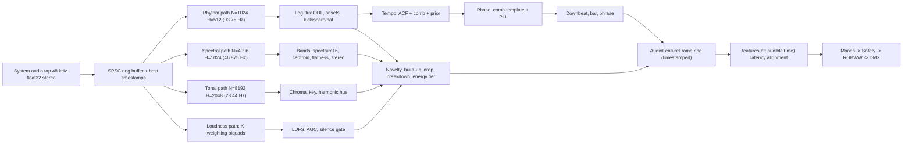
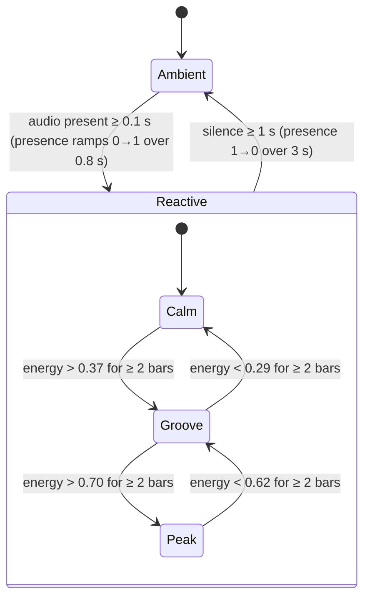

# Prism Music Mode — music-reactive lighting design spec

**Status:** research spec, ready for implementation · **Date:** 2026-11-06 · **Audience:** Swift engineers working on `PrismCore/Music`, `PrismCore/Effects` and `PrismCore/Color` · **Scope:** system-audio capture → real-time analysis → `AudioFeatures` → 16 Moods → safety layer → RGBWW → DMX.

Music Mode should make the studio *breathe* with whatever is playing on the Mac (Spotify, YouTube, a DJ app). The look is elegant, synth-like and cinematic, and can be left running for hours. It must **never** strobe or flash in an annoying way, it must stay safe for photosensitive viewers, and it must keep faces correctly lit for filming. This document gives the formulas, constants and pseudo-code to build it. Items that still need measurement or real-music tuning are marked **unverified** or **not yet validated**. Everything marked *validated* was checked numerically with the Python reference model in Appendix A on synthetic audio. That proves the logic, not the tuning on real recordings.

## Design principles

1. **Predict, don't react.** Beat-locked layers run on the PLL's *predicted* clock and are rendered for the instant the listener will hear (`audibleTime`, §1.15). Onset-triggered terms arrive one latency late, so they are kept smooth and secondary.
2. **Never black, never square.** While music plays, every included fixture keeps an intensity floor. Pulses are raised-cosine kernels that pass through slew limits. There are no hard cuts.
3. **Space over time.** Rhythm is expressed by *where* light is (waves, chases, alternating groups across stage positions and along tubes) more than by *how much*. This keeps the room's total luminance steady even when individual fixtures move (§4.1, R9–R10).
4. **Slow colour, faster intensity.** Hue changes on bars and sections with OKLab cross-fades. Intensity carries the beat.
5. **Safety is a layer, not a convention.** Slew limits, floors and the flash guard run after every mood and cannot be bypassed (§4). Photosensitive-safe mode is **on by default**.
6. **Faces stay lit.** The key (P1) and fill (PN1) are excluded by default. Fixtures that spill onto the talent get half the pulse depth and capped intensity, and camera-safe whites (§3.0, §5.3).
7. **Degrade gracefully.**
   * No trusted beat → energy-driven motion.
   * Silence → a slow ambient version of the mood, then a hand-back to the normal look.
   * Single-cell fixtures → the mood is evaluated at the fixture's centroid.
   * Unmeasured emitters → documented defaults.

## Key numbers (TL;DR)

| Topic | Value | Section |
|---|---|---|
| Capture | Core Audio process tap (macOS 14.2+), ScreenCaptureKit fallback (13.0+); 48 kHz Float32 | §1.1 |
| Analysis paths | rhythm N 1024 / hop 512 (93.75 Hz); spectral 4096 / 1024 (46.875 Hz); tonal 8192 / 2048 (23.4 Hz) | §1.2 |
| Bands (Hz) | sub 20–60 · bass 60–250 · lowMid 250–500 · mid 500–2k · highMid 2k–6k · high 6k–16k (same as `AudioFeatures.swift`) | §1.3 |
| Loudness / AGC | BS.1770 K-weighting; momentary 400 ms, short-term 3 s; reference τ up 3 s / down 30 s; per-band peak 0.15 s / 4 s, floor 0.5 s / 8 s, range 12–40 dB | §1.4–1.5 |
| Onsets | 3-band log spectral flux; threshold = median + k·std over 0.5 s + δ; k = 2.0 / 2.0 / 1.25 | §1.6 |
| Tempo | ACF + 4-harmonic comb + log-normal prior (120 BPM, σ 1 octave), 60–180 BPM, every 0.5 s over 6 s | §1.7 |
| Beat clock | comb-template phase + PI loop (Kp 0.25, Ki 0.05), ±0.2-beat gate, lock after 3 s of consistent tempo. Synthetic tests: p90 phase error ≤ 3.8 ms on steady tracks, lock 9.4 s after the music starts | §1.8 |
| Latency | light path ≈ 55–90 ms with an ENTTEC DMX USB Pro; render for `t + L_light − L_audio + 15 ms` | §1.15 |
| Render rate | 40–44 Hz (the ENTTEC DMX USB Pro sends at most 40 fps) | §2, §3.0 |
| Pulses | ≤ 2.5 Hz (1.5 Hz in photosensitive-safe mode); flash guard ≤ 3 flashes/s (2 in safe mode); intensity floors 0.12–0.20 | §3.2, §4 |
| Colour | all mixing in OKLab (`mixOK`); CSS Color 4 chroma reduction; RGBWW white extraction | §4.5, §5 |
| Moods | 16 (the 14 requested plus Ember and Nebula), 4–5 curated palettes each | §3.3 |
| Silence | enter below −60 dBFS for 1 s; 3 s fade to the ambient look; hand-back after `silenceFadeSeconds` (recommend 20–30 s) | §1.14 |

## London Studio defaults

This is the rig in the "London Studio" stage plan (ENTTEC DMX USB Pro). Positions are read from the plan as a front view (x left → right, y bottom → top). If the plan is really a top-down floor plan, y means "upstage" and none of the maths changes.

| Fixture | Where on the plan | Role | Music Mode default |
|---|---|---|---|
| B2, B3 (horizontal) | top | `background` | included |
| B4 (horizontal) | below B2/B3 | `background` | included |
| B1 (vertical), B5 (vertical) | left and right edges | `background` | included |
| B6, B7, B8 (diagonal cluster) | beside the performer, bottom centre-right | `nearSubject` | included at 0.5 pulse depth, max I 0.7 |
| PN1 (panel) | bottom-left | `fill` | excluded (optional ambient-only mode) |
| P1 (dimmer only) | top-left | `key` | excluded (holds the preset look) |

> [!IMPORTANT]
> **Check the channel budget before implementing pixel effects.** Eight tubes × 16 pixels × 5 channels (RGBWW) = 640 slots, which is more than one DMX universe (512). Options:
> * a second universe (a two-port interface, or Art-Net / sACN);
> * a fixture mode with fewer pixels (moods sample at the segment centres `u = (k + 0.5)/K`);
> * a whole-tube mode.
>
> The plan labels the tubes "Dimmer Color", which may already be a single-cell mode. In that case every mood still works *across* fixtures (it is spatial on the stage plane), but there is no motion *along* the tubes.

## Contents

1. Real-time audio analysis pipeline (§1.0–1.16): capture, frame plan, vDSP front-end, loudness, AGC, onsets, tempo, beat PLL, downbeats and phrases, chroma and key → hue, timbre, novelty and drops, energy tiers, silence, latency, prior art
2. `AudioFeatures`: the contract between analysis and effects, and how it maps onto the existing `PrismCore/Music` types (§2)
3. Effects engine and the 16 Moods: rendering model, building blocks, state machine, per-mood maths and palettes (§3)
4. Anti-flicker and safety: photosensitivity rules, flash guard, slew limits, smoothing filters, OKLab/OKLCH, dimming curve (§4)
5. Gamut: OKLab → fixture RGB → RGBWW, white extraction, brightness consistency, other fixture types (§5)
6. Testing and validation plan (§6)
7. References (§7)
8. Appendix A: reference rhythm tracker (Python) with expected output

**Conventions.**

* `I` is *perceptual* intensity (0–1, CIE L*-like); `Y` is linear light (§4.6).
* Colours are OKLab `(L, a, b)` or OKLCH `(L, C, h°)`.
* A one-pole time constant τ means `a = 1 − exp(−Δt/τ)` per update.
* "EMA_τ" is that filter.
* All feature values are 0…1 unless a unit is given.

---

## 1. Real-time audio analysis pipeline

### 1.0 Overview



### 1.1 Capture and threading

* **Source (preferred): Core Audio process tap.** `AudioHardwareCreateProcessTap` is `API_AVAILABLE(macos(14.2))` in the SDK header, and Apple's sample targets macOS 14.2+ (the AudioCap README says 14.4, so test on 14.2) [CATap]. Set-up sequence, as in Apple's "Capturing system audio with Core Audio taps" sample and the open-source AudioCap [AudioCap]:
  1. Translate Prism's own PID to a process object (`kAudioHardwarePropertyTranslatePIDToProcessObject`).
  2. Create `CATapDescription(stereoGlobalTapButExcludeProcesses: [prismProcessObject])` with `muteBehavior = .unmuted`, then call `AudioHardwareCreateProcessTap`.
  3. Create a **private** aggregate device whose `kAudioAggregateDeviceTapListKey` = `[[kAudioSubTapUIDKey: tapUUID]]`.
  4. Read the stream format from `kAudioTapPropertyFormat`.
  5. Register `AudioDeviceCreateIOProcIDWithBlock`, then call `AudioDeviceStart`.

  Needs `NSAudioCaptureUsageDescription` in Info.plist. It asks for an audio-only permission and has the lowest latency.
* **Fallback (macOS 13.0 – 14.1): ScreenCaptureKit.** Set `SCStreamConfiguration.capturesAudio = true` (default false), `sampleRate = 48_000`, `channelCount = 2` and `excludesCurrentProcessAudio = true` (default false). Buffers arrive on the `.audio` stream output. Needs the Screen Recording permission and carries more latency [SCK].
* **Optional:** any input device (mic or audio interface) through `AVAudioEngine.inputNode`, for live bands.
* Convert to **48 kHz Float32 non-interleaved** (use `AVAudioConverter` if the device runs at 44.1/96 kHz).
* The **real-time IOProc does no work beyond a memcpy** into a lock-free SPSC ring (capacity 1 s). It also stores `(sampleIndex, hostTime)` anchors taken from `AudioTimeStamp.mHostTime`, converted with `mach_timebase_info`. No allocation, locks, ObjC messaging or Swift ARC traffic on that thread.
* An **analysis thread** (QoS `.userInteractive`, or a Mach time-constraint thread with period = 512 samples) pulls complete hops and runs the three paths. Every feature frame is stamped with the **host time of its window centre**.
* Downmix `m = 0.5(L+R)` for everything except the stereo features (§1.3).

### 1.2 Frame plan

| Path | Window (Hann, periodic) | Hop | Rate | Window-centre delay | Produces |
|---|---|---|---|---|---|
| Rhythm | 1024 (21.3 ms) | 512 | 93.75 Hz | 10.7 ms | ODF, onsets, kick/snare/hat envelopes, tempo, beat phase |
| Spectral | 4096 (85.3 ms) | 1024 | 46.875 Hz | 42.7 ms | 6 bands, `spectrum16`, centroid, flatness, stereo, novelty input |
| Tonal | 8192 (170.7 ms) | 2048 | 23.44 Hz | 85.3 ms | chroma, key, harmonic hue |
| Loudness | per-sample K-weighting | 1024 | 46.875 Hz | ≈ 200 ms (400 ms window) | momentary / short-term LUFS, AGC, silence |

The rhythm path matches the canonical ~11 ms onset-function resolution used by BTrack (1024/512 at 44.1 kHz), aubio (1024/512) and librosa (hop 512) [BTrack][aubio][librosa]. Bass needs the longer spectral window: at N = 4096 bins are 11.72 Hz wide, so the 20–60 Hz band spans bins 1.7–5.1. Chroma needs 5.86 Hz bins (N = 8192) to separate semitones down to about 100 Hz. Total CPU at 48 kHz is well under 1 % of one Apple-silicon core.

### 1.3 Spectral front-end (vDSP)

```swift
import Accelerate
let N = 4096, log2n = vDSP_Length(12)
let fft    = vDSP.FFT(log2n: log2n, radix: .radix2, ofType: DSPSplitComplex.self)!
let window = vDSP.window(ofType: Float.self, usingSequence: .hanningDenormalized, count: N, isHalfWindow: false)

func spectrum(_ x: UnsafePointer<Float>, into power: inout [Float]) {      // power.count == N/2 + 1
    vDSP.multiply(UnsafeBufferPointer(start: x, count: N), window, result: &windowed)
    windowed.withUnsafeBytes { vDSP_ctoz($0.bindMemory(to: DSPComplex.self).baseAddress!, 2, &split, 1, vDSP_Length(N/2)) }
    fft.forward(input: split, output: &split)
    // vDSP packing: realp[0] = DC, imagp[0] = Nyquist; forward real FFT values are 2× the mathematical DFT.
    let k = 2.0 / Float(N)                    // = 0.5 (undo vDSP 2×) · 4/N (Hann coherent gain 0.5, one-sided)
    for b in 1..<N/2 { let re = split.realp[b]*k, im = split.imagp[b]*k; power[b] = re*re + im*im }
    power[0] = pow(split.realp[0]*k*0.5, 2); power[N/2] = pow(split.imagp[0]*k*0.5, 2)
}
```

With this scaling a full-scale sine reads amplitude ≈ 1 at its peak bin. The vDSP header documents the real forward FFT (`zrip`) as "scale = 2", with DC packed in `realp[0]` and Nyquist in `imagp[0]` [vDSP-pack]. Inverse scaling is documented inconsistently (header comment vs. programming guide), so unit-test it if you rely on it. The ACF in §1.7 is normalised by `r[0]`, which makes the inverse scale irrelevant there. In production, write the loop with `vDSP.squareMagnitudes` + `vDSP.multiply(k*k, …)`. `vDSP.FFT(log2n:radix:ofType:)` is available from macOS 10.15.

**Band energies.** Precompute a weight matrix `W[band][bin]` once. Each weight is the fractional overlap of the bin's span `[f_k − Δf/2, f_k + Δf/2]` with the band edges. Then:

```text
E_b   = Σ_k W[b][k] · P[k]                     (vDSP_mmul or sparse dot)
D_b   = 10·log10(E_b + 1e-12)                   (dB)
```

The edges match the six bands already declared in `PrismCore/Music/AudioFeatures.swift`:

| Band | Edges (Hz) | Bins @ N = 4096 (Δf = 11.72 Hz) | Typical content |
|---|---|---|---|
| sub | 20–60 | 1.7–5.1 | sub-bass, 808 tails, kick fundamental (low) |
| bass | 60–250 | 5.1–21.3 | kick body, bass line |
| lowMid | 250–500 | 21.3–42.7 | warmth, low vocals, guitars |
| mid | 500–2000 | 42.7–170.7 | vocals, snare body, leads |
| highMid | 2000–6000 | 170.7–512.0 | presence, attack, snare crack, sibilance |
| high | 6000–16000 | 512.0–1365.3 | hats, cymbals, air (lossy streams roll off near 16 kHz) |

**`spectrum16`**: 16 log-spaced bands with edges `40 · (400)^(i/16)` Hz. In order: 40, 58.2, 84.6, 123, 178.9, 260.1, 378.3, 550.1, 800, 1163, 1692, 2460, 3578, 5203, 7566, 11003, 16000. These are the same idea as WLED's 16 GEQ channels and LedFx's mel bands [WLED-SR][LedFx]. Normalise each band with the per-band AGC below and smooth it with attack 15 ms / release 200 ms.

**Stereo:** compute `E_L`, `E_R` (bass + mid bands, from separate L/R FFTs on the spectral path). Then `stereoBalance = (E_R − E_L)/(E_R + E_L + ε)` and `stereoWidth = E_side/(E_mid + E_side + ε)` with mid = (L+R)/2 and side = (L−R)/2, each EMA-smoothed.

### 1.4 Perceptual loudness (ITU-R BS.1770 / EBU R128)

Each channel runs a two-stage **K-weighting** filter at 48 kHz [BS1770]. Use `vDSP.Biquad` or `vDSP_biquad`. Coefficients are normalised so that a0 = 1, with the difference equation `y = b0·x + b1·x₋₁ + b2·x₋₂ − a1·y₋₁ − a2·y₋₂`:

| Stage | b0 | b1 | b2 | a1 | a2 |
|---|---|---|---|---|---|
| 1 – high-shelf (+4 dB) | 1.53512485958697 | −2.69169618940638 | 1.19839281085285 | −1.69065929318241 | 0.73248077421585 |
| 2 – RLB high-pass | 1.0 | −2.0 | 1.0 | −1.99004745483398 | 0.99007225036621 |

```text
z_i      = mean of y_i² over the window (per channel)
Loudness = −0.691 + 10·log10( Σ_i G_i · z_i )      G_L = G_R = 1.0       [LUFS]
Momentary  M : 400 ms window, updated every hop (running sum over 19 spectral hops ≈ 405 ms)
Short-term S : 3 s window
```

The −0.691 dB constant cancels the K-filter gain at 997 Hz. Our numerical check gives +0.70 dB at 1 kHz, +4.0 dB above 5 kHz and −13 dB at 20 Hz. The coefficients above are BS.1770-5's, which are specified for 48 kHz; resample other rates to 48 kHz or redesign the biquads. Momentary (0.4 s sliding rectangular window) and short-term (3 s) loudness are **ungated** in EBU Tech 3341 [EBU3341]. The gates (absolute −70 LKFS, relative −10 LU over 400 ms blocks with 75 % overlap) apply only to *integrated* loudness, which Prism doesn't need.

> [!NOTE]
> The captured level may or may not include the system volume (taps capture the process mix). Absolute LUFS is therefore used **only** for silence gating and diagnostics. Visual dynamics always come from AGC-relative values.

### 1.5 Adaptive gain (AGC) and normalisation

Streaming services already normalise loudness (Spotify ≈ −14 LUFS by default). So the AGC should be **slow**: preserve within-track dynamics (verse vs. drop) and compensate between tracks, apps and volume changes.

**Global reference `R` (LUFS)** follows the short-term loudness `S` with an asymmetric one-pole filter:

```text
a_up   = 1 − exp(−Δt / 3 s)       (S > R: a louder track quickly becomes the reference)
a_down = 1 − exp(−Δt / 30 s)      (S < R: quiet sections stay visibly quieter)
R     += (S > R ? a_up : a_down) · (S − R);     R = clamp(R, −45, −5)
R is frozen while isSilent (no gain run-away in gaps, no blinding first beat after a pause)

loudness     = clamp((M − R + 18) / 24, 0, 1)      // M = R → 0.75, R + 6 LU → 1.0, R − 18 LU → 0
loudnessSlow = EMA_{1.5 s}( clamp((S − R + 18) / 24, 0, 1) )
```

**Per-band auto-range** (for each of the 6 bands and each `spectrum16` band, dB domain): a fast-attack peak follower `P_b` and a slow floor follower `F_b`.

```text
P_b += (D_b > P_b ? 1 − e^{−Δt/0.15 s} : 1 − e^{−Δt/4 s}) · (D_b − P_b)
F_b += (D_b < F_b ? 1 − e^{−Δt/0.5 s}  : 1 − e^{−Δt/8 s}) · (D_b − F_b)
range = clamp(P_b − F_b, 12 dB, 40 dB)
n_b   = clamp((D_b − F_b) / range, 0, 1)        // feeds bands / bandsFast / bandsSlow
Both followers are frozen while isSilent.
```

The 12 dB minimum range stops noise or steady pads from being stretched to full scale; the 40 dB maximum keeps loud and soft passages distinguishable.

Envelope smoothing of `n_b` (one-pole, `a = 1 − exp(−Δt/τ)`, Δt = 21.33 ms):

* `bandsFast`: attack τ 10 ms (a = 0.88), release τ 120 ms (a = 0.163).
* `bands`: one-euro filter, mincutoff 1.0 Hz, β 0.3, dcutoff 1 Hz (§4.4).
* `bandsSlow`: τ 1 s (a = 0.021).

The design is a dB-domain cousin of the classic visualiser normaliser: divide by an exponential peak follower with rise ≈ 0.99 and decay ≈ 0.001–0.01 per frame [ARLS]. WLED offers the same idea as "normal / vivid / lazy" AGC presets using a PI controller [WLED-SR]. Expose three presets the same way:

| Preset | P_b release | R τ_down | Effect |
|---|---|---|---|
| Vivid | 2 s | 15 s | lively, quieter parts brighter |
| Normal | 4 s | 30 s | default |
| Lazy | 8 s | 60 s | most dynamic, cinematic |

### 1.6 Onset detection (rhythm path)

The front end is log-compressed spectral flux in three bands, i.e. the "SF log" family. Böck et al. found it the best simple **online** onset detector: log compression improved every ODF they tested, and a semitone-filterbank variant reached an online F ≈ 0.80 [Bock12]. SuperFlux additionally applies a 3-bin frequency max-filter to the reference frame to suppress vibrato [SuperFlux].

```text
mag[k]   = 2·|Z[k]|/N                                   (scaled as in §1.3, N = 1024)
Y[n,k]   = log10(1 + λ·mag[k]),  λ = 1000              (≈ −60 dBFS knee)
Yref[k]  = max(Y[n−1, k−1], Y[n−1, k], Y[n−1, k+1])     (SuperFlux-style max filter; optional)
d[n,k]   = max(0, Y[n,k] − Yref[k])
SF_low   = mean_{k: 30–200 Hz}    d[n,k]
SF_mid   = mean_{k: 200–2500 Hz}  d[n,k]
SF_high  = mean_{k: 2500–16k Hz}  d[n,k]
ODF o[n] = 0.5·SF_low + 0.3·SF_mid + 0.2·SF_high       (kick-weighted: stabilises the tactus, §1.7)
```

**Adaptive threshold and causal peak picking**, applied to each band's flux and to `o` separately:

```text
W      = last M = 47 frames (0.5 s) of the signal x
thr[n] = median(W) + k·std(W) + δ,    δ = 0.1·mean_{10 s}(x)
onset at frame c = n−1  iff  x[c] > thr[c]  ∧  x[c] ≥ x[c−1]  ∧  x[c] > x[n]  ∧  (c − c_last)·H/fs ≥ refractory
strength s = 1 − exp(−max(0, (x[c] − median(W)) / (std(W)+ε) − k) / 2)        ∈ [0, 1)
```

The peak test costs one hop (10.7 ms) of latency. aubio uses the same median + `thr`·mean idea with a 7-frame window and a 50 ms minimum inter-onset interval [aubio]. librosa uses pre/post max 30 ms, averaging over ±100 ms and δ = 0.07 on a 0–1 normalised envelope [librosa].

| Signal | k | Refractory | Extra gate | Envelope feature |
|---|---|---|---|---|
| broadband `o` | 2.0 | 100 ms | — | `onset` (decay τ 150 ms) |
| `SF_low` | 2.0 | 150 ms | — | `kick` (τ 180 ms) |
| `SF_mid` | 2.0 | 120 ms | accept only if z_mid > z_low at that frame (not a kick's click) | `snare` (τ 150 ms) |
| `SF_high` | 1.25 | 60 ms | — | `hihat` (τ 70 ms) |

Validation was on a synthetic 124 BPM house loop (kick on every beat, snare on 2 and 4, 8th-note hats), ±50 ms tolerance:

* Low band: F = 0.98.
* High band: F = 0.94 at k = 1.0, 0.88 at 1.25.
* Mid band with the kick-rejection gate: F = 0.95, against 0.78 without it.

Real material needs re-tuning, but these k values are good starting points. `onsetDensity` counts broadband onsets over the last 4 s.

### 1.7 Tempo estimation (60–180 BPM)

The approach is an autocorrelation of the ODF, enhanced by a comb filterbank and weighted by a log-normal tempo prior. It is the same family as BTrack's comb filterbank with Rayleigh weighting (β = 43 ≈ 120 BPM) [BTrack][Davies07], librosa's `tempo` (log2 Gaussian prior, start 120 BPM, σ = 1 octave) [librosa] and Ellis's TPS (τ0 = 0.5 s, σ = 1.4 octaves) [Ellis07].

```text
Every 0.5 s, on the last 6.0 s of ODF (563 frames at 93.75 Hz):
 1. x[n] = max(0, o[n] − mean(o[n−8 … n+8]))            // BTrack-style adaptive mean removal + half-wave rectify
    x   -= mean(x)
 2. r[τ] = IFFT(|FFT(x, 2048)|²)[τ] / (L − τ);  r /= r[0]   // unbiased normalised ACF (vDSP, zero-padded)
 3. For bpm in 60.0 … 180.0 step 0.5:
        τ = 60·fps/bpm                                      // fps = 93.75, so τ ∈ [31.25, 93.75] frames
        S(bpm) = Σ_{h=1..4} (1/h) · max_{j ∈ [−(h−1), h−1]} r_interp(h·τ + j)    // comb: 4 harmonics with tolerance
        P(bpm) = S(bpm) · exp(−½ (log2(bpm/120) / 1.0)²)                         // log-normal prior
 4. bpm₀ = argmax P;  τ̂ = harmonicRefine(r, 60·fps/bpm₀)                        // see below
 5. periodicity = r(τ̂)                                     // 0 … 1, the confidence ingredient
```

**`harmonicRefine` is essential.** A grid argmax on a linearly interpolated ACF snaps to integer lags (124 BPM read as 125.0). Refine as follows:

```text
For h = 1…4: c = h·τ₀; k* = argmax r[k] for k ∈ {⌊c⌉−1, ⌊c⌉, ⌊c⌉+1}
    parabolic offset δ = ½ (r[k*−1] − r[k*+1]) / (r[k*−1] − 2r[k*] + r[k*+1])
    τ_h = (k* + δ) / h,  weight w_h = r[k*] · h            // longer lags give finer resolution
τ̂ = Σ w_h τ_h / Σ w_h;   bpm = 60·fps/τ̂
```

**Octave handling for lighting:**

1. The comb (which sums harmonics) together with the prior already favours the *tactus*. In our tests:

   | Input | Estimate |
   |---|---|
   | 124 house | 124.0 |
   | 160 house | 160.0 |
   | 90 swung hip-hop | 90.0 |
   | 75 hip-hop | 75.0 |
   | 174 drum & bass | 87.0 (half-time) |

   Half-time for drum & bass is *desirable* for light: 87 slow pulses beat 174 frantic ones.
2. Continuity: a new estimate replaces the tracked tempo only if it is **stable**, meaning the last 4 estimates (1.5 s) agree within 2 %. Tempo-change re-seeding additionally requires confidence > 0.6 and |ΔT|/T > 3 %. Octave flips (×2, ×½, ×1.5) go through the same test, so a single stray estimate can never flip the tempo. This mirrors BTrack's Gaussian tempo-transition matrix (σ ≈ 10 BPM) [BTrack].
3. **The pulse grid is separate from the tempo.** `pulseDivisor d` is the smallest of {1, 2, 4} with `bpm/d ≤ 135` (Club) or ≤ 130 (other rhythmic moods). The hard rule is `bpm/d ≤ 150`, i.e. 2.5 Hz. For example, 160 BPM pulses at 80/min while the reported tempo stays 160.
4. Triple metre / swing: the ±(h−1)-frame comb tolerance absorbs swing. Optionally compare `r(3τ)` with `r(4τ)` to flag 3/4.

**Confidence**, validated on synthetic material:

```text
c = clamp((periodicity − 0.12) / 0.18, 0, 1) · (stable ? 1 : 0.25)
beatConfidence = EMA_{2 s}(c)
```

Beat-driven tracks gave periodicity 0.28–0.81, with estimates that stay stable for as long as the beat lasts. A sustained pad never became lock-eligible. Dense random onsets (Poisson snare hits, ≈ 2.9 per second) are harder:

* Their periodicity peaked at 0.18–0.29 per 30 s excerpt, which overlaps the weakest real track (swung hip-hop, ≈ 0.3).
* Their tempo estimates, however, rarely stay stable for long. The longest run of lock-eligible updates (stable ∧ c > 0.5) reached 6 in only 1 of 20 excerpts, while real tracks stay eligible continuously.

So **persistence** is the discriminator, and §1.8 requires 3 s of consecutive eligibility before it locks. Plain "peak-to-mean of the tempo score" did **not** separate beats from non-beats (octave peaks dilute it), and neither did a phase z-score (random onsets still scored ≈ 4.5) or the coherence of successive phase measurements (overlapping windows make them coherent even for random input).

### 1.8 Beat phase tracking and prediction (PLL)

The design is **comb-template phase measurement + a phase-locked loop**. It is cheap, it free-runs ("flywheels") through breakdowns, and it extrapolates beats into the future exactly, which latency compensation needs (§1.15).

```text
State: Φ (unwrapped phase in beats; beatCount = ⌊Φ⌋, φ = Φ − ⌊Φ⌋), T (s/beat), locked: Bool,
       eligibleRun: Int, outliers: [e] (≤ 3), lowConfSeconds
Each rhythm hop (Δt = 10.67 ms):     Φ += Δt / T          (when locked)

Every 0.5 s (after tempo estimation, §1.7):
  // phase measurement: offset ψ (frames back from newest ODF frame) of the most recent beat
  for ψ in 0 ..< ⌈τ̂⌉:  score[ψ] = Σ_{m=0..5} 0.8^m · o_interp(n_now − ψ − m·τ̂)
  ψ* = argmax score  (+ parabolic sub-frame refinement);  pz = (score[ψ*] − mean)/std
  φ_meas = (ψ*/τ̂) mod 1                      // fraction of a beat elapsed since that beat (at the ODF time base)
  eligibleRun = (stable ∧ c > 0.5) ? eligibleRun + 1 : 0
  lowConfSeconds = (c < 0.2) ? lowConfSeconds + 0.5 : 0

  if !locked:
      if eligibleRun ≥ 6 {                    // 3 s of persistent, confident tempo (rejects random onsets)
          T = 60/bpm;  Φ = ⌊Φ⌋ + φ_meas;  locked = true;  outliers = []
      }
  else:
      if stable ∧ c > 0.6 ∧ |60/bpm − T|/T > 0.03 {
          re-seed T and Φ as above (genuine tempo change); outliers = []
          fade beat-locked layers out/in over 1 beat
      }
      if pz > 3.5 {                            // ignore unreliable phase measurements
          e = wrap(φ_meas − φ) ∈ [−0.5, 0.5)
          if |e| ≤ 0.2 {                       // normal PI correction
              Φ += Kp · c · e                  // Kp = 0.25 per 0.5 s update
              T *= (1 − Ki · c · e)            // Ki = 0.05: the integral term owns fine tempo
              outliers = []
          } else {                             // outlier: one bad measurement must not drag the clock
              outliers.append(e)  (keep the last 3)
              if outliers.count == 3 ∧ c > 0.5 {
                  m = circularMean(outliers)   // atan2(Σ sin 2πe, Σ cos 2πe) / 2π
                  if max_i |wrap(e_i − m)| < 0.08 { Φ += m;  outliers = [] }   // grid really moved (DJ cut)
              }
          }
      }
      if lowConfSeconds ≥ 15: locked = false   // clock keeps running; beatConfidence is ≈ 0 by then
Never let beatCount decrease: apply a backward correction that would cross an integer as a temporary
slow-down spread over the next beat.
```

"Consecutive" outliers means consecutive *reliable* measurements (pz > 3.5); a normal correction or a re-seed clears the list.

**Why the gate.** The first design (Kp 0.15, Ki 0.02, no gate) failed the breakdown test on 3 of 6 noise seeds (p90 ≈ 86 ms). When the drums stop, the 6 s window still holds the old beat, so `c` stays near 1. In that window, a wrong measurement scored pz 3.71, just above the 3.5 threshold, with e = 0.43 beat. The PI loop accepted it and pulled the tempo from 124 to 125.1 BPM, and the clock then flywheeled through the breakdown at the wrong tempo. The ±0.2-beat gate rejects such single measurements, and the 3-outlier rule still follows genuine grid jumps. With the gate in place, the higher gains (0.25 / 0.05) cut the ramp-tracking error from p90 27–43 ms to 13–28 ms, and steady-state error stays ≤ 3.8 ms.

Results on synthetic tests (6 s ODF window, updates every 0.5 s, phase error against ground truth from t = 10 s, 6 noise seeds; the seed-1 numbers are in Appendix A):

| Test | Result |
|---|---|
| House 124 / 128 / 100 / 140 / 160, hip-hop 90 (swing 25 %) / 75 (swing 20 %) | Locks 9.4 s after the music starts (6 s window + 3 s lock rule). Final tempo 124.00 / 128.11 / 99.99 / 139.99 / 160.00 / 90.01 / 75.00. Median phase error within ±2.7 ms (most within ±0.5 ms), p90 ≤ 3.8 ms on every seed |
| Drum & bass 174 | Locks at 86.99 (half-time) on the snare, i.e. 344 ms (one 174-grid beat) away from the kick grid. §1.9's half-time rule is meant to shift it onto the kick (not yet validated) |
| Tempo ramps 120 → 128 and 128 → 120 BPM over 40 s, 6 ms timing jitter | Locks at 9.4–13.9 s. The clock runs ≈ 12 ms behind an accelerating ramp and ≈ 12 ms ahead of a decelerating one (median, seed 1); p90 13–28 ms across seeds. Final tempo (seed 1) 127.36 vs. a true 127.82, and 120.33 vs. 120.19 |
| 10 s drum-less breakdown (pad only) | Periodicity drops to 0.02–0.05 and `beatConfidence` decays to ≈ 0.1. The clock flywheels at 123.99 BPM. When the drums return, the error is already < 20 ms and confidence is back above 0.6 within ≈ 3.5 s, without re-seeding. p90 over the whole track ≤ 3.8 ms on every seed |
| Half-beat grid jump at 22 s (hard DJ cut) | Three agreeing outliers trigger one re-phase; settled (< 20 ms) 2.1 s after the cut, then p90 ≤ 0.9 ms |
| Ambient pad | Never locks (6 / 6 seeds) |
| Random onsets (Poisson snare hits) | False lock in 2 of 46 excerpts (4 %), never before 11.9 s. Beat-locked layers are weighted by `beatConfidence`, which limits the visible damage, and the 15 s low-confidence rule releases the lock |

The 9.4 s lock time is acceptable because every mood looks complete without beat lock (§3.0). An untested speed-up is to start estimating once 3 s of ODF exist and grow the window to 6 s. Ableton Link or MIDI clock, when present, locks instantly. The reference implementation (Python) is in Appendix A. Port it 1:1 and use its outputs as golden data in unit tests (§6).

**Alternative: BTrack-style cumulative score** [BTrack] is more robust on expressive or live music:

```text
CS[n] = (1−α)·ODF[n] + α · max_{v ∈ [−2τ, −τ/2]} W1(v)·CS[n+v],   α = 0.9
W1(v) = exp(−(η·ln(−v/τ))²/2),  η = 5
```

To predict, extend `CS` τ frames into the future with ODF = 0. Weight it by `W2(v) = exp(−(v − τ/2)²/(2(τ/2)²))` and take the argmax as time-to-next-beat. Feed those predictions into the same PLL as measurements.

> [!WARNING]
> BTrack hard-codes 44 100 Hz in its tempo/lag constants. If it is ported or used at 48 kHz without changing those constants, its BPM reads ≈ 8 % low [BTrack].

Heavier options are madmom's online DBN or the BeatNet particle filter [madmom][BeatNet]. Ableton Link or MIDI clock can override the PLL when the user DJs with Link-enabled software.

### 1.9 Downbeat, bar and phrase heuristics (4/4 assumed)

At each new beat `k` (when `beatCount` increments), measure features in a ±60 ms window around the predicted beat time:

```text
kickS   = max SF_low z-score                      (kicks favour beats 1 and 3, dominant on 1)
snareS  = max gated SF_mid z-score                (backbeat on 2 and 4)
chordΔ  = 1 − cos(chroma_after_250ms, chroma_before_250ms)   (harmony changes on bar lines)
bassΔ   = 1 if the dominant low-band peak frequency moved > 1 semitone
novS    = novelty spike (0/1) within the window
score   = 1.0·kickS + 1.5·chordΔ + 0.5·bassΔ + 1.0·novS − 0.7·snareS
A[k mod 4] = 0.9·A[k mod 4] + score               (memory ≈ 10 bars)
```

* `downbeatOffset = argmax A`. Switch only if `A[new] > 1.2·A[current]` for 2 consecutive bars.
* `barPhase = (((k − offset) mod 4) + φ)/4` and `beatInBar = (k − offset) mod 4`.
* `downbeatConfidence = (A_max − A_2nd)/(|A_max| + ε)`, clamped to 0–1.
* **Half-time locks** (e.g. drum & bass at 87) may lock onto the backbeat (snare). The same accumulator, evaluated on the half-time grid, shifts the phase by ½ when `kickS` at φ = 0.5 dominates.
* **Phrase:** dance music is built in 8/16/32-bar phrases. `phrasePhase = ((barCount − phraseAnchor) mod 8 + barPhase)/8`. Re-anchor to the current bar on a section change or drop that falls within ±1 beat of a downbeat. Drop detection also uses phrase boundaries as a prior (×1.5 score at bar 0 of a phrase).

### 1.10 Chroma, key and harmonic hue

**Chroma** (tonal path, N = 8192, 65 Hz–2.1 kHz, which is C2–C7). This is a simplified HPCP: Essentia defaults are size 12, reference 440 Hz, 40–5000 Hz, squared-cosine weighting over a 1-semitone window, unit-max normalisation [Essentia].

```text
Y[k] = mag[k];  keep spectral peaks (local maxima ≥ −60 dB re frame max), parabolically interpolated (f_p, a_p)
for each peak:  p = 12·log2(f_p/440) + 69;  for pc in round(p)±1:
                   d = |p − nearest(pc)|;  if d < 0.5: chroma[pc mod 12] += a_p² · cos²(π·d)    (window 1 semitone)
chroma /= max(chroma)                        // unitMax
chroma_display = EMA_{0.5 s}, chroma_color = EMA_{2 s}, chroma_key = EMA_{20 s}
```

**Key:** Pearson-correlate `chroma_key` with the 24 rotated Krumhansl–Kessler profiles [KK82]. Essentia's default `bgate` profile is a good alternative for pop/EDM.

```text
major = [6.35, 2.23, 3.48, 2.33, 4.38, 4.09, 2.52, 5.19, 2.39, 3.66, 2.29, 2.88]
minor = [6.33, 2.68, 3.52, 5.38, 2.60, 3.53, 2.54, 4.75, 3.98, 2.69, 3.34, 3.17]
key = argmax_{k∈0..23} corr(chroma_key, rotate(profile, k));  keyConfidence = clamp((r1 − r2)/0.15, 0, 1)
```

Change `key` only if the new key wins for 8 s.

**Harmony → hue (circle of fifths).** Harmonically close chords and keys map to close colours. Scriabin's "clavier à lumières" likewise ordered colours along the fifths.

```text
q(pc) = (7·pc) mod 12                                   // C0 G1 D2 A3 E4 B5 F#6 C#7 G#8 D#9 A#10 F11
z     = Σ_pc chroma_color[pc] · exp(i·2π·q(pc)/12)
harmonicHue  = fract(arg(z)/2π)                         // smoothed by filtering z (not the angle!)
tonalClarity = |z| / Σ chroma_color                     // 1 = single clear tonal centre, ~0 = noise/atonal
OKLCH hue lookup (deg) at fifths index 0…11: [29, 60, 95, 140, 190, 230, 265, 290, 315, 340, 355, 12]
  (C red · G orange · D yellow · A green · E cyan · B sky · F# blue · C# indigo · G# violet · D# magenta · A# pink · F crimson),
  linearly interpolated (on the circle) by the fractional fifths position.
Minor keys: same hue as the relative major (the centroid lands there naturally), C ×0.85, hue −10° (cooler).
```

C major triad → between G and D (warm amber); A minor → close by. A modulation by a fifth moves the hue one step. Ready-made 12-colour tables (vivid / soft / pastel / even-lightness) are in M07.

### 1.11 Timbre: centroid (brightness), flatness

```text
centroid   = Σ_k f_k·mag[k] / Σ_k mag[k]                 (40 Hz–16 kHz, spectral path)
brightness = clamp(log2(centroid/250) / log2(8000/250), 0, 1)    → one-euro (mincutoff 0.3 Hz, β 0.05)
flatness   = exp(mean_k ln P[k]) / mean_k P[k]            (200 Hz–16 kHz; 0 tonal … 1 noise) → EMA 0.3 s
```

Typical uses: brightness → palette position or white mix ("hot" mixes look whiter). Flatness gates snares and helps recognise risers and noise sweeps (§1.12).

### 1.12 Novelty, sections, build-ups, drops, breakdowns

**Novelty (real-time Foote approximation)** [Foote00]. Every 250 ms, build `v = [n_sub … n_high (6), brightness, flatness, 0.5·chroma_color (12)]`, 20 dimensions in total.

```text
μ_S = EMA_{τ=1 s}(v),  μ_L = EMA_{τ=8 s}(v)
d   = ‖μ_S − μ_L‖₂ / √20
z   = (d − mean_60s(d)) / std_60s(d);   novelty = clamp(z/4, 0, 1)
Section change: z > 2.5 ∧ rising ∧ ≥ 8 s since last; if beatConfidence > 0.5, fire on the next downbeat (≤ 1 bar wait).
```

A full checkerboard-kernel novelty on a 2 Hz self-similarity matrix (kernel ±8 s) is affordable. It is better for *confirming* sections offline-style, but it lags by half the kernel, so use it only to adjust `phraseAnchor`.

**Build-up / riser**, computed per bar:

```text
bassRatioLong = E_{sub+bass}(2 s) / E_{sub+bass}(16 s)              (linear power)
buildup = clamp( 0.35·slope_4bars(brightness)/0.1 + 0.25·slope_4bars(onsetDensity)/0.1
               + 0.25·(1 − clamp(bassRatioLong, 0, 1)) + 0.15·slope_4bars(loudnessSlow)/0.1 , 0, 1)
```

The slope is a least-squares slope per bar. Snare rolls show as rising `onsetDensity`, noise risers as rising brightness and flatness, and the low end is typically filtered out during a build.

**Drop** (EDM-style), evaluated at every downbeat, or every beat when the beat is not trusted:

```text
ΔB  = dB(E_{sub+bass}(last 250 ms)) − dB(mean E_{sub+bass} over previous 2 bars)
pre = max(buildup over previous 2 bars) > 0.4  ∨  (bassRatioLong < 0.3 for ≥ 2 bars)
drop iff ΔB ≥ +6 dB ∧ loudness ≥ 0.7 ∧ kick onset within ±60 ms ∧ pre ∧ (t − lastDrop) ≥ 16 s
dropStrength = clamp((ΔB − 6)/6 + 0.5·maxBuildup, 0, 1)
```

**Breakdown:** `isBreakdown = bassRatioLong < 0.16 (−8 dB) for ≥ 2 bars ∧ loudnessSlow dropped ≥ 0.2 from its 16 s max`. Clear it when `bassRatioLong > 0.5`.

### 1.13 Energy level and tiers

```text
energyRaw = 0.45·loudnessSlow + 0.25·onsetDensity + 0.20·bandsSlow.bass + 0.10·brightness     // onsetDensity is already 0…1
energy    = EMA_{3 s}(energyRaw)
Tiers: calm < 0.33 ≤ groove < 0.66 ≤ peak; enter thresholds +0.04, exit −0.04; min dwell 2 bars (4 s without beat)
```

SoundSwitch's Autoloops work the same way: pre-built beat-synced looks are selected by energy and section [SoundSwitch]. Our tiers select parameter sets inside a mood.

### 1.14 Silence detection and graceful ambient fallback

```text
level = 20·log10(RMS of mono mix over 100 ms)          (dBFS; −∞ for digital zero)
enter silence: level < −60 dBFS continuously for 1.0 s  (0.3 s if exact digital zeros = player paused)
exit  silence: level > −50 dBFS for 0.1 s              (10 dB hysteresis)
presence: on enter → cosine ease 1→0 over 3.0 s;  on exit → 0→1 over 0.8 s
on exit: reactive layers additionally ramp in over 1.5 s; beat-locked terms wait for beatConfidence:
        ≈ 3.5 s if the clock is still locked (gap < 15 s, same tempo), ≈ 9.5 s for a fresh lock (§1.8)
during silence: freeze AGC (R, P_b, F_b) and key; clock flywheels 15 s (gapless DJ transitions), then unlock
long silence: after MusicModeSettings.silenceFadeSeconds of silence, cross-fade (4 s, OKLab) from the mood's
              ambient look to the underlying (non-music) look; audio return fades music back in over 0.8 s
```

Each mood's `ambient()` is its base layer with all audio terms set to their idle values (`ρ = 0`, `L = 0.4`, bands 0), motion speed ×0.3 and intensity ×0.6. Render `mix(ambient, reactive, presence)` per pixel in OKLab and intensity. The room settles into a slow, pretty look instead of going dark or freezing mid-pulse.

> [!TIP]
> The current code default `silenceFadeSeconds = 4` would drop back to the base look in ordinary gaps (track changes, YouTube ads, a 5 s pause). Use **20–30 s** so that short gaps stay inside the mood's ambient look.

### 1.15 Latency compensation and beat prediction

**Clock domain:** everything is in host time (`mach_absolute_time`). Each feature frame carries the capture host time of its window centre.

| Stage | Typical | How to get it |
|---|---|---|
| Capture buffer (tap IOProc) | 5–11 ms | IOProc buffer size (256–512 frames) |
| Rhythm analysis (centre + peak look-ahead) | 21 ms | 512 + 512 samples |
| Spectral / tonal / loudness centre | 43 / 85 / ≈ 200 ms | (only affects slow features) |
| Render tick quantisation | 0–25 ms (avg ≈ 12) | 40–44 Hz render loop |
| USB host → widget | ≈ 1–2 ms | full-speed bulk transfer. The FTDI *latency timer* (default 16 ms, adjustable 1–255 ms) only delays **device → host** data such as widget replies, not DMX output [FTDI] |
| Widget refresh wait | 0–25 ms (avg ≈ 12.5) | the ENTTEC DMX USB Pro re-sends its latest buffer at its own rate: 1–40 packets/s, or 0 = as fast as possible; the product page says 40 fps max [ENTTEC] |
| DMX wire time | ≈ 22.7 ms for start code + 512 slots | 250 kbit/s, 44 µs per slot, BREAK ≥ 92 µs, MAB ≥ 12 µs [E111]. A shorter universe shortens the frame (but send at least 24 slots). The widget's 40 fps cap still applies |
| Fixture processing / PWM | 5–40 ms (unverified) | measure; disable fixture "smooth" dimming modes |
| **Audio output** | USB interface ≈ 5–15 ms; built-in speakers: read at runtime; **Bluetooth ≈ 100–280 ms; AirPlay up to ≈ 2 s** | total output latency = `kAudioDevicePropertyLatency` + `kAudioStreamPropertyLatency` (the header defines a stream's total latency as their sum) + `kAudioDevicePropertySafetyOffset` + `kAudioDevicePropertyBufferFrameSize`, all in frames [CALatency]. iPad tap-to-sound tests (which include touch processing) measured AirPods Pro 2 at 126 ms, AirPods Pro at 144–167 ms and the original AirPods at 274–296 ms, against 83 ms for the iPad's built-in speakers [BTlat]. Apple warns AirPlay "can result in a 2-second delay" [AirPlayLat]. Bluetooth codec delay is often under-reported, so offer a user offset |
| Acoustic travel | 2.9 ms per metre | 343 m/s; add it to `L_audio` for a listener far from the speakers (monitors at 3 m ≈ 9 ms) |

**Alignment rule:**

```text
L_light = renderAvg + usb + widgetWait + dmxWire + fixture   (≈ 55–90 ms typical with an ENTTEC Pro)
L_audio = outputDeviceLatency + acoustic + userOffset        (per output-device UID, persisted)
lead    = +0.015 s                                      (show light ~15 ms *before* sound — see below)
audibleTime(t_render) = t_render + L_light − L_audio + lead          // capture-timeline instant to depict
Δ = audibleTime − t_newestAnalysed
if Δ ≤ 0: continuous features = interpolate(history, audibleTime)    // e.g. Bluetooth: delay the lights
if Δ > 0: continuous features = newest (hold);  clock = extrapolate PLL: Φ(audibleTime) = Φ₀ + (audibleTime − t₀)/T
```

* With wired speakers, Δ ≈ +50–100 ms. Beat-locked visuals stay **exact** because the PLL predicts them. Onset-triggered accents arrive ≈ Δ late, so moods use beat-locked accents when `beatConfidence` is high and keep onset-driven terms smooth. This is why most moods are built on predicted beats.
* With Bluetooth or AirPlay, Δ is negative: features are read from the 2 s history (extend it to 3 s for AirPlay), so lights stay in sync.
* **Why a small visual lead:** people tolerate sound arriving *after* light much more than before it. In ITU-R BT.1359-1, a positive value means sound is advanced relative to vision. Its detectability thresholds are +45 ms / −125 ms and its acceptability thresholds +90 ms / −185 ms [BT1359]. EBU R37 asks for end-to-end sound no more than 40 ms before the picture and no more than 60 ms after it [EBU-R37]. For lights, "sound early" means lights late, so aim for light 0–20 ms early and never more than about 40 ms late. Acoustic travel already makes light arrive early at a distance.
* **Calibration UX:** a "Sync" sheet plays a click track while one tube pulses on the predicted beat. The user slides the offset (−250…+500 ms, 5 ms steps) until the two coincide. Store the offset per output device.

### 1.16 What we borrow from existing systems

| System | What it does (verified) | What Prism adopts |
|---|---|---|
| aubio | `specflux`/`hfc`/`complex`/`kl`/… onset functions with median + thr·mean peak picking, minioi 50 ms, silence gate −70 dB (−90 dB for tempo); Davies & Plumbley-based beat tracker with Rayleigh prior at 120 BPM [aubio] | log-flux ODF, median-based adaptive threshold, silence gating |
| BTrack | 1024/512 frames, complex-spectral-difference ODF, cumulative score α = 0.9 / η = 5, comb filterbank (4 harmonics) + Rayleigh β = 43, 41 tempo states 80–160 BPM, beat prediction half a beat ahead [BTrack] | comb filterbank, adaptive mean removal, beat prediction concept, tempo-transition inertia |
| librosa | `onset_strength` (log-mel flux), `peak_pick` defaults, `beat_track` (Ellis DP, tightness 100), `tempo` (log2-normal prior, 120 BPM, σ 1 octave), `plp` [librosa] | tempo prior, offline reference for testing |
| Essentia | `RhythmExtractor2013` (multifeature), `OnsetDetection`, `HPCP` (12 bins, 40–5000 Hz, squared-cosine 1-semitone window), `Key` (default profile bgate), `NoveltyCurve`, `LoudnessEBUR128` [Essentia] | chroma/HPCP recipe, key profiles, loudness |
| madmom / BeatNet | online RNN+DBN beat tracking; CRNN + particle filter beat/downbeat [madmom][BeatNet] | future upgrade path (Core ML) |
| LedFx | Resamples to 30 kHz with FFT 4096 and hop 500 (60 fps). aubio onset (`hfc`) and tempo. Three 24-band melbanks (to 350 / 2000 / 15000 Hz). `FREQUENCY_RANGES` Sub Bass 20–60, Bass 60–250, Low Mid 250–500, Mid 500–2k, Upper Mid 2–4k, High Mid 4–6k, High 6–24k. Mel-gain normaliser (exp filter: decay 0.01, rise 0.99). `bar_oscillator` = beat counter mod 4, with no real downbeat detection. Silence scene after 5 s. Effects include Energy, Power, Scroll, Spectrum, Wavelength, Melt, Water, Lava lamp, Bar [LedFx] | band naming, bar/beat oscillators → `beatPhase`/`barPhase` (we add real downbeat heuristics), gradient palettes |
| audio-reactive-led-strip | 44.1 kHz, 60 fps, 24 mel bins 200–12000 Hz. Exponential filters with separate rise/decay: gain 0.01 / 0.99, smoothing 0.5 / 0.99 [ARLS] | asymmetric smoothing / peak-follower AGC |
| WLED Sound Reactive | 22.05 kHz, 512-sample FFT, 16 GEQ channels (43–9259 Hz) with pink-noise correction. AGC presets normal / vivid / lazy (PI controller: Kp 0.6 / 1.5 / 0.65, Ki 1.7 / 1.85 / 1.2). Dynamics limiter attack 80 ms / decay 1400 ms. Squelch and peak detection, no BPM tracker [WLED-SR] | `spectrum16`, AGC presets, squelch → silence gate, slow-decay limiter idea |
| Philips Hue Sync / Entertainment | Music-sync intensities Subtle / Moderate / High / Extreme ("High" pulses and flashes rapidly). Palette-based colour. Entertainment streaming at 50–60 Hz, which the bridge forwards over Zigbee at ≈ 25 Hz (secondary source) [HueEnt] | a few user macros (reactivity, palette, brightness); we deliberately have no "Extreme" flash level |
| Nanoleaf Rhythm | Sound plugins call `enableEnergy`, `enableFft(nBins)`, `enableMel`, `enableBeatFeatures` and read `getEnergy`, `getFftBins`, `getMelBins`, `getIsBeat`, `getIsOnset`, `getTempo`. Plugins are called every ≥ 50 ms (≤ 20 Hz) [Nanoleaf] | features-to-effect contract (ours is timestamped, produced at 46.875 Hz and sampled by the renderer at 40–44 Hz) |
| SoundSwitch | Autoscript analyses tracks. Autoloops are beat-synced generic scenes used as a fallback for unscripted tracks. Phrase types Intro / Main 1 / Main 2 / Middle / Bridge / Outro; build-up and breakdown detection; strobe can be set to zero [SoundSwitch] | energy tiers + section-driven variation, strobe-free by design |
| LightJams | `music.X` sources with `.low` / `.mid` / `.hi` / `.avg` / `.beat` (20 bands). `trigger()` with hysteresis, hold and delay; `onBeat(fct, multiple, offset)`; Ableton Link [LightJams] | formula-driven per-pixel shading, hysteresis on every trigger |
| Synesthesia | VJ audio uniforms `syn_*Level`, `syn_*Hits`, `syn_*Time` (a clock that runs faster when loud), `syn_*Presence`, `syn_OnBeat`, `syn_BPM`, `syn_BPMConfidence`, `syn_BPMSin/Tri`, `syn_FadeInOut`, `syn_Intensity` [Synesthesia] | naming + semantics of `AudioFeatures`; `syn_*Time` = our motion clocks (§3.1) |

---

## 2. `AudioFeatures` — the contract between analysis and effects

The analyzer publishes one `AudioFeatureFrame` per spectral hop (46.875 Hz) into a timestamped ring buffer (≥ 2 s). The renderer (40–44 Hz, DMX-paced; the ENTTEC DMX USB Pro tops out at 40 fps) asks for `features(at: audibleTime)` (§1.15), which **interpolates** continuous fields between the two neighbouring frames (or extrapolates the musical clock), and returns this value type. Effects must treat it as read-only and must be frame-rate independent (use the event *times* / counters, never "was there an onset in this frame?" booleans — rates differ between analysis and render).

```swift
import simd

public enum EnergyTier: UInt8, Sendable { case calm, groove, peak }

/// Six perceptual bands, AGC-normalised to 0…1.
public struct Bands6: Sendable, Equatable {
    public var sub: Float      //   20 –    60 Hz
    public var bass: Float     //   60 –   250 Hz
    public var lowMid: Float   //  250 –   500 Hz
    public var mid: Float      //  500 –  2000 Hz
    public var highMid: Float  // 2000 –  6000 Hz
    public var high: Float     // 6000 – 16000 Hz
}

/// Snapshot of the music at the instant that will be *audible* when the frame being rendered becomes *visible*.
/// Ranges are guaranteed (clamped) by the analyzer. "τ" = one-pole time constant.
public struct AudioFeatures: Sendable {
    // ── Timing ───────────────────────────────────────────────────────────────
    public var audioTime: Double          // capture-timeline host seconds this snapshot describes (§1.15)
    public var predictionHorizon: Float   // s beyond newest analysed audio (+ = extrapolated clock, − = from history)

    // ── Presence / silence (§1.14) ──────────────────────────────────────────
    public var isSilent: Bool             // gate (hysteresis −60/−50 dBFS, 1 s hold)
    public var digitalSilence: Bool       // exact zeros (player paused / stopped)
    public var presence: Float            // 0…1 eased: 1→0 over 3 s into silence, 0→1 over 0.8 s on return

    // ── Loudness / AGC (§1.4–1.5) ───────────────────────────────────────────
    public var loudness: Float            // 0…1 AGC-relative momentary loudness (400 ms), one-euro smoothed
    public var loudnessSlow: Float        // 0…1 AGC-relative short-term loudness (3 s), EMA τ = 1.5 s
    public var loudnessLUFS: Float        // −70…0 absolute momentary LUFS (diagnostics / gating only)
    public var agcReferenceLUFS: Float    // current AGC reference (diagnostics)

    // ── Spectrum (§1.3) ─────────────────────────────────────────────────────
    public var bands: Bands6              // one-euro (mincutoff 1.0 Hz, β 0.3) — general use
    public var bandsFast: Bands6          // attack τ 10 ms / release τ 120 ms — pulses, punch
    public var bandsSlow: Bands6          // EMA τ 1.0 s — colour, ambience, swell
    public var spectrum16: SIMD16<Float>  // 16 log bands 40 Hz–16 kHz, attack 15 ms / release 200 ms
    public var stereoBalance: Float       // −1 (L) … +1 (R), energy-weighted, EMA τ 0.5 s
    public var stereoWidth: Float         // 0 mono … 1 wide (side/mid energy), EMA τ 1 s

    // ── Timbre (§1.11) ──────────────────────────────────────────────────────
    public var brightness: Float          // 0…1 log spectral centroid (250 Hz → 0, 8 kHz → 1), one-euro (0.3 Hz, β 0.05)
    public var flatness: Float            // 0 tonal … 1 noise-like, EMA τ 0.3 s

    // ── Onsets (§1.6), 93.75 Hz source ─────────────────────────────────────
    public var onset: Float               // 0…1 broadband onset envelope (jump to strength, decay τ 150 ms)
    public var kick: Float                // 0…1 low-band (30–200 Hz) onset envelope, decay τ 180 ms
    public var snare: Float               // 0…1 mid-band (200–2500 Hz) onset envelope, kick-rejection gate z_mid > z_low, decay τ 150 ms
    public var hihat: Float               // 0…1 high-band (2.5–16 kHz) onset envelope, decay τ 70 ms
    public var onsetDensity: Float        // 0…1 = min(1, broadband onsets per second over the last 4 s ÷ 6)
    public var onsetCount: UInt64         // monotonic; new onsets = onsetCount − lastSeen
    public var lastOnsetTime: Double      // audible-timeline time of last onset
    public var lastOnsetStrength: Float   // 0…1

    // ── Musical clock (§1.7–1.9), latency-compensated & predicted ──────────
    public var bpm: Float                 // tracked tempo (PLL), 0 until first lock
    public var beatConfidence: Float      // 0…1, EMA τ 2 s; < 0.3 ⇒ do not beat-lock
    public var beatPhase: Float           // φ ∈ [0,1), 0 exactly on the predicted beat
    public var beatCount: Int64           // unwrapped beat counter, never decreases
    public var pulseDivisor: Int          // 1, 2 or 4 — lighting pulse grid (half-time for fast tempi)
    public var barPhase: Float            // [0,1), 0 at the downbeat
    public var beatInBar: Int             // 0…3 (4/4 assumed)
    public var barCount: Int64
    public var downbeatConfidence: Float  // 0…1
    public var phrasePhase: Float         // [0,1) over 8 bars, re-anchored on section change / drop

    // ── Harmony (§1.10) ─────────────────────────────────────────────────────
    public var chroma: SIMD12<Float>      // max-normalised, EMA τ 0.5 s, index 0 = C
    public var harmonicHue: Float         // 0…1 turn on the circle-of-fifths wheel, smoothed τ 2 s (on unit vector)
    public var tonalClarity: Float        // 0…1 = |Σ chroma·e^{iθ}| / Σ chroma, EMA τ 2 s
    public var key: Int                   // 0–11 major (C…B), 12–23 minor, −1 unknown
    public var keyConfidence: Float       // 0…1

    // ── Structure (§1.12–1.13) ──────────────────────────────────────────────
    public var novelty: Float             // 0…1 (z-score / 4), section-change likelihood
    public var energy: Float              // 0…1 composite, EMA τ 3 s
    public var energyTier: EnergyTier     // hysteresis, min dwell 2 bars
    public var buildup: Float             // 0…1 build-up / riser likelihood
    public var isBreakdown: Bool
    public var sectionCount: UInt32
    public var lastSectionChangeTime: Double
    public var dropCount: UInt32
    public var lastDropTime: Double
    public var lastDropStrength: Float    // 0…1
}
```

### 2.1 Field semantics & rules

| Group | Update source | Interpolation for render | Notes |
|---|---|---|---|
| loudness, bands*, spectrum16, brightness, flatness, chroma, novelty, energy | 46.875 Hz spectral hop / 23.4 Hz tonal hop | linear between the two frames bracketing `audioTime`; hold newest if `audioTime` is ahead | never extrapolate amplitudes (overshoot → flashes) |
| onset/kick/snare/hihat envelopes | 93.75 Hz rhythm hop | recomputed analytically: `strength·exp(−(audioTime − tOnset)/τ)` | exact at any render rate |
| beatPhase, beatCount, barPhase, beatInBar, barCount, phrasePhase | PLL state (§1.8) | **extrapolated**: `Φ(t) = Φ₀ + (t − t₀)/T` | the only fields that are genuinely *predicted* |
| counters + last…Time | events | none (copied) | consumers keep `lastSeen` counters |
| bpm, confidences, key, tier | slow | hold | |

* **Defaults in silence:** continuous fields decay toward 0 with their own release; clock keeps free-running for 15 s (DJ gaps) with `beatConfidence` decaying (τ 2 s); `presence` drives the ambient cross-fade.
* **Thread-safety:** the analyzer writes frames into a single-producer/single-consumer ring (`ManagedAtomic<Int>` write index, fixed-capacity array of POD structs); the renderer reads two frames and interpolates — no locks on the audio thread, no allocation after start.
* **Debug HUD:** expose the struct over a local `OSLog` signpost stream or a small SwiftUI overlay (ODF, threshold, onsets, φ, confidence, tier) — indispensable for tuning.

### 2.2 Mapping onto the existing `PrismCore/Music` types

The repo already declares a compact `AudioFeatures` (Double fields and arrays), plus `MusicMood`, `MusicModeSettings` and `AudioSource` in `Sources/PrismCore/Music/AudioFeatures.swift`. The least disruptive path is:

1. Add the rich fields above.
2. Keep the existing public fields as a façade derived from them, so current callers keep compiling.

| Existing field | Source in this spec | Notes |
|---|---|---|
| `timestamp` | `audioTime` | capture-timeline seconds of the depicted instant |
| `isActive` | `!isSilent` | blend with `presence` (0…1), not with the Bool |
| `level` | `loudness` | |
| `bands[0…5]` | `bands.sub … bands.high` | identical edges |
| `onset` | `onset` | an envelope, not an event |
| `beat` | renderer-side edge: `beatCount != lastSeenBeatCount` | compute per render frame from the counter; never latch booleans in the analyzer |
| `beatPhase`, `barPhase`, `bpm` | same names | predicted / extrapolated (§2.1) |
| `tempoConfidence` | `beatConfidence` | |
| `brightness`, `chroma`, `novelty` | same names | `chroma` as 12 values, index 0 = C |
| `sectionChange` | renderer-side edge on `sectionCount` or `dropCount` | |
| `spectrum` (32 bins) | `spectrum16`, or a 32-band variant with edges `40·400^(i/32)` Hz | the lowest 32-band bands (< 60 Hz) are narrower than one FFT bin at N = 4096; the overlap weights interpolate them |
| `sub`, `bass`, `mid`, `treble` helpers | keep | |

**`MusicMood`:** add `ember` and `nebula` (M15, M16). Unknown raw values already decode to `.aurora`.

**`MusicModeSettings` → engine macros (§3.1):**

| Setting | Engine use |
|---|---|
| `reactivity` | `ρ` (same meaning, default 0.6) |
| `brightness` | `masterIntensity` (default 0.85) |
| `smoothness` | `slewScale = min(1, 1.6 − smoothness)` multiplies the §4.3 rise / fall / ΔE limits, so it can only make them slower than the class limits. Spring times scale by `T95 × (0.5 + 0.833·smoothness)` (×1 at the default 0.6) |
| `palette` | custom stops (≥ 2 colours) → OKLab LUT (§3.1); empty = the mood's palettes |
| `silenceFadeSeconds` | long-silence hand-back to the underlying look (§1.14); recommend 20–30 s |
| `targets` | which fixtures are driven; per-fixture roles (§3.0) still set the gains |
| `source` | capture back-end (§1.1) |

Settings to add: `photosensitiveSafe` (default true), `cameraSafe` (true), `speed` (0.25–2, 1), `pulseRate` (auto / 1 / ½ / ¼), `whiteUse` (0–1), `paletteIndex` + `autoRotatePalette`, and a per-output-device `audioOffsetMs` (§1.15).

---

## 3. Effects engine & Moods

### 3.0 Rendering model

**Coordinates.** Everything spatial is computed in a normalised *stage plane* exactly as drawn in Prism's stage plan (front view as seen by camera/audience):

| Symbol | Definition |
|---|---|
| `p = (x, y)` | pixel position, `x` left→right, `y` bottom→top, both normalised by the **larger** stage dimension so distances are isotropic (`x ∈ [0,1]`, `y ∈ [0, h/w]` or vice-versa). |
| `a_f`, `b_f` | tube end-points (pixel 1 end = `a_f`). Pixel `j` of `N_f`: `u_j = (j + 0.5)/N_f`, `p_j = a_f + u_j·(b_f − a_f)`. |
| `u↑` | "upward" tube coordinate: `u` if `a_f.y ≤ b_f.y`, else `1 − u`. Horizontal tubes: left→right. |
| `c` | focal point (default: performer marker if present, else stage centre `(0.5, 0.45)`). |
| `r`, `θ` | `r = |p − c| / r_max` (0 at focal point, 1 at farthest pixel); `θ = atan2(p.y−c.y, p.x−c.x)/(2π) + 0.5 ∈ [0,1)`. |
| `σ_f`, `σ_p` | deterministic per-fixture / per-pixel seeds in `[0,1)` (`hash(fixtureUUID)`, `hash(fixtureUUID, j)`), used to de-correlate. |
| `rank_f` | rank of the fixture's centroid along `x` (0 = leftmost); `group_f` = user group or `rank_f mod 2`. |
| `orient_f` | `.horizontal` if `|Δx| ≥ |Δy|` of the tube axis else `.vertical`. |

Single-cell fixtures (panel, key) are one "pixel" at their centroid with `u = 0.5`.

**Fixture roles & defaults** (stored per fixture; music mode only drives *included* roles):

| Role | Default in Music Mode | Gain on reactive layers | Notes |
|---|---|---|---|
| `background` (tubes on walls/set) | ✔ included | 1.0 | main canvas |
| `accent` (tubes in shot / practicals) | ✔ included | 1.0 | |
| `nearSubject` (tubes that spill on the talent, e.g. floor tubes B6–B8) | ✔ included | 0.5 depth, max I 0.7 | "camera-safe" |
| `fill` (panel PN1) | ✘ excluded (opt-in: *ambient-only*: colour follows mood base at ≤0.02/s change, no pulses) | 0 | filming |
| `key` (P1) | ✘ excluded (holds the static look of the current preset) | 0 | filming |

**Frame pipeline (per DMX frame, 40–44 Hz).**

```text
features  = analyzer.features(at: audibleTime)            // §1.15 latency-aligned
mood.update(features, dt)                                 // clocks, events, palette cross-fades
for pixel in includedPixels:
    (lab, I) = mood.shade(pixel, features)                // OKLab colour + perceptual intensity 0…1
    (lab, I) = blend(ambient(pixel), (lab, I), presence)  // §1.14 silence fallback
    I       *= roleGain(pixel) * masterIntensity
(lab, I) = safety.process(all pixels)                     // §4: colour slew, intensity slew, floors, flash guard
dmx      = gamut.toRGBWW(lab, I) per pixel                // §5
```

**Mood output contract.** `shade()` returns `lab: SIMD3<Float>` (OKLab of the *full-level* colour; palette colours carry their own relative level) and `I ∈ [0,1]` (perceptual intensity). The final linear emitter drive is `linearRGB(lab) × dimCurve(I)` (§4.6). Moods never write DMX directly and never bypass §4.

### 3.1 Shared building blocks (Swift-flavoured pseudo-code)

```swift
@inline(__always) func clamp01(_ x: Float) -> Float { min(max(x, 0), 1) }
@inline(__always) func fract(_ x: Float) -> Float { x - floor(x) }
@inline(__always) func smoothstep(_ e0: Float, _ e1: Float, _ x: Float) -> Float {
    let t = clamp01((x - e0) / (e1 - e0)); return t * t * (3 - 2 * t)
}
@inline(__always) func gauss(_ x: Float, _ w: Float) -> Float { exp(-0.5 * x * x / (w * w)) }

/// Asymmetric raised-cosine beat kernel ("breath pulse").
/// Peak = 1 exactly at φ = 0 (the predicted beat), 0 at φ = 1 − a, C¹-continuous everywhere
/// (no edges ⇒ no strobe-like steps). a = anticipation/attack fraction, s = sharpness ≥ 1.
func Kb(_ phi: Float, a: Float, s: Float) -> Float {
    if phi < 1 - a { let x = phi / (1 - a);          return pow(0.5 + 0.5 * cos(.pi * x), s) }
    else           { let y = (phi - (1 - a)) / a;    return pow(0.5 - 0.5 * cos(.pi * y), s) }
}

/// Bi-exponential event envelope normalised to peak 1 (0 for dt < 0). Smooth rise over ~ta, decay ~td.
func env(_ dt: Float, ta: Float, td: Float) -> Float {
    guard dt > 0 else { return 0 }
    let tp = ta * td / (td - ta) * log(td / ta)            // time of peak
    return (exp(-dt / td) - exp(-dt / ta)) / (exp(-tp / td) - exp(-tp / ta))
}

/// Phase on the lighting pulse grid (d = 1, 2 or 4 beats), aligned to the bar so half-time pulses land on beats 1 & 3.
func pulsePhase(_ f: AudioFeatures, _ d: Int) -> Float {
    (Float(f.beatInBar % d) + f.beatPhase) / Float(d)
}
/// Seconds per pulse on that grid.
func pulsePeriod(_ f: AudioFeatures, _ d: Int) -> Float { Float(d) * 60 / max(f.bpm, 1) }

/// Beat-locked drive that degrades gracefully to an energy-driven drive when the beat is not trusted.
func beatDrive(_ f: AudioFeatures, a: Float, s: Float, d: Int) -> Float {
    let c = smoothstep(0.3, 0.7, f.beatConfidence)
    return c * Kb(pulsePhase(f, d), a: a, s: s) + (1 - c) * f.bandsFast.bass
}

/// Index that advances on every downbeat (or every `period` bars) with an OKLab cross-fade
/// centred on the downbeat (starts `half` seconds *before* it — anticipation hides latency).
func barSynced(_ f: AudioFeatures, periodBars: Int = 1, half: Float = 0.15) -> (i0: Int, i1: Int, w: Float) {
    let Tbar = 240 / max(f.bpm, 1) * Float(periodBars)
    let pb = (Float(Int(f.barCount) % periodBars) + f.barPhase) / Float(periodBars)   // phase in the period
    let tRel = (pb < 0.5 ? pb : pb - 1) * Tbar                     // s from the nearest boundary
    let k = Int(f.barCount) / periodBars + (pb < 0.5 ? 0 : 1)       // index of the nearest boundary
    return (k - 1, k, smoothstep(-half, half, tRel))
}
```

* **Motion clocks.** Never multiply `t` by a time-varying speed (it makes everything jump). Each mood keeps clocks `τ` integrated per frame: `τ += dt * speed * (1 + boost)`, where `boost ≥ 0` is a smooth music term. Beat "surges" therefore *accelerate* motion instead of displacing it.
* **Noise.** `noise3(x,y,z) ∈ [-1,1]` = Perlin "improved" gradient noise (or OpenSimplex2S); `fbm3(p, octaves: n) = Σ_{o<n} 0.5^o · noise3(2^o p) / Σ 0.5^o`. Keep all noise *temporal* frequencies ≤ 2 Hz (see §4 R4).
* **Palettes.** Each palette = ordered hex stops. At load time build a 256-entry LUT in OKLab (stops interpolated with `mixOK`, §4.5, gamut-mapped, §5). `pal(q)` samples it **cyclically** (`q` wraps) unless noted `palClamp(q)`; `palIdx(i)` returns stop `i mod n`. Palette hex encodes chroma **and relative level** (a dark stop is an intentionally dim "shadow" colour).
* **Palette changes** cross-fade in OKLab: `lab = mixOK(palA(q), palB(q), w)`, `w` driven by `barSynced` or a timed `smoothstep` (4 s when no beat).
* **Recent-beat ring.** The engine stores, per pulse, its predicted time `t_k` and the kick strength measured around it (`A_k ∈ [0,1]`, 0.5 if unknown) for the last 4 pulses; waves/chases sum over this ring.
* **Global user macros** (mapped to `MusicModeSettings` in §2.2): `masterIntensity` (0–1, 0.85 = `brightness`), `reactivity ρ` (0–1, 0.6 = `reactivity`), `smoothness` (0–1, 0.6), `speed` (0.25–2, 1), `palette` (index / auto-rotate / custom stops), `pulseRate` (auto / 1 / ½ / ¼), `cameraSafe` (on), `whiteUse` (0–1, §5), `photosensitiveSafe` (on by default; §4.1). In formulas below `ρ` multiplies every audio-driven term so `ρ = 0` gives a pure, slow ambient look.

### 3.2 Mood state machine (common to all moods)



| Event (from `AudioFeatures`) | Default response (all moods unless the mood overrides) | Guard rails |
|---|---|---|
| Tier change | cross-fade the mood's tier parameter set over 2 bars (4 s without beat) | min dwell 2 bars |
| `sectionCount` incremented | advance palette (`+1`) with 2-bar cross-fade, or rotate the mood's direction/variant | ≥ 8 s apart |
| `buildup` rising | floor `+= 0.12·buildup`, motion speed `×(1 + 0.5·buildup)`, chroma `×(1 − 0.3·buildup)` (washes slightly toward white = "riser") | never adds pulses faster than §4 limits |
| `dropCount` incremented | mood-specific *accent* for 2–4 bars (bloom/burst/sweep); master lift ≤ +0.3 with `env(Δ, 0.12, 2.5)`; palette jump to the palette's "hot" stops | ≥ 16 s apart; through flash guard |
| `isBreakdown` true | `ρ ×0.5`, speed ×0.6, intensity ×0.8, palette offset toward the cool/dim end | released when bass returns |
| `beatConfidence < 0.3` | all beat-locked terms fall back to energy-driven terms (`beatDrive`) | — |
| key change (`keyConfidence > 0.5`) | Spectrum/Prism: global hue glides along shortest OKLCH arc over 3 s | — |
| Mood switch (user) | per-pixel OKLab + intensity cross-fade, 3 s | — |

**Dynamics classes** (enforced by §4 as limits; moods are designed inside them):

| Class | Moods | Floor (I) | Max pulse depth | Min attack / decay | Max pulses/s |
|---|---|---|---|---|---|
| Gentle | Aurora, Ocean Drift, Sunset, Lava Lamp, Cinematic, Chill/Lo-fi, Starfield, Ember, Nebula | 0.12–0.15 | 0.25 | 150 ms / 400 ms | 1.5 |
| Rhythmic | Neon Pulse, Synthwave, Spectrum, Heartbeat, Gradient Sweep, Prism Bloom | 0.20 | 0.50 | 60 ms / 200 ms | 2.5 |
| Energetic | Club | 0.20 | 0.70 | 40 ms / 150 ms | 2.5 |

Pulse divisor `d` (per mood, overrides `features.pulseDivisor` upward only): choose the smallest `d ∈ {1,2,4}` such that `bpm/d ≤ moodMaxPPM` where `moodMaxPPM` = 135 (Club), 130 (Rhythmic), 90 (Gentle); and always `bpm/d ≤ 150` (2.5 Hz hard cap; 90 = 1.5 Hz in photosensitive-safe mode).

---

### 3.3 The Moods

Notation used below: `f` = `AudioFeatures`; `L = f.loudness`, `Ls = f.loudnessSlow`; `B.x`, `Bf.x`, `BS.x` = `bands`, `bandsFast`, `bandsSlow` (`sub, bass, lowMid, mid, highMid, high`); `K = f.kick`, `Sn = f.snare`, `Hh = f.hihat`, `O = f.onset`; `φ = f.beatPhase`, `β = f.barPhase`; `cb = smoothstep(0.3, 0.7, f.beatConfidence)`; `Δdrop = f.audioTime − f.lastDropTime`, `Δsec = f.audioTime − f.lastSectionChangeTime`; `T = 60/bpm`; `ρ` = reactivity. All intensities are finally clamped to `[floor, 1]` (floor from the dynamics class).

---

#### M01 · Aurora — *Gentle* (ambient, downtempo, chill-out, cinematic electronic)

Slow luminous curtains drifting across the stage; colour climbs from green to violet with height; music makes the curtains swell and surge, highs add a fine shimmer.

Palettes (low → high curtain energy):

| Name | Stops |
|---|---|
| Borealis | `#062A3A #00B386 #3DFF9A #5CE1E6 #8A5CFF #E05CFF` |
| Australis | `#0A1A4F #2E6BFF #00E0C7 #A6FF4D #FF5FA2` |
| Polar Night | `#0B1340 #3A2CFF #7A3CFF #00D1FF #B8FFF2` |
| Emerald Veil | `#003B2F #00A86B #50FFB1 #C6FFE8` |

```swift
// update (per frame)
let swell = beatDrive(f, a: 0.30, s: 1, d: max(2, d))            // half-time breath
τ += dt * speed * (0.6 + 0.4*Ls + 0.6*ρ*cb*swell)                  // curtains surge on the beat
// shade (per pixel)
let w    = fbm3(1.2*x + 0.04*τ, 0.35*y, 0.06*τ, octaves: 3)         // −1…1, mostly horizontal variation
let rib  = smoothstep(0.15, 0.85, 0.5 + 0.5*w)                       // curtain mask
let ray  = 0.5 + 0.5*sin(2*π*(3.0*x + 0.8*w + 0.03*τ))               // vertical ray structure
let dropE = env(Δdrop, ta: 0.15, td: 2.5)
let front = 1.0 - 0.6*Δdrop                                          // drop: violet front descends from the top
let burst = dropE * smoothstep(front - 0.2, front, y)
let q    = clamp01(0.10 + 0.62*rib + 0.25*y + 0.08*BS.high + 0.25*burst)
var I    = 0.22 + 0.55*rib*(0.65 + 0.35*ray)
I += ρ*(0.30*(Ls - 0.5) + 0.20*B.mid)                                // swell with body of the music
I += ρ*0.05*B.high*noise3(6*x, 6*y, 1.2*t)                           // shimmer: ≤ 5 % depth, ≤ 2 Hz
I += 0.25*burst
return (palClamp(q), I)
```

Params: `curtainScale` 0.6–2.0 (1.2, multiplies the `1.2*x` term), `shimmer` 0–1 (scales the 0.05 term, max 0.05), `rayAmount` 0–1 (0.35). Section change: palette +1 over 2 bars. Breakdown: τ-speed ×0.5. Fixtures: tubes ✔, panel ambient-only, key ✘.

---

#### M02 · Neon Pulse — *Rhythmic* (synth-pop, electro, nu-disco, house)

Saturated neon pairs that swap sides every bar with a soft cross-fade; every pulse "breathes" from the tube centre outward like gas lighting up.

Palettes (discrete, ordered so neighbours contrast):

| Name | Stops |
|---|---|
| Tokyo | `#FF2A6D #05D9E8 #7700FF #D1F7FF` |
| Miami | `#FF3CAC #00F5D4 #784BA0 #2B86C5` |
| Acid | `#FF00E6 #39FF14 #00F0FF #FFF200` |
| Electric Rose | `#FF006E #3A86FF #8338EC #FB5607` |

```swift
let P   = beatDrive(f, a: 0.10, s: 2, d: d)                          // smooth pulse peaking on the beat
let Tp  = pulsePeriod(f, d), dtb = pulsePhase(f, d) * Tp             // seconds since the last pulse
let (i0, i1, w) = barSynced(f, periodBars: bpm > 128 ? 2 : 1, half: 0.15)
let lab  = mixOK(palIdx(i0 + group_f), palIdx(i1 + group_f), w)      // groups alternate colours
let core = 0.85 + 0.15*cos(2*π*(u - 0.5))                            // brighter tube centre
let trav = gauss(abs(u - 0.5) - dtb / Tp, 0.12) * cb                 // ring travels centre→ends in one pulse
var I = 0.40 + ρ*(0.45*P*(0.7 + 0.3*K) + 0.15*trav)
I *= core
I += ρ*0.06*Hh*sparkle(σ_p, t, rate: 0.6)                            // tiny hi-hat glints (§M11 sparkle)
// drop: 1 bar of colour *chase* along x, then return
if Δdrop < 4*T { lab = mixOK(lab, palIdx(i1 + 1 + rank_f), 0.6*env(Δdrop - 0.5*T*Float(rank_f)/7, ta: 0.06, td: 0.6)) }
return (lab, I)
```

Params: `pulseDepth` 0.2–0.5 (0.45), `swapEveryBars` 1/2/4 (auto), `travel` 0–1 (0.15). Section change: next palette. Breakdown: pulses at `d×2`, depth ×0.5.

---

#### M03 · Ocean Drift — *Gentle* (deep house, chill, lo-fi, ambient)

Three slow travelling swells cross the stage; crests catch "foam" (whiter, uses the white emitters); bass deepens the swell, beats push the water.

| Name | Stops (deep → foam) |
|---|---|
| Lagoon | `#003F5C #0077B6 #00B4D8 #48CAE4 #CAF0F8` |
| Deep Sea | `#03045E #023E8A #0096C7 #00F5D4` |
| Tropical | `#006D77 #00B4A6 #83C5BE #EDF6F9 #FFDDD2` |
| Bioluminescence | `#001233 #0353A4 #00E5FF #7CFFCB` |

```swift
τ += dt * speed * (1 + 0.5*ρ*cb*beatDrive(f, a: 0.3, s: 1, d: max(2, d)))
// three waves: direction angle (deg), wavelength λ (stage units), temporal frequency ν (Hz), amplitude
let W: [(Float, Float, Float, Float)] = [(-10, 0.90, 0.05, 0.5), (5, 0.50, 0.08, 0.3), (20, 0.27, 0.13, 0.2)]
var h: Float = 0
for (ang, lam, nu, amp) in W {
    let dir = SIMD2(cos(ang*π/180), sin(ang*π/180))
    h += amp * sin(2*π*(dot(p, dir)/lam - nu*τ) + 6.28*σ_seed(ang))
}                                                                     // h ∈ [-1, 1]
let swell = 0.5 + 0.5*h*(0.7 + 0.3*ρ*BS.bass)
let crest = smoothstep(0.62, 0.92, swell)
let foam  = crest * (0.3 + 0.7*ρ*max(B.high, O))
var lab = palClamp(0.15 + 0.6*swell)
lab = mixOK(lab, palClamp(1.0), foam*0.6)                             // foam → lightest stop (white emitters)
var I = 0.30 + 0.35*swell + ρ*(0.20*Ls + 0.12*B.bass)
// drop: one big swell crosses left→right in one bar
let X = Float(Δdrop) / (4*T)
I += 0.30*gauss(x - X, 0.12) * (Δdrop < 4*T ? 1 : 0)
// optional stereo: wave direction biased toward the louder side
return (lab, I)
```

Params: `waveScale` 0.5–2 (scales λ), `foam` 0–1 (0.6), `stereoFollow` on/off (rotates all directions by `15°·f.stereoBalance`).

---

#### M04 · Sunset — *Gentle* (soul, R&B, indie, acoustic, chillwave)

A sky gradient from violet (top) to gold (horizon) with a soft sun glow around the focal point. The sun "sets" a little at every section change; bass warms the hue; highs add pink glints.

| Name | Stops (top sky → horizon) |
|---|---|
| Golden Hour | `#2D1B69 #8E2DE2 #FF4E50 #FC913A #F9D423` |
| Malibu | `#355C7D #6C5B7B #C06C84 #F67280 #F8B195` |
| Desert Bloom | `#3D1E6D #B33F62 #F9564F #F3C677 #FFE8C2` |
| Tequila | `#4A0E4E #C2185B #FF5722 #FF9800 #FFC107` |

```swift
// state: horizon height hz (starts 0.65), lowered by 0.12 per section change with a 6 s glide, wraps 0.25→0.75
let sun  = SIMD2(c.x + 0.15*sin(0.013*τ), hz)
let glow = exp(-dist2(p, sun) / (2 * pow(0.18*(1 + 0.6*env(Δdrop, ta: 0.3, td: 4)), 2)))
let q    = clamp01(0.85 - (y - hz)*0.9 + 0.05*noise3(1.5*x, 0.5*y, 0.03*τ))   // 0 top … 1 horizon
var lab  = palClamp(q)
lab = hueShift(lab, -8 * BS.bass)                                    // OKLCH hue −8° with bass (warmer)
lab = mixOK(lab, palClamp(1.0), 0.45*glow)                           // golden sun core
if sparkleOn(σ_p, t, rate: 0.15 + 0.6*ρ*B.high) { lab = hueShift(lab, +20); }   // pink glints, depth 0.08
var I = 0.35 + 0.30*glow + ρ*(0.25*Ls + 0.10*B.lowMid + 0.10*cb*Kb(pulsePhase(f, max(2, d)), a: 0.3, s: 1.5))
return (lab, I)
```

Params: `sunSize` 0.1–0.3 (0.18), `setPerSection` 0–0.2 (0.12), `warmth` 0–15° (8°).

---

#### M05 · Synthwave — *Rhythmic* (synthwave, retrowave, outrun, 80s pop)

Horizontal tubes become the **sun** (pink→orange→yellow stripes that slowly scroll), vertical/diagonal tubes become the **perspective grid**: light pulses run up them toward the horizon on every beat.

| Name | Sun gradient | Grid pair | Night base |
|---|---|---|---|
| Outrun | `#FF2E97 #FF6C11 #FFD319` | `#2DE2E6 #8B2CFF` | `#241734` |
| Vaporwave | `#FF71CE #FFB3E6 #FFFB96` | `#01CDFE #B967FF` | `#05FFA1` (accent) |
| Nightdrive | `#FC28A8 #FF8B3D #FFF338` | `#03EDF9 #8B2CFF` | `#1A0B3D` |
| Laser Grid | `#FF2975 #FF8A3D #FFD300` | `#F222FF #00E5FF` | `#120458` |

```swift
if orient_f == .horizontal {                                          // SUN
    let q = clamp01(0.15 + 0.8*(y - yMinSun)/(yMaxSun - yMinSun))    // lower tubes pink, upper yellow
    let stripes = smoothstep(0.25, 0.45, fract(4*u + 0.5*τBar))       // τBar += dt / (4T): 1 stripe per bar
    var I = (0.55 + 0.30*ρ*BS.bass) * (0.75 + 0.25*stripes)
    I += ρ*0.20*beatDrive(f, a: 0.12, s: 2, d: d)
    return (sunPal(q), I)
} else {                                                              // GRID
    let (i0, i1, w) = barSynced(f, periodBars: 2)                     // grid colour swaps every 2 bars
    let lab = mixOK(gridPal(i0 + rank_f), gridPal(i1 + rank_f), w)
    var I: Float = 0.20                                               // dim base glow
    for k in recentPulses.prefix(3) {                                 // pulse k launched at t_k, strength A_k
        let age = f.audioTime - k.t
        let pos = Float(age) / (2*pulsePeriod(f, d)) * (Δdrop < 8*T ? 2 : 1)   // reaches the top in 2 pulses (×2 after drop)
        I += ρ*(0.35 + 0.35*k.A) * gauss(u↑ - pos, 0.06 + 0.04*B.high) * exp(-Float(age)/0.9)
    }
    return (lab, I)
}
```

Per-pixel pulse rate equals the pulse rate (≤ 2.5 Hz) even when travel speed doubles. Section change: swap sun/grid palettes. Params: `stripeCount` 2–8 (4), `gridSpeed` 0.5–2.

---

#### M06 · Lava Lamp — *Gentle* (lo-fi, psychedelic, soul, downtempo)

Five slow metaballs wander through the stage plane; blob cores glow hot; bass inflates the blobs; a drop launches a big blob from the floor.

| Name | Stops (base → hot core) |
|---|---|
| Classic | `#5A0000 #FF2D00 #FF7B00 #FFB800 #FFE45C` |
| Purple Haze | `#240046 #7209B7 #F72585 #FF8FAB` |
| Toxic | `#0B3D2E #08A045 #6BBF59 #DDF247` |
| Blue Lava | `#03045E #0077B6 #00B4D8 #90E0EF` |
| Peach Melt | `#6D2E46 #A26769 #D5B9B2 #ECE2D0` |

```swift
let fx: [Float] = [0.011, 0.017, 0.023, 0.029, 0.013], fy: [Float] = [0.019, 0.007, 0.015, 0.021, 0.026]  // Hz
let R = 0.16 * (1 + 0.25*ρ*BS.bass + 0.08*ρ*cb*Kb(β, a: 0.4, s: 1))   // bar-length breathing
var F: Float = 0
for i in 0..<5 {
    let ci = SIMD2(0.5 + 0.38*sin(2*π*(fx[i]*τ + 0.13*Float(i))), 0.5 + 0.42*sin(2*π*(fy[i]*τ + 0.29*Float(i))))
    F += R*R / (dist2(p, ci) + 0.002)
}
if Δdrop < 16*T {                                                     // eruption blob rises from the floor over 4 bars
    let cy = -0.2 + 1.4*Float(Δdrop)/(16*T)
    F += 1.6*R*R / (dist2(p, SIMD2(c.x, cy)) + 0.002)
}
let q = smoothstep(0.6, 2.5, F)
var I = 0.18 + 0.70*smoothstep(0.5, 1.5, F) + ρ*0.15*Ls
return (palClamp(q), I)
```

Params: `blobCount` 3–7 (5), `blobSize` 0.1–0.25 (0.16), `viscosity` = speed (default 0.7).

---

#### M07 · Spectrum (Chroma) — *Rhythmic* (pop, jazz, piano, classical, anything harmonic)

Colour *is* the harmony: the global hue follows the chroma centroid on the circle of fifths (§1.10), each fixture shows one of the currently strongest pitch classes, saturation follows tonal clarity (clear chords = saturated, noisy/percussive = pastel), and tubes show a soft spectral column.

Pitch-class colour tables (index = pitch class, chromatic order `C C# D D# E F F# G G# A A# B`; hues follow the circle of fifths, Scriabin-style):

| Name | 12 stops |
|---|---|
| Fifths Vivid (gamut cusp) | `#FB110E #730EFA #FED619 #FD13CC #1FFEF4 #FC1161 #0D10FC #FD9012 #C612FD #56FE19 #FC1297 #16C1FD` |
| Fifths Soft (35 % to white) | `#FF8372 #9B80FF #FEE68A #FF85DF #96FFF8 #FF8296 #5184FF #FFB97E #DC83FF #A0FF8A #FF82BA #86D8FF` |
| Fifths Pastel (65 % to white) | `#FFBEB3 #C6BDFF #FFF2C3 #FFC0EF #CBFFFB #FFBEC6 #9FC0FF #FFDABB #EDBFFF #CFFFC3 #FFBEDA #C1EBFF` |
| Fifths Even-L (OKLCH L 0.70, C 0.18) | `#FA6A59 #9F88FF #BB9C00 #E56BC1 #00B6AF #F86680 #6E9AFF #E68100 #C877EA #59B842 #F167A4 #00ADE4` |

```swift
// global: harmonic colour from the circle-of-fifths centroid (already smoothed τ=2 s in features)
let hueG = f.harmonicHue                                             // 0…1 turn on the fifths wheel
let clarity = f.tonalClarity
// per fixture: one of the top-3 pitch classes; assignment rotates by one fixture per bar (cross-faded)
let top3 = argsortDesc(f.chroma).prefix(3)                          // recompute at 4 Hz, hysteresis 10 %
let (i0, i1, w) = barSynced(f)
let pcA = top3[(rank_f + i0) % 3], pcB = top3[(rank_f + i1) % 3]
var lab = mixOK(pcTable(pcA), pcTable(pcB), w)
lab = mixOK(fifthsWheel(hueG), lab, 0.65)                            // pull toward the global harmonic hue
lab = scaleChroma(lab, 0.35 + 0.65*clarity)                          // tonal clarity → saturation
// per pixel: soft spectral column (bottom = bass … top = treble) on tubes
let band = spectrumLerp(f.spectrum16, u↑)                            // linear interp across 16 bands
var I = 0.30 + 0.35*L + ρ*(0.25*band + 0.15*cb*Kb(pulsePhase(f, d), a: 0.12, s: 2))
// drop: 1 bar where every fixture shows a different pitch class (whole wheel), then return
if Δdrop < 4*T { lab = mixOK(lab, pcTable((rank_f*7) % 12), env(Δdrop, ta: 0.1, td: 1.5)) }
return (lab, I)
```

Key change (`key` changes with `keyConfidence > 0.5`) → `hueG` glides via shortest arc over 3 s (already smooth). Params: `table` (above), `harmonyPull` 0–1 (0.65), `column` 0–1 (0.25).

---

#### M08 · Cinematic — *Gentle* (film score, post-rock, orchestral, ballads)

Large, slow, graded compositions (teal/orange, neo-noir, desert...). No beat pulses. Light follows the *arc* of the music: crescendos lift it, section changes trigger 4–8 s "sunrise sweeps" across the stage.

| Name | Stops |
|---|---|
| Teal & Orange | `#0F4C5C #1B998B #F6AE2D #F26419` |
| Neo Noir | `#0B0C2A #1F3B73 #2DE2E6 #FF3864` |
| Dune | `#3B1F0E #8C4A1E #D98E32 #F2C879 #FFF1D6` |
| Arrival | `#1C2833 #2E4053 #85929E #D5D8DC` |
| Moonlight | `#0A1931 #185ADB #7FB3FF #E8F0FF` |

```swift
let α   = 2*π*τ/120                                                 // composition axis rotates once per 120 s
let xr  = 0.5 + (x - 0.5)*cos(α) + (y - 0.5)*sin(α)
var q   = clamp01(0.15 + 0.55*xr)                                    // background: cool → warm across the frame
if role == .accent || role == .nearSubject { q = 0.9 }               // accents take the complementary end stop
let cloud = 0.85 + 0.15*fbm3(0.8*x + 0.01*τ, 0.8*y, 0.02*τ, octaves: 2)
let LsVerySlow = ema(f.loudnessSlow, τ: 4)                           // extra smoothing inside the mood
var I = (0.30 + 0.50*LsVerySlow) * cloud + ρ*0.15*f.novelty
// sweep on section change or drop: light front crosses the stage in 6 s, decays over 8 s
let Δe = min(Δsec, Δdrop), front = Float(Δe)/6 * 1.3 - 0.15
I += 0.35 * smoothstep(0, 1, (front - xSweep)/0.3) * exp(-Float(Δe)/8)   // xSweep = x or 1−x (alternates)
return (palClamp(q), min(I, role == .nearSubject ? 0.7 : 1))
```

Params: `rotationPeriod` 60–600 s (120), `arcFollow` 0–1 (0.5), `sweepDuration` 4–12 s (6).

---

#### M09 · Club — *Energetic* (house, techno, EDM, dance-pop) — energetic, **no strobe**

Beat-locked chases and colour hits with smooth envelopes, ping-pong across the stage; tiers add complexity; drops trigger a colour "bomb" and centre-out ripples. Room luminance stays nearly constant during fast chases (overlapping envelopes).

| Name | Stops |
|---|---|
| Peak Time | `#FF0055 #7000FF #00C2FF #FF7A00 #E8F4FF` |
| Ultraviolet | `#6A00FF #B100E8 #FF00C8 #00E1FF` |
| Ibiza | `#FF5F6D #FFC371 #00D2FF #FF2BD6` |
| Ice | `#00F0FF #0080FF #8F00FF #E0FBFF` |
| Techno | `#1A1AFF #B000FF #FF2D55 #F2F2FF` |

```swift
// groups: G = 4 groups by x-rank (pairs of tubes); pattern ping-pongs per bar
let G = 4, g = rank_f * G / fixtureCount
let pattern = [0, 1, 2, 3, 3, 2, 1, 0]
var chase: Float = 0
for k in recentPulses.prefix(3) {                                     // overlapping envelopes
    let active = pattern[Int(k.index % 8)]
    if active == g { chase += (0.6 + 0.4*k.A) * env(f.audioTime - k.t, ta: 0.04, td: 0.35) }
}
let P = beatDrive(f, a: 0.08, s: 2, d: d)
let (i0, i1, w) = barSynced(f, half: 0.12)
var lab = mixOK(palIdx(i0 + g/2), palIdx(i1 + g/2), w)              // two colours on stage at a time
var I: Float
switch f.energyTier {
case .calm:   I = 0.40 + ρ*0.30*P                                    // breathing wash
case .groove: I = 0.30 + ρ*(0.25*P + 0.45*min(chase, 1))             // pulse + chase
case .peak:   I = 0.30 + ρ*(0.20*P + 0.45*min(chase, 1)
                          + 0.15*gauss(fract(u↑ - pulsePhase(f, d)) - 0.5, 0.15)) // per-pixel run along tubes, 1×/pulse
}
// build-up: floor rises, chase subdivides only if per-group rate stays ≤ 2.5 Hz (see §4 R1/R3)
I += 0.15*f.buildup
// drop: colour bomb (300 ms cross-fade, never instant) + centre-out ripple on every pulse for 4 bars
if Δdrop < 16*T {
    lab = mixOK(lab, palIdx(0), 0.8*env(Δdrop, ta: 0.15, td: 3.0))
    let ripple = gauss(r - pulsePhase(f, d)*1.2, 0.10)
    I = max(I, 0.35 + 0.45*ρ*ripple)
}
return (lab, I)
```

Rules specific to Club: `redPulseDepthMax = 0.35` for saturated reds (§4 R2); with chase event rate > 2.5 Hz, `td ≥ 1.5 × event interval` so the room's summed luminance ripple stays < 10 %. Params: `chasePattern` (ping-pong / L→R / random-no-repeat), `groups` 2–8 (4), `hitColorEveryBars` 1–4.

---

#### M10 · Chill / Lo-fi — *Gentle* (lo-fi hip hop, jazz-hop, bedroom pop, coffee-shop)

Dusty pastels, dappled light drifting like sun through leaves; slow half/quarter-time breathing; subliminal "vinyl crackle" glints. Uses the white emitters for creamy pastels.

| Name | Stops |
|---|---|
| Lo-fi Café | `#FFB4A2 #E5989B #B5838D #6D6875 #FFE8D6` |
| Lavender Dusk | `#CDB4DB #FFC8DD #FFAFCC #BDE0FE #A2D2FF` |
| Matcha Latte | `#CCD5AE #E9EDC9 #FEFAE0 #FAEDCD #D4A373` |
| Vinyl Sunset | `#F4A261 #E76F51 #2A9D8F #E9C46A` |
| Rainy Window | `#8EA8C3 #CBD5E1 #A3B18A #F2E9E4` |

```swift
τ += dt * speed * 0.5
let q = fract(0.025*τ + 0.35*x + 0.15*σ_f + 0.05*noise3(2*x, 2*y, 0.05*τ))   // ~40 s drift period
let dapple = 0.9 + 0.1*fbm3(3*x + 0.02*τ, 3*y, 0.04*τ, octaves: 2)
var I = (0.35 + 0.25*Ls) * dapple
I += ρ*0.12*cb*Kb(pulsePhase(f, d4 := (bpm < 90 ? 2 : 4)), a: 0.35, s: 1)    // ≤ 12 % breathing
I += 0.06*crackle(σ_p, t, ratePerTube: 0.3, ta: 0.05, td: 0.3)                // rare tiny glints
return (pal(q), I)
```

Params: `drift` 20–120 s (40), `breath` 0–0.15 (0.12). Section change: palette rotate with an 8 s cross-fade.

---

#### M11 · Starfield — *Gentle* (ambient, piano, minimal, space, downtempo)

A deep sky at low level; stars (single pixels) are born on onsets and highs, swell and fade slowly; each bar adds one brighter star; drops send shooting stars along tubes.

| Name | Sky base | Star colours |
|---|---|---|
| Night Sky | `#0B1026` | `#FFFFFF #CFE3FF #FFE9C4` |
| Nebula Dust | `#1A0B2E` | `#E0AAFF #FFFFFF #9D4EDD` |
| Arctic | `#001B2E` | `#E0FBFC #98C1D9 #FFFFFF` |
| Golden Dust | `#1B1200` | `#FFD166 #FFF3B0 #FFFFFF` |

```swift
// particle state per pixel: (tBirth, amp, colourIdx, refractoryUntil)
let λ = 0.03 * (0.3 + ρ*(1.2*B.high + 0.8*O)) * (1 + 0.5*f.energy)          // births / s / pixel
if t > refractoryUntil && rng.uniform() < 1 - exp(-λ*dt) { spawn(amp: rng.uniform(0.4, 1.0)*(0.6 + 0.4*L)) }
if newStrongOnset(f, min: 0.6) { spawnRandom(count: 2...4) }                   // onset-synced births
if newDownbeat(f) { spawnRandom(count: 1, amp: 1.0, td: 1.5) }                  // one bright star per bar
let star = amp * env(t - tBirth, ta: 0.12, td: 0.9) * (0.9 + 0.1*sin(2*π*(0.5 + σ_p)*t))  // ≤ 10 % scintillation @ ≤1.5 Hz
let sky  = 0.10 + 0.05*fbm3(2*x, 2*y, 0.02*τ, octaves: 2)
var lab = mixOK(skyBase, starColour[colourIdx], clamp01(star / max(sky + star, 1e-3)))
var I = sky + 0.85*star
// drop: 3–5 shooting stars over 2 bars, each a Gaussian head + exponential tail moving along u at 2.5 tubes/s
I += shootingStars(f, pixel)                                                   // tail: exp(-(head − u)/0.15) behind head
return (lab, I)
```

Per-pixel refractory 2 s ⇒ ≤ 0.5 births/s/pixel. Params: `density` 0–2 (1), `twinkle` 0–0.1 (0.1), `skyLevel` 0.05–0.25 (0.10).

---

#### M12 · Heartbeat — *Rhythmic* (ballads, R&B, cinematic, minimal techno)

A "lub-dub" double pulse that ripples outward from the focal point. Uses rose/crimson that is **not** WCAG "saturated red" (R/(R+G+B) < 0.8 in linear RGB) so pulsing stays safe.

| Name | Stops (shadow, body, peak, highlight) |
|---|---|
| Rose | `#5C1A33 #D63A6A #FF5C8A #FFC2D1` |
| Amethyst | `#3C1A5B #8E44AD #D980FA #F8C8FF` |
| Coral | `#4A1C1C #E07A5F #F2A07B #FFE5D9` |
| Ice Heart | `#0B2545 #13315C #8DA9C4 #EEF4ED` |

```swift
// cycle = d beats with d chosen so that cycles/min ≤ 75 (2 flashes per cycle ⇒ ≤ 2.5 flashes/s)
let dc  = [1, 2, 4].first { bpm / Float($0) <= 75 } ?? 4
let Tc  = pulsePeriod(f, dc)
let δ   = clamp(0.32 / Tc, 0.18, 0.40)                                // lub→dub spacing (cycle units)
func bump(_ x: Float) -> Float { let s = x*Tc; return s < 0 ? 0 : env(s, ta: 0.05, td: 0.18) }
let φc  = fract(pulsePhase(f, dc) - 0.15*r)                           // ripple: outer pixels lag by 15 % of a cycle
let H   = cb > 0 ? (bump(φc) + 0.6*bump(φc - δ)) : restingHeart(t, bpm: 60, depth: 0.5)
let lab = mixOK(palClamp(0.35), palClamp(0.9), clamp01(H))
var I   = 0.30 + ρ*0.55*clamp01(H)*(0.6 + 0.4*Bf.bass) + 0.10*Ls
// drop: "racing heart" — dc halves for 4 bars if the result still satisfies ≤ 75 cycles/min… else unchanged
return (lab, I)
```

Params: `ripple` 0–0.3 (0.15), `dubLevel` 0.3–0.8 (0.6).

---

#### M13 · Gradient Sweep — *Rhythmic* (pop, house, funk, anything with a steady beat)

A palette gradient lies across the stage along a direction that rotates each phrase; every pulse pushes the gradient one step (fast start, soft landing) and launches a soft brightness wave that travels across all fixtures by position.

| Name | Stops |
|---|---|
| Soft Rainbow | `#FF6B6B #FFD93D #6BCB77 #4D96FF #9B5DE5` |
| Candy | `#F15BB5 #FEE440 #00BBF9 #00F5D4 #9B5DE5` |
| Citrus | `#FF9F1C #FFBF69 #CBF3F0 #2EC4B6` |
| Berry | `#7209B7 #B5179E #F72585 #4CC9F0` |
| Mono Blue | `#03045E #0077B6 #00B4D8 #90E0EF #CAF0F8` |

```swift
// direction cycles per phrase (8 bars): 0°, 180°, 90°, 270°, 45°, 225° — 1-bar slerp between angles
let θd = directionForPhrase(f)                                        // smoothed angle
let dir = SIMD2(cos(θd), sin(θd))
let s  = clamp01(dot(p - SIMD2(0.5, 0.5), dir) / sMax + 0.5)          // projected position 0…1
let nP = Float(pulseIndex), φp = pulsePhase(f, d)
let step: Float = 1 / (4 * Float(paletteCount))
let ease = cb * (1 - pow(1 - φp, 3)) + (1 - cb) * φp                  // stepped motion only when beat is trusted
let κ  = step * (nP + ease) + 0.004*τ                                  // + slow drift
let q  = fract(0.6*s + κ)
var wave: Float = 0
for k in recentPulses.prefix(3) {
    let age = Float(f.audioTime - k.t), v = 1 / (1.5*pulsePeriod(f, d))   // crosses the stage in 1.5 pulses
    wave += (0.35 + 0.40*k.A) * gauss(s - v*age, 0.12) * exp(-age/1.2)
}
var I = 0.35 + 0.25*L + ρ*wave
if Δdrop < 32*T { /* radial mode for 8 bars: replace s by r */ }
return (pal(q), I)
```

Params: `span` 0.3–1 (0.6 = fraction of the palette visible across the stage), `waveWidth` 0.06–0.25 (0.12), `directionSet` (H only / H+V / all).

---

#### M14 · Prism Bloom — *Rhythmic* (signature look; works for most music)

Light entering a prism: a soft white core at the focal point disperses into spectral colour with distance; the spectrum slowly rotates; every downbeat a bloom ring expands; drops open the full spectrum.

| Name | Stops |
|---|---|
| Prism (OKLCH L .72 C .17, 30° steps) | `#F771A0 #FD7562 #EF8600 #C89F00 #98B305 #3FC168 #00BFA8 #00B9CF #0EAFFF #829EFF #B688FE #DE79D7` |
| Opal (L .86 C .09) | `#FFBBCF #FFBFB4 #FDC495 #E8CF8C #C9DA97 #A7E2B2 #8CE5D3 #86E2F2 #A3D8FF #BFD0FF #D9C6FF #F3BCED` |
| Crystal | `#7DF9FF #5AA9FF #8B7CFF #D47CFF #FF8AD8` |
| Ember Prism | `#FF4D8D #FF5E5B #FF8C42 #FFC145 #FFE66D` |
| Diamond | `#FFFFFF #E8F7FF #FFF1E6 #F3E8FF #E8FFF3` |

```swift
let Tbar = 4*T
let bloom  = env(Δdrop, ta: 0.2, td: 6.0)                            // 0…1 after a drop
let span   = 0.65 + 0.35*bloom                                        // fraction of the spectrum visible
let h0     = 0.011*τ + 0.3*f.harmonicHue*harmonyLink                 // slow rotation (1 turn / 90 s) + harmony
let Rcore  = (0.12 + 0.10*Ls + 0.08*ρ*cb*Kb(β, a: 0.2, s: 1)) * (1 + bloom)
let core   = exp(-(r*r)/(Rcore*Rcore))
let shimmer = 0.07*sin(2*π*(0.5*u + 0.07*τ))                          // "refraction" along each tube
let q      = fract(h0 + span*(0.65*r + 0.15*θ) + shimmer)
var lab    = pal(q)
lab = mixOK(lab, whiteCore /* OKLab(0.97,0,0) */, 0.7*core)
// bloom ring every downbeat
let ageBar = β * Tbar, ring = gauss(r - ageBar/Tbar*1.2, 0.08) * exp(-ageBar/(0.6*Tbar))
var I = 0.30 + 0.30*pow(1 - r, 0.7)*(0.5 + 0.5*L)
I += ρ*((0.40 + 0.20*bloom)*ring*cb + 0.15*cb*Kb(pulsePhase(f, d), a: 0.12, s: 2))
if f.isBreakdown { lab = scaleChroma(lab, 0.5) }
return (lab, I)
```

Section change: `h0 += 1/3` turn with a 4 s glide. Params: `harmonyLink` 0–1 (0.3), `rotation` 30–600 s/turn (90), `coreSize` 0.05–0.3 (0.12).

---

#### M15 · Ember — *Gentle* (acoustic, folk, jazz, singer-songwriter, unplugged)

Warm, organic flame-like movement (no flicker): flames get livelier with loudness, the room glows brighter when the voice (mid band) carries.

| Name | Stops (ember → flame tip) |
|---|---|
| Candle | `#7A2E0E #FF8A00 #FFB347 #FFD8A8` |
| Fireplace | `#5A1E02 #C2410C #F97316 #FDBA74` |
| Whiskey Bar | `#3E1F0D #9C4A1A #E8A15A #FFE0B2` |
| Rose Gold | `#6B2D3A #B76E79 #E8B4B8 #FFE5D0` |

```swift
τ += dt * speed * (0.6 + 0.6*L)                                      // livelier when louder
let fl = 0.55 + 0.25*fbm3(2*u↑ + 10*σ_f, 0.7*τ, 0, octaves: 2) + 0.10*fbm3(5*u↑, 1.7*τ, 3, octaves: 1)
let q  = clamp01(0.25 + 0.6*fl - 0.15*(1 - Ls))                      // quiet passages cool toward ember red
var I  = fl*(0.65 + 0.35*Ls) + ρ*0.20*BS.mid
return (palClamp(q), I)
```

Noise content stays below ~1.5 Hz at default speed (depth ≤ 0.25). Params: `flameScale` 1–4 (2), `voiceFollow` 0–1 (0.2).

---

#### M16 · Nebula — *Gentle* (ambient techno, trance breakdowns, space ambient, IDM)

Domain-warped clouds of colour drift through the stage; bass makes the gas glow; sparse onset stars; a drop triggers a "supernova" shell expanding from a random point.

| Name | Stops |
|---|---|
| Orion | `#1B0A3C #5B21B6 #DB2777 #F472B6 #93C5FD` |
| Carina | `#0F172A #1E40AF #0EA5E9 #F59E0B #FDE68A` |
| Crab | `#1A0B0B #7F1D1D #EA580C #22D3EE` |
| Helix | `#022C22 #0D9488 #5EEAD4 #F0ABFC` |

```swift
let wv  = SIMD2(fbm3(1.3*x, 1.3*y, 0.03*τ, octaves: 3), fbm3(1.3*x + 5.2, 1.3*y + 1.3, 0.03*τ, octaves: 3))
let q   = clamp01(0.5 + 0.5*fbm3(1.1*x + 1.5*wv.x, 1.1*y + 1.5*wv.y, 0.02*τ, octaves: 3))
let den = smoothstep(-0.2, 0.6, fbm3(0.9*x - 3.1, 0.9*y + 2.7, 0.025*τ, octaves: 2))
var I   = 0.15 + 0.55*den + ρ*0.20*BS.bass*den + ρ*starLayer(f, pixel, sparsity: 0.3)
if Δdrop < 8*T {                                                      // supernova
    let shell = gauss(dist(p, novaCenter) - 0.5*Float(Δdrop), 0.07) * exp(-Float(Δdrop)/3)
    I += 0.5*shell; /* colour: lightest stop */ 
}
return (palClamp(q), I)
```

Params: `warp` 0–3 (1.5), `cloudScale` 0.5–2 (1.1).

---

#### Helper behaviours referenced above

* `sparkle(σ_p, t, rate)` / `crackle(...)`: per-pixel Poisson events with the given mean rate (events/s/pixel or per tube), each `env(Δ, ta, td)` with `ta ≥ 0.05 s`, `td ≥ 0.3 s`, amplitude ≤ the stated depth; per-pixel refractory ≥ 1 s. Use a deterministic xorshift RNG seeded from `σ_p` so previews are reproducible.
* `hueShift(lab, deg)`, `scaleChroma(lab, k)`: operate in OKLCH (`h += deg`, `C *= k`), then gamut-map (§5).
* `mixOK(a, b, w)`: perceptual mix in OKLab with chroma restoration (§4.5).
* `ema(x, τ)` inside a mood is a per-mood one-pole filter (`a = 1 − exp(−dt/τ)`).
* All per-pixel randomness must be *spatially* random (never all pixels at once) and is limited per pixel by refractory times; room-wide synchronous changes must go through the flash guard (§4.2).

---

## 4. Anti-flicker and safety

### 4.1 Photosensitivity rules turned into engine limits

Primary guidance (verified against the sources):

* **WCAG 2.2 SC 2.3.1 "Three Flashes or Below Threshold" (Level A):** "Web pages do not contain anything that flashes more than three times in any one second period, or the flash is below the general flash and red flash thresholds" [WCAG22].
* **General flash:** "a pair of opposing changes in relative luminance of 10% or more of the maximum relative luminance (1.0) where the relative luminance of the darker image is below 0.80".
* **Red flash:** "any pair of opposing transitions involving a saturated red". WCAG 2.2 Note 3 (taken from ISO 9241-391) makes this measurable: "one transition is either to or from a state with a value R/(R + G + B) that is greater than or equal to 0.8, and the difference between states is more than 0.2 (unitless) in the CIE 1976 UCS chromaticity diagram" [WCAG22][ISO9241-391].
  * WCAG's relative-luminance R, G, B are *linearised* sRGB.
  * WCAG does not restate this for the ratio. We use linear values there too, which is stricter: it flags more oranges and pinks.
* **Area exemption.** A screen passes if the flashing area is small (≤ 0.006 sr, about 25 % of any 10° visual field) [WCAG22], or under ITU-R BT.1702-3 if it covers ≤ 25 % of the screen [ITU1702].
* **ITU-R BT.1702-3 (2023):**
  * A potentially harmful flash is a luminance change of ≥ 20 cd/m² where the darker state is < 160 cd/m².
  * "Irrespective of luminance, a transition to or from a saturated red is also potentially harmful."
  * A sequence fails only if it has > 3 flashes in any 1 s **and** covers > 25 % of the screen.
  * Flashes whose leading edges are ≥ 360 ms apart (50 Hz video) or ≥ 334 ms apart (60 Hz) are always acceptable.
  * Flashing for more than 5 s "might constitute a risk even when it complies" [ITU1702].
* **Clinical background and venue guidance:**
  * About 3 % of people with epilepsy are photosensitive. Flashing at 3–30 Hz is the common trigger range, 16–25 Hz the most likely, some people react up to 60 Hz, and under 3 Hz is uncommon [EpiSoc]. Epilepsy Action cites 10–25 Hz [EpiAction].
  * For strobes in clubs and public performances, the UK Health and Safety Executive recommends ≤ 4 flashes per second (quoted by the Epilepsy Society), and the BBC says "at/or below 4 flashes per second" [EpiSoc][BBC-strobe]. The Epilepsy Foundation says people should not be exposed to more than 3 flashes per second [EpiFound].
* **Modulation of the light source itself:** IEEE 1789-2015 defines Mod% = 100·(Lmax − Lmin)/(Lmax + Lmin). Its recommended practice for seizure prevention keeps Mod% < 5 % below 90 Hz [IEEE1789]. We use the same 5 % figure as the "texture" ceiling for fast components (R4).

A room full of light fills the *whole* visual field, so the area exemptions never apply. Every rule below therefore holds per fixture *and* for the room aggregate. Our 2.5 Hz pulse cap gives leading edges ≥ 400 ms apart, which is inside BT.1702's always-acceptable spacing (≥ 360 / 334 ms). Safe mode's 1.5 Hz gives ≥ 667 ms.

| # | Rule | Default | Photosensitive-safe mode (on by default; also enabled when macOS "Reduce motion" is on) |
|---|---|---|---|
| R1 | General-flash counter. Opposing transitions with ΔY_rel ≥ 0.10 whose darker state has Y_rel < 0.80, counted in any 1 s window, per fixture and for the room aggregate | ≤ 3 flashes (6 transitions) | ≤ 2 flashes |
| R2 | Red-flash counter. Transitions where one state is saturated red (linear `R/(R+G+B) ≥ 0.8`) and Δu′v′ > 0.2 | ≤ 1 per s | ≤ 0.5 per s |
| R3 | Pulse grid cap. Any periodic intensity modulation deeper than 10 % runs at ≤ 2.5 Hz (150 per min), which is why `pulseDivisor` exists | 2.5 Hz | 1.5 Hz |
| R4 | Fast-modulation depth cap (shimmer, twinkle, noise). Components above 3 Hz stay at Mod% ≤ 5 % (the IEEE 1789 seizure-prevention level); components at 2–3 Hz stay at depth ≤ 15 % | 5 % / 15 % | 3 % / 10 % |
| R5 | Minimum envelope times (see the class table in §3.2) | attack ≥ 40 ms, decay ≥ 150 ms | attack ≥ 80 ms, decay ≥ 250 ms |
| R6 | Intensity floor while music plays. Never black between pulses: a black gap is what turns a pulse into a strobe | class floor (0.12–0.20) × presence | +0.05 |
| R7 | Saturated-red pulse depth, in `I` units. Enforced per pixel: while the pixel's colour is saturated red (linear `R/(R+G+B) ≥ 0.8`), `floor = max(classFloor, peakHold₁ₛ(I) − depthMax)`, where `peakHold₁ₛ` holds the maximum `I` of the last 1 s | ≤ 0.35 | ≤ 0.25 |
| R8 | No hard cuts. Every colour or intensity change goes through the slew limits in §4.3. The only exceptions are explicit user blackout or panic | — | — |
| R9 | Room-level ripple. When a chase runs faster than 2.5 Hz, the room-aggregate luminance ripple stays < 10 % (overlapping envelopes) | — | < 5 % |
| R10 | Sustained room-wide flashing. BT.1702 warns that flashing for more than 5 s may be a risk even when it complies. If room-aggregate flashes (R1) have continued for > 5 s, limit the room-aggregate swing to ΔY_room ≤ 0.25 through `depthGain`; release after 4 s without room flashes. Moods should take their rhythm from *spatial staggering* (waves, chases, alternating groups), which keeps the room aggregate steady while individual fixtures move | log only | enforced |

`Y_rel` is a fixture's relative luminance, normalised to its own maximum (all emitters at full):

```text
Y_rel = (0.2126·R + 0.7152·G + 0.0722·B + Y_ww·WW + Y_cw·CW) / Y_max
```

The drives are linear emitter values in 0…1. The room aggregate is a luminous-flux-weighted mean of the fixtures' `Y_rel` (weight = fixture lumens; default 1 per tube and 1.5 for the panel).

### 4.2 Flash guard (per fixture + room aggregate)

The guard runs after the moods and the slew limiter and before the RGBWW conversion. It counts luminance transitions with hysteresis extremum tracking, which is how Harding-style flash analysers count flashes. The Trace Center's free PEAT tool, built with Graham Harding and Cambridge Research Systems, is one example; it has since been retired [PEAT].

```swift
struct FlashGuard {
    var yExt: Float = 0, dir: Int8 = 0            // last extremum and direction (+1 rising, −1 falling)
    var times = RingBuffer<Double>(capacity: 16)  // completion times of qualifying transitions
    var depthGain: Float = 1                      // fed back to the mood's reactive terms (0.3…1)
    let thr: Float = 0.10, darkMax: Float = 0.80
    var maxTransitions: Int { safeMode ? 4 : 6 }  // 2 or 3 flashes per second

    mutating func process(_ yIn: Float, t: Double, dt: Float) -> Float {   // returns allowed Y
        times.removeAll { t - $0 > 1.0 }
        var y = yIn
        let fall = dir >= 0 && yExt - y >= thr && min(y, yExt) < darkMax
        let rise = dir <= 0 && y - yExt >= thr && min(y, yExt) < darkMax
        if (fall || rise) && times.count + 1 > maxTransitions {
            y = fall ? yExt - thr + 0.005 : yExt + thr - 0.005             // stay just under the threshold
            depthGain = max(0.3, depthGain * 0.7)                          // and calm the mood down
        }
        if dir >= 0 { if y > yExt { yExt = y } else if yExt - y >= thr && min(y, yExt) < darkMax { times.append(t); dir = -1; yExt = y } }
        if dir <= 0 { if y < yExt { yExt = y } else if y - yExt >= thr && min(y, yExt) < darkMax { times.append(t); dir = +1; yExt = y } }
        depthGain = min(1, depthGain + 0.1 * dt)                           // recover at 0.1 per s
        return y
    }
}
// apply: scale all emitter drives of the fixture by (yAllowed / yProposed); the room guard scales every fixture.
// red guard: same structure on (u′, v′) with the transition test "Δu′v′ > 0.2 ∧ either endpoint saturated red";
// when its budget is exhausted, hold the current chromaticity (colour slew = 0) until the window frees up.
```

`depthGain` multiplies each mood's `ρ`-scaled terms. The usual result is that the mood *softens* before the hard clamp is ever needed. Log every clamp event: a mood that triggers the guard under normal music is a design bug.

`u′ = 4X/(X + 15Y + 3Z)` and `v′ = 9Y/(X + 15Y + 3Z)`. Get XYZ from the fixture's linear emitter drives through the emitter matrix in §5.

### 4.3 Slew limits (frame-rate independent)

The limiter applies to perceptual intensity `I` per pixel, after the mood and before the flash guard:

| Class | Max rise | Max fall | Colour ΔE_OK max | Hue change > 60° needs |
|---|---|---|---|---|
| Gentle | 1.5 /s | 0.65 /s | 0.5 /s | ≥ 1.0 s |
| Rhythmic | 8 /s | 2.6 /s | 1.2 /s | ≥ 0.25 s |
| Energetic | 15 /s | 4.4 /s | 2.0 /s | ≥ 0.15 s |

```text
I_out = I_prev + clamp(I_target − I_prev, −maxFall·Δt, +maxRise·Δt)
lab_out = lab_prev + (lab_target − lab_prev) · min(1, ΔEmax·Δt / max(ΔE_OK(lab_prev, lab_target), 1e-6))
          where ΔE_OK = ‖Δ(L,a,b)‖₂ (Euclidean distance in OKLab)
```

At 40 Hz (25 ms frames), the Energetic limits take a 0.2 → 0.9 pulse up in ≈ 47 ms (2 frames) and back down in ≈ 160 ms (7 frames). These are punchy but never square-edged.

### 4.4 Smoothing filters

**One-euro filter** [1euro]. This is an adaptive low-pass: smooth when the signal is steady, responsive when it moves fast.

```text
α(fc)   = 1 / (1 + τ/Δt),  τ = 1/(2π·fc)
dx      = (x − x̂_prev)/Δt;          dx̂ = dx̂_prev + α(d_cutoff)·(dx − dx̂_prev)
fc      = mincutoff + β·|dx̂|
x̂       = x̂_prev + α(fc)·(x − x̂_prev)
```

The reference implementation's defaults are `mincutoff` = 1.0 Hz, β = 0 and `d_cutoff` = 1.0 Hz [1euro]. Tuning procedure (from the same source): set β = 0 and lower `mincutoff` until jitter is gone, then raise β until lag on fast moves disappears. Keep `d_cutoff` = 1 Hz. β multiplies a speed, so its value depends on the signal's units. Our features live in 0…1 and move at most ≈ 10 units/s, so useful β values (0.05–0.5) are larger than those in examples tuned for pixel coordinates.

| Signal | Rate | mincutoff | β (per unit/s) | Notes |
|---|---|---|---|---|
| `bands` | 46.875 Hz | 1.0 Hz | 0.3 | attacks (≈ 10 /s slope) open to ≈ 4 Hz |
| `loudness` | 46.875 Hz | 0.8 Hz | 0.2 | |
| `brightness` | 46.875 Hz | 0.3 Hz | 0.05 | |
| harmonic vector `z` (Re, Im separately) | 23.4 Hz | 0.2 Hz | 0 | filter the vector, never the angle |
| Optional output anti-jitter on `I` | 40–44 Hz | 3.0 Hz | 0.5 | only for noise-driven moods |

**Critically damped spring.** This is the smoothest way to chase a moving target (colour cross-fades, mood parameters, the Prism core radius). The update is the exact closed-form solution for a target held constant over the step (derivation and a cached-coefficient version in [Juckett]), so it is stable for any Δt:

```swift
/// x: value, v: velocity, g: target, ω: natural frequency (rad/s). Exact solution of x'' = −ω²(x−g) − 2ωx'.
func springStep(_ x: inout Float, _ v: inout Float, target g: Float, omega ω: Float, dt: Float) {
    let y = x - g, e = exp(-ω * dt), k = (v + ω * y) * dt
    x = g + (y + k) * e
    v = (v - ω * k) * e
}
// response to a step is (1 + ωt)·e^{−ωt}: 95 % settled at ωt = 4.74, 99 % at 6.64  →  ω = 4.74 / T95
```

| Use | T95 |
|---|---|
| Club intensity | 0.08 s |
| Rhythmic intensity | 0.15 s |
| Gentle intensity | 0.4 s |
| Colour (rhythmic) | 0.25 s |
| Colour (gentle) | 0.6 s |
| Mood parameter sets (tier changes) | 1 bar |

Started from rest, the spring never overshoots. If it is already moving toward the target (the target moved, then stopped), it can cross the target at most once (overshoot ≤ |v + ω·y| / (2.718·ω), with y = x − g at the moment the target stops) and never oscillates. So it cannot create flashes, but its output still goes through the §4.3 slew limiter and the [0, 1] clamp. Unity's `SmoothDamp` is the familiar approximation (`ω = 2/smoothTime`, `e ≈ 1/(1 + x + 0.48x² + 0.235x³)`); prefer the exact form above [SmoothDamp].

**Asymmetric one-pole** (envelopes): `y += (x > y ? a_up : a_down)·(x − y)` with `a = 1 − exp(−Δt/τ)`.

### 4.5 Colour interpolation in OKLab / OKLCH

All colour mixing happens in **OKLab** [OKLab]. sRGB hex stops are linearised first.

```text
sRGB → linear:   c ≤ 0.04045 ? c/12.92 : ((c + 0.055)/1.055)^2.4
linear → sRGB:   c ≤ 0.0031308 ? 12.92c : 1.055·c^(1/2.4) − 0.055

linear sRGB → LMS:
  l = 0.4122214708 r + 0.5363325363 g + 0.0514459929 b
  m = 0.2119034982 r + 0.6806995451 g + 0.1073969566 b
  s = 0.0883024619 r + 0.2817188376 g + 0.6299787005 b
l′ = ∛l,  m′ = ∛m,  s′ = ∛s
  L = 0.2104542553 l′ + 0.7936177850 m′ − 0.0040720468 s′
  a = 1.9779984951 l′ − 2.4285922050 m′ + 0.4505937099 s′
  b = 0.0259040371 l′ + 0.7827717662 m′ − 0.8086757660 s′

OKLab → linear sRGB:
  l′ = L + 0.3963377774 a + 0.2158037573 b
  m′ = L − 0.1055613458 a − 0.0638541728 b
  s′ = L − 0.0894841775 a − 1.2914855480 b
  l = l′³, m = m′³, s = s′³
  r = +4.0767416621 l − 3.3077115913 m + 0.2309699292 s
  g = −1.2684380046 l + 2.6097574011 m − 0.3413193965 s
  b = −0.0041960863 l − 0.7034186147 m + 1.7076147010 s

OKLCH:  C = √(a² + b²),  h = atan2(b, a);   a = C·cos h,  b = C·sin h
```

These were checked numerically: white maps to (1, 0, 0) and the round-trip error is < 1e-7. Reference OKLCH values for sanity checks: `#FF0000` = (0.628, 0.258, 29.2°), `#0000FF` = (0.452, 0.313, 264.1°), `#FFFF00` = (0.968, 0.211, 109.8°).

**`mixOK(A, B, t)`**, the default perceptual mix:

```text
CA, CB = chroma of A, B
if min(CA, CB) < 0.02:  return lerp(A, B, t)                 // one end ~neutral: straight OKLab line
Δh = wrapToPi(hB − hA)
if |Δh| ≤ 150°:                                              // chroma-restoring OKLab (no grey/muddy midpoint)
    M = lerp(A, B, t);  Cm = hypot(M.a, M.b);  Ct = lerp(CA, CB, t)
    if Cm > 1e-4 { M.a *= Ct/Cm;  M.b *= Ct/Cm }
    return M
else:                                                        // near-complementary: travel around the hue circle
    take the arc (±) whose midpoint hue has the larger gamut-cusp chroma
    h = hA + Δh_arc·t;  L = lerp(LA, LB, t);  C = lerp(CA, CB, t);  return OKLCH(L, C, h)
then gamut-map (§5.2)
```

Why the hybrid:

* Plain OKLab lines desaturate badly between distant hues; on LEDs this reads as a pale "white flash".
* Plain OKLCH arcs can wander through unrelated hues.
* Chroma restoration keeps saturation constant along the short path.
* Palettes are pre-baked to 256-entry LUTs with `mixOK`. Only dynamic colours (Spectrum, Prism hue rotations, cross-fades) are mixed per frame.

### 4.6 Dimming curve and quantisation

* Moods output **perceptual** intensity `I`. Convert it to linear light with the inverse CIE L* curve (smooth and exact at the joint):

  ```text
  Y = I > 0.08 ? ((I + 0.16)/1.16)³ : I/9.033
  ```

  Set fixtures to their **linear** dimming curve and turn off "smooth" or "fade" modes, which add latency and fight the engine. Use a γ = 2.2 power curve as an alternative if a fixture's linear mode is not truly linear.
* **8-bit steps are visible at low levels:** going from 1/255 to 2/255 doubles the output. Mitigations:
  * Use 16-bit dimmer channels where the fixture has them.
  * Put the tube's master dimmer to `max(pixel Y)` and send per-pixel colours *relative* to it, which gains up to 8 bits of resolution at low levels.
  * Keep included fixtures at I ≥ 0.12 (≈ 1.4 % Y) while music plays.
  * Do not run long slow fades inside the bottom 3 %.
* Avoid temporal dithering on DMX: at 40–44 Hz it is itself visible flicker.
* LED PWM flicker is the fixture's business (IEEE 1789 recommends high PWM frequencies) [IEEE1789]. Test the lowest used levels on camera at the production shutter speed.

---

## 5. Gamut: mapping colours to RGBWW fixtures

Goals:

* Saturated colours stay **pure RGB**, because adding white kills saturation.
* Pastels and near-whites come mostly from the **white emitters**, which are more efficient, have better CRI and look better on skin and camera.
* Colour is preserved exactly when white is substituted, so turning the `whiteUse` knob never shifts hue.

### 5.1 Emitter model

Each fixture type has 5 emitters with linear drives `d = (R, G, B, WW, CW) ∈ [0,1]⁵`. Model each emitter by its XYZ at full drive. If the fixture has not been measured, assume:

| Emitter | Default assumption | Linear-sRGB-equivalent vector `v` (relative to full RGB white, Y = 1) |
|---|---|---|
| R, G, B | ≈ sRGB/Rec.709 primaries; full R+G+B = D65 white | (1,0,0), (0,1,0), (0,0,1) |
| WW | 2700 K on the Planckian locus, Y_ww = 0.9 | **(1.736, 0.725, 0.174)** |
| CW | 6500 K on the Planckian locus, Y_cw = 1.0 | **(1.043, 0.984, 1.035)** |

To compute `v` for any CCT T and relative luminance Y_w, use the cubic-spline approximation of the Planckian locus. Wikipedia attributes it to Kim et al. (a patent) and cites Kang et al., J. Korean Phys. Soc. 41(6):865–871 (2002) [Planck]:

```text
x(T) = −0.2661239e9/T³ − 0.2343580e6/T² + 0.8776956e3/T + 0.179910     (1667–4000 K)
     = −3.0258469e9/T³ + 2.1070379e6/T² + 0.2226347e3/T + 0.240390     (4000–25000 K)
y(x) = −1.1063814x³ − 1.34811020x² + 2.18555832x − 0.20219683          (1667–2222 K)
     = −0.9549476x³ − 1.37418593x² + 2.09137015x − 0.16748867          (2222–4000 K)
     = +3.0817580x³ − 5.87338670x² + 3.75112997x − 0.37001483          (4000–25000 K)
XYZ = (x/y, 1, (1−x−y)/y);  rgb = M_XYZ→sRGB · XYZ;  v = rgb · Y_w / (0.2126 r + 0.7152 g + 0.0722 b)
M_XYZ→sRGB = [[ 3.2404542, −1.5371385, −0.4985314],
              [−0.9692660,  1.8760108,  0.0415560],
              [ 0.0556434, −0.2040259,  1.0572252]]
```

`M_XYZ→sRGB` is the D65 inverse of the standard sRGB → XYZ matrix (as tabulated by Bruce Lindbloom). That matrix's Y row (0.2126729, 0.7151522, 0.0721750) rounds to the WCAG luminance weights used throughout §4 [sRGB].

Checks: 2700 K → normalised (1, 0.417, 0.100); 3200 K → (1, 0.517, 0.194); 5600 K → (1, 0.860, 0.779).

**Calibration (optional, per fixture model).** Measure each emitter at full with a colorimeter or spectrometer to get XYZ. That gives a 3×5 matrix `M_fix`. Then use `M_RGB = M_fix[:, 0..2]`, compute `v_ww = M_RGB⁻¹·XYZ_ww` and `v_cw = M_RGB⁻¹·XYZ_cw`, and convert targets from sRGB into the fixture's RGB space with `M_RGB⁻¹·M_sRGB→XYZ`. A phone-camera "white match" UI (adjust `Y_ww` and `Y_cw` until the tube's whites match its RGB white) is a good cheap substitute.

### 5.2 Gamut mapping into the fixture triangle

1. The mood produces OKLab; convert to linear RGB.
2. If any channel is < 0 or > 1, reduce **OKLCH chroma at constant L and h** by bisection until the colour fits. This is the CSS Color 4 algorithm (binary search with a "local MINDE" clip test) [CSS4gamut]. Ottosson's analytic gamut-clipping solution is a fast closed-form alternative [OKgamut].
3. Palettes are mapped once, when their 256-entry LUT is built.
4. Per-frame colours (hue rotations, cross-fades) are mapped live. This is cheap: roughly 130 pixels (8 × 16 tube pixels plus the panel) × 40–44 Hz × ≈ 12 iterations.
5. **Lighting-specific rule:** never map by reducing *lightness*. Light can always be dimmed later through `I`; only chroma is reduced.

```text
gamutMap(L, C, h):                      // CSS Color 4 §13 "binary search gamut mapping", destination = fixture RGB
  if L ≥ 1: return white;  if L ≤ 0: return black
  if inGamut(L, C, h): return toRGB(L, C, h)
  JND = 0.02, ε = 0.0001
  clipped = clip01(toRGB(L, C, h))
  if ΔE_OK(clipped, (L, C, h)) < JND: return clipped     // clipping alone is invisible
  lo = 0, hi = C, loInGamut = true
  while hi − lo > ε:
      c = (lo + hi)/2
      if loInGamut ∧ inGamut(L, c, h): lo = c; continue
      clipped = clip01(toRGB(L, c, h));  E = ΔE_OK(clipped, (L, c, h))
      if E < JND:
          if JND − E < ε: return clipped
          loInGamut = false; lo = c
      else: hi = c
  return clipped
```

### 5.3 White substitution (RGB → RGBWW)

```swift
/// rgb: linear target (fixture RGB space, ≥ 0, ≤ 1). Returns 5 emitter drives.
func toRGBWW(_ rgb: SIMD3<Float>, whiteUse α: Float, vWW: SIMD3<Float>, vCW: SIMD3<Float>) -> (SIMD3<Float>, Float, Float) {
    // 1. choose the warm/cool blend m ∈ [0,1] that maximises extractable white
    func extractable(_ m: Float) -> Float {
        let v = (1 - m) * vWW + m * vCW
        return min(rgb.x / v.x, rgb.y / v.y, rgb.z / v.z)
    }
    var lo: Float = 0, hi: Float = 1                       // extractable(m) is concave → golden-section, 12 iters
    for _ in 0..<12 { let m1 = lo + 0.382*(hi-lo), m2 = lo + 0.618*(hi-lo)
                      if extractable(m1) < extractable(m2) { lo = m1 } else { hi = m2 } }
    let m = 0.5 * (lo + hi)
    // 2. white amount, partially applied
    let w = α * max(0, extractable(m))
    let v = (1 - m) * vWW + m * vCW
    // 3. residual RGB reproduces the rest exactly (≥ 0 by construction)
    let res = simd_max(rgb - w * v, .zero)
    var out = (res, w * (1 - m), w * m)
    // 4. headroom: if any drive > 1, scale all drives (chromaticity preserved) and report to the intensity limiter
    let mx = max(res.max(), out.1, out.2); if mx > 1 { out = (res / mx, out.1 / mx, out.2 / mx) }
    return out
}
```

The function `min(r/v_r, g/v_g, b/v_b)` is a minimum of linear functions of `m`, so it is concave and has a single optimum. Worked examples with the default emitters and `α = 1`:

| Target | Linear RGB | Result |
|---|---|---|
| Pastel pink `#FFC2D1` | (1.00, 0.54, 0.64) | WW 0.44 + CW 0.23 + RGB (0.00, 0, 0.33) |
| Peach `#FFB4A2` | — | WW 0.53 + CW 0.07 + B 0.19 |
| Ice `#E0FBFF` | — | CW 0.72 + G/B 0.26 |
| Warm white `#FFE8D6` | — | WW 0.21 + CW 0.62 + G 0.05 |
| Magenta `#FF00E6` | — | **pure RGB** (w = 0) |
| Amber `#FF9F1C` | — | RGB + WW 0.07 |

**`whiteUse α` per mood.**

| α | Moods |
|---|---|
| 1.0 | Chill/Lo-fi, Cinematic (Arrival/Moonlight), Starfield stars, Prism core, Ocean foam |
| 0.85 | default |
| 0.6 | Neon, Club, Synthwave (keeps the "LED-pure" punch, still helps pastels) |

The camera-safe option forces α = 1 on `nearSubject` fixtures.

### 5.4 Brightness consistency across hues

At full drive, saturated blue (OKLab L 0.45) looks much darker than yellow (L 0.97). Moods that sweep hue (Prism, Gradient Sweep, Spectrum) would visibly "pump" as the colours change. Apply a partial equalisation in perceptual units:

```text
e(c) = clamp( (L_ref / L_OK(c))^k , 0.6, 1 ),   L_ref = min L_OK over the active palette (≥ 0.45), k = evenBrightness ∈ [0,1] (0.5)
I ← I · e(c)
```

The factor only ever dims, so saturated colours keep full drive. White substitution adds headroom for pastels; keep that headroom unused by default (`I = 1` means "the colour at its RGB-only full level"), so pastels don't jump out. An optional "white boost" (≤ 1.4×) can be offered for daylight-bright looks.

### 5.5 Other fixture types

| Fixture | Mapping |
|---|---|
| RGB only | skip §5.3 |
| RGBW (one white) | `vCW = vWW = v_w` |
| RGBA / RGBAW / RGBACL (more emitters) | solve `min ‖M·d − XYZ‖² − λ·(white and amber usage)` subject to `0 ≤ d ≤ 1` (small NNLS / projected gradient, warm-started from the previous frame), or extend the extraction idea greedily: whites first, then amber for warm hues |
| CCT-only panel (bi-colour) | `CCT = mix(2700, 6500, coolness)` with `coolness = smoothstep(60°, 200°, h)` for hues between 60° and 300°; level = `I·(0.6 + 0.4·(1 − C/0.3))`; ≤ 2 %/s change (ambient-only) |
| Dimmer-only key light (P1) | excluded; if opted in, `I = base·(0.9 + 0.1·loudnessSlow)` with ≤ 2 %/s slew, never pulses |
| HSI-mode fixtures | prefer their RGBWW/raw mode; if forced, convert OKLCH → fixture HSI using the fixture's documented hue wheel |

**Camera notes.** RGB-only mixes have spiky spectra and render skin poorly. On subject-facing fixtures, keep chroma ≤ 0.12 unless the look intends a coloured rim, and let whites carry the light. Avoid green-shifted whites on skin by calibrating `Y_ww` / `Y_cw` (§5.1). The DMX update rate (40–44 Hz) is not visible on camera as long as the slew limits are respected; PWM banding at very low levels is the fixture's property, so test the lowest used level at the production shutter speed.

---

## 6. Testing and validation plan

The synthetic tests in Appendix A prove that the rhythm logic is correct. They do not prove the tuning on real recordings. Everything below is needed before the constants in §1 can be called final.

### 6.1 Offline harness and golden tests

* **`prism-analyze` CLI target.** It runs the production `PrismCore/Music` analyzer on audio files (`AVAudioFile`, resampled to 48 kHz) faster than real time and writes per-frame `AudioFeatures` and the predicted beat times as CSV or JSON.
  * It feeds hops strictly in order with no look-ahead, so its output equals what the live path would produce.
  * Expose the same debug values as the HUD (§6.7).
* **Golden tests from Appendix A.** Write the synthetic signals to WAV once with the Python model and commit them as test fixtures; Python's RNG cannot be reproduced in Swift. Assert, per fixture:

  | Assertion | Pass condition |
  |---|---|
  | Lock time | ≤ 10 s |
  | Final tempo, steady tracks | within ±0.2 BPM |
  | Phase error, steady tracks | p90 ≤ 5 ms |
  | Breakdown | flywheels; p90 ≤ 5 ms |
  | Half-beat jump | settles within 3 s |
  | Ambient pad | never locks |
  | Fixed set of 20 random-onset excerpts | ≤ 1 false lock |
  | Port vs. Python model | the Swift port matches per-frame ODF and tempo-score values to ≈ 1e-4 |

* **Cross-checks.** Run librosa (`onset_strength`, `tempo`, `beat_track`, `plp`) and madmom (online `DBNBeatTrackingProcessor`) on the same files [librosa][madmom]. Large disagreements on tempo or phase point to a bug or a tuning problem.

### 6.2 Datasets and metrics

* **Beat-annotated datasets:** Ballroom, GTZAN (with community beat annotations), SMC (deliberately difficult excerpts) and Hainsworth. Use mirdata loaders where they exist [mirdata].
* **Non-beat material:** speech, ambient, rubato classical. Use it to measure the no-lock rate.
* **Beat metrics** (`mir_eval.beat`) [mir_eval]:
  * F-measure with a ±70 ms window;
  * CMLt / AMLt continuity scores (AMLt accepts double- and half-time, which suits a lighting tracker that deliberately prefers the slower metrical level);
  * Information Gain.
* **Tempo metrics:**
  * Acc1: within ±4 % of the annotation.
  * Acc2: Acc1, but also accepting ×2, ×3, ×½ and ×⅓.

| Metric | Initial target (not yet measured) |
|---|---|
| Tempo Acc2, Ballroom | ≥ 90 % |
| Beat F-measure (online), Ballroom / GTZAN | ≥ 0.75 / ≥ 0.6 |
| AMLt, Ballroom | ≥ 0.8 |
| Median lock time on beat material | ≤ 10 s |
| No-lock rate on non-beat material | ≥ 95 % of excerpts |
| Downbeat phase correct (4/4 pop / EDM, §1.9 heuristic) | ≥ 70 % of bars |

These targets are deliberately modest for a causal tracker. Revise them after the first measured run.

### 6.3 Safety unit tests (§4)

| Test | Pass condition |
|---|---|
| 5 Hz full-swing square wave in `Y` into `FlashGuard` | ≤ 3 flashes (6 qualifying transitions) in every 1 s window; ≤ 2 in safe mode; `depthGain` drops |
| 2 Hz full-swing pulses | pass unchanged in default mode |
| Alternating `#FF0000` ↔ `#0000FF` at 2 Hz | red-guard transitions ≤ 1 per s (≤ 0.5 in safe mode); chromaticity held, never snapped |
| Intensity step 0 → 1 for each dynamics class | no frame-to-frame change above `maxRise·Δt` / `maxFall·Δt`; rise time within one frame of the class limit |
| Music playing, any mood | no included pixel below `classFloor·presence`; saturated-red pixels obey R7 |
| All 8 tubes pulsing in phase at 2.5 Hz for 10 s, safe mode | room-aggregate swing ≤ 0.25 after 5 s (R10) |
| Property test: random mood parameters + random `AudioFeatures` at 40 Hz for 10 simulated minutes | zero R1 / R2 violations, counted by an *independent* checker rather than the guard itself |
| Frame-rate independence: same scene rendered at 30, 40 and 44 Hz | same envelopes within 1 frame |

### 6.4 Soak test and visual review

* **4-hour soak** on a playlist that covers the genre checklist (§6.6), with every mood in rotation. Log clamp events (flash guard, red guard, slew saturation) per mood.
  * Under normal music, flash-guard clamps should be zero, since a clamp is a mood design bug (§4.2).
  * No memory growth and no allocations in steady state.
  * Analysis CPU ≈ 1 % of one Apple-silicon core (estimate; measure it).
* **Independent flash check.** Film the room in a wide shot at 50 or 60 fps and run a WCAG 2.3.1-style flash analyser (a Harding-style tool) over the footage. This measures the camera image, not the eye, so treat it as a sanity check on top of §6.3.
* **On-camera review:** look at skin tones on `nearSubject` fixtures, PWM banding at the lowest levels used, and rolling-shutter artefacts at the production shutter speed.

### 6.5 Latency calibration test

1. Play a 120 BPM click track through the real output device while one tube pulses on the *predicted* beat.
2. Film speaker and tube together with a phone at 240 fps (4.2 ms per frame).
3. Measure the offset between light and click over at least 20 beats.
4. Adjust the per-device offset until the light is 0–20 ms early (§1.15).
5. Repeat for the built-in speakers, a USB interface, Bluetooth headphones and AirPlay.

The goal after calibration is ±10 ms, consistent across restarts. The "Sync" sheet in §1.15 is the user-facing version of this test.

### 6.6 Genre listening checklist

| Material | What must happen |
|---|---|
| House / EDM 120–128 BPM | lock within ≈ 10 s; one accent per drop; no double-time pulses |
| Drum & bass 170–176 BPM | half-time pulses (≈ 87 / min) on the kick (validates the §1.9 half-time rule) |
| Swung hip-hop 85–95 BPM | stable lock; pulses on beats, not on swung sixteenths |
| Lo-fi (soft drums, 70–90 BPM) | Gentle moods stay calm; a lock is optional |
| Ballad / rubato piano | no lock, or a graceful unlock; harmonic hue follows chord changes |
| Classical / film score | no beat pulses; novelty-driven section changes; Cinematic looks intentional |
| Speech / podcast | no lock (or a rare, brief false lock); steady ambient look |
| Pauses, track changes, ads | 3 s fade to ambient; hand-back only after `silenceFadeSeconds`; no blinding first beat on return |
| Live band with tempo drift | the PLL follows; if not, evaluate the BTrack-style option (§1.8) |

### 6.7 Debug HUD

An in-app overlay (developer setting) showing:

* signals: `spectrum16`, the six bands with AGC floor and peak, loudness against the reference `R`;
* rhythm: ODF with onset markers, the tempo-score curve with the chosen BPM, and a PLL phase dial with predicted beat ticks against detected onsets;
* state: `beatConfidence` and the lock state, energy tier, section / drop / breakdown events;
* latency: `L_light`, `L_audio` and Δ;
* safety: per-fixture flash-guard counters and `depthGain`.

Most tuning sessions only need this HUD and a playlist.

### 6.8 Performance budget (estimates, measure on target hardware)

| Stage | Work per second at 48 kHz |
|---|---|
| Rhythm path | 93.75 real FFTs of 1024 points + 3-band flux |
| Spectral path | 46.875 × 3 real FFTs of 4096 points (mono, L, R) + band matrix |
| Tonal path | 23.4 real FFTs of 8192 points + peak picking |
| Tempo | every 0.5 s: one 2048-point ACF + 241 BPM candidates × 4 harmonics (≈ 7k interpolations) |
| Phase | every 0.5 s: ≤ 94 offsets × 6 beats |
| Render | ≈ 130 pixels × 40–44 Hz × (mood shading + OKLab ↔ linear + ≈ 12 gamut-map iterations) |

Targets: analysis ≤ 1 % and rendering ≤ 2 % of one Apple-silicon core, with no allocations after start-up.

---

## 7. References

Keys match the bracketed citations in the text. URLs were checked in November 2026 unless a note says otherwise. Where a claim rests on a secondary source, the entry says so.

### 7.1 Beat tracking, onsets and music analysis

* **[BTrack]** A. M. Stark, M. E. P. Davies, M. D. Plumbley, "Real-time beat-synchronous analysis of musical audio", DAFx-09 (2009). https://www.dafx.de/paper-archive/2009/papers/paper_65.pdf · code: https://github.com/adamstark/BTrack
* **[Davies07]** M. E. P. Davies, M. D. Plumbley, "Context-dependent beat tracking of musical audio", *IEEE Trans. Audio, Speech, and Language Processing* 15(3):1009–1020 (2007). https://doi.org/10.1109/TASL.2006.885257
* **[Ellis07]** D. P. W. Ellis, "Beat tracking by dynamic programming", *J. New Music Research* 36(1):51–60 (2007). https://www.ee.columbia.edu/~dpwe/pubs/Ellis07-beattrack.pdf
* **[aubio]** P. Brossier et al., aubio: a library for audio and music analysis (onset, tempo, pitch). https://github.com/aubio/aubio
* **[librosa]** B. McFee et al., librosa (`onset_strength`, `beat.tempo` / `feature.rhythm.tempo`, `beat_track`, `chroma_*`). https://github.com/librosa/librosa · docs: https://librosa.org/doc/
* **[Essentia]** Music Technology Group (UPF), Essentia algorithm reference (`Key`, `RhythmExtractor2013`, `OnsetDetection`, …). https://essentia.upf.edu/reference/
* **[SuperFlux]** S. Böck, G. Widmer, "Maximum filter vibrato suppression for onset detection", DAFx-13 (2013). https://www.dafx.de/paper-archive/2013/papers/09.dafx2013_submission_12.pdf
* **[Bock12]** S. Böck, F. Krebs, M. Schedl, "Evaluating the online capabilities of onset detection methods", ISMIR 2012. https://archives.ismir.net/ismir2012/paper/000049.pdf
* **[madmom]** S. Böck, F. Korzeniowski, J. Schlüter, F. Krebs, G. Widmer, "madmom: a new Python audio and music signal processing library", ACM Multimedia 2016. https://github.com/CPJKU/madmom
* **[BeatNet]** M. Heydari, F. Cwitkowitz, Z. Duan, "BeatNet: CRNN and particle filtering for online joint beat, downbeat and meter tracking", ISMIR 2021. https://arxiv.org/abs/2108.03576
* **[Foote00]** J. Foote, "Automatic audio segmentation using a measure of audio novelty", Proc. IEEE ICME 2000. https://doi.org/10.1109/ICME.2000.869637
* **[KK82]** C. L. Krumhansl, E. J. Kessler, "Tracing the dynamic changes in perceived tonal organization in a spatial representation of musical keys", *Psychological Review* 89(4):334–368 (1982). https://doi.org/10.1037/0033-295X.89.4.334

### 7.2 Products and prior art

* **[LedFx]** LedFx: network LED effect controller with audio-reactive effects. https://github.com/LedFx/LedFx
* **[ARLS]** S. Lawson, audio-reactive-led-strip (mel filterbank, exponential smoothing, gain normalisation). https://github.com/scottlawsonbc/audio-reactive-led-strip
* **[WLED-SR]** WLED with the AudioReactive usermod (originating in the WLED-SR / MoonModules forks). Code: https://github.com/wled/WLED · docs: https://kno.wled.ge/advanced/audio-reactive/ · sound settings (AGC, squelch, gain): https://mm.kno.wled.ge/soundreactive/Sound-Settings/
* **[HueEnt]** Philips Hue, "Sync your lights with music": https://www.philips-hue.com/en-us/explore-hue/blog/sync-with-music · Entertainment API streaming rates (secondary source): https://iotech.blog/posts/philips-hue-entertainment-api/
* **[Nanoleaf]** Nanoleaf Aurora SDK for macOS (Rhythm plugin API: `getEnergy`, `getFftBins`, `getIsBeat`, `getTempo`, …). https://github.com/nanoleaf/aurora-sdk-mac
* **[SoundSwitch]** inMusic, SoundSwitch User Guide: https://cdn.inmusicbrands.com/soundswitch/files/User%20Guide.pdf · Phrase editing: https://support.soundswitch.com/en/support/solutions/articles/69000844233-soundswitch-phrase-editing
* **[LightJams]** LightJams formula reference (`onBeat`, music beat energy, `tapTempo`): https://www.lightjams.com/commandline.html · Music to DMX (band analysis, beat amplitude, auto gain): https://www.lightjams.com/musicToDMX.html
* **[Synesthesia]** Synesthesia SSF audio uniforms (`syn_BassLevel`, `syn_*Presence`, `syn_BPM`, `syn_BPMConfidence`, …). https://app.synesthesia.live/docs/ssf/audio_uniforms.html

### 7.3 Photosensitivity and flicker safety

* **[WCAG22]** W3C, WCAG 2.2, Success Criterion 2.3.1 "Three Flashes or Below Threshold": https://www.w3.org/TR/WCAG22/#three-flashes-or-below-threshold · Understanding document: https://www.w3.org/WAI/WCAG22/Understanding/three-flashes-or-below-threshold.html
* **[ISO9241-391]** ISO 9241-391:2016, Ergonomics of human-system interaction, Part 391: Requirements, analysis and compliance test methods for the reduction of photosensitive seizures. https://www.iso.org/standard/56350.html
* **[ITU1702]** ITU-R BT.1702-3 (11/2023), Guidance for the reduction of photosensitive epileptic seizures caused by television. https://www.itu.int/dms_pubrec/itu-r/rec/bt/R-REC-BT.1702-3-202311-I!!PDF-E.pdf
* **[EpiSoc]** Epilepsy Society (UK), "Photosensitive epilepsy". https://epilepsysociety.org.uk/about-epilepsy/epileptic-seizures/seizure-triggers/photosensitive-epilepsy
* **[EpiAction]** Epilepsy Action (UK), "Photosensitive epilepsy". https://www.epilepsy.org.uk/info/triggers/photosensitive-epilepsy
* **[BBC-strobe]** BBC Safety, "Strobe lighting". https://www.bbc.co.uk/safety/resources/aztopics/strobe-lighting
* **[EpiFound]** Epilepsy Foundation, "Shedding light on photosensitivity, one of epilepsy's most complex conditions". https://www.epilepsy.com/stories/shedding-light-photosensitivity-one-epilepsys-most-complex-conditions
* **[PEAT]** University of Wisconsin–Madison news (2009), "Software tool helps web developers identify seizure-causing content" (Trace Center PEAT): https://news.wisc.edu/software-tool-helps-web-developers-identify-seizure-causing-content/ · retirement noted by UAMS: https://communications.uams.edu/web/kb/utesting-videos-and-animations-for-photosensitive-seizure-risks/
* **[IEEE1789]** IEEE 1789-2015, Recommended Practices for Modulating Current in High-Brightness LEDs for Mitigating Health Risks to Viewers. https://standards.ieee.org/ieee/1789/4479/

### 7.4 Synchronisation, smoothing and colour

* **[BT1359]** ITU-R BT.1359-1 (11/1998), Relative timing of sound and vision for broadcasting. https://www.itu.int/dms_pubrec/itu-r/rec/bt/R-REC-BT.1359-1-199811-I!!PDF-E.pdf
* **[EBU-R37]** EBU R37, The relative timing of the sound and vision components of a television signal. https://tech.ebu.ch/docs/r/r037.pdf
* **[1euro]** G. Casiez, N. Roussel, D. Vogel, "1€ Filter: a simple speed-based low-pass filter for noisy input in interactive systems", CHI 2012, doi:10.1145/2207676.2208639. https://gery.casiez.net/1euro/ · reference implementations and defaults: https://github.com/casiez/OneEuroFilter
* **[Juckett]** R. Juckett, "Damped Springs" (2012): derivation of the over-, under- and critically damped closed forms, with cached-coefficient code. https://www.ryanjuckett.com/damped-springs/
* **[SmoothDamp]** Unity `Mathf.SmoothDamp` source: https://github.com/Unity-Technologies/UnityCsReference/blob/master/Runtime/Export/Math/Mathf.cs · its stated basis is *Game Programming Gems 4*, ch. 1.10 (critically damped ease-in/ease-out smoothing): https://gameenginegems.com/gemsdb/book.php?id=6
* **[OKLab]** B. Ottosson, "A perceptual color space for image processing" (2020). https://bottosson.github.io/posts/oklab/
* **[OKgamut]** B. Ottosson, "sRGB gamut clipping" (2021). https://bottosson.github.io/posts/gamutclipping/
* **[CSS4gamut]** W3C, CSS Color Module Level 4, gamut mapping by binary search on OKLCH chroma with a local-MINDE clip (JND 0.02, ε 0.0001): https://www.w3.org/TR/css-color-4/#binsearch · https://www.w3.org/TR/css-color-4/#GM-chroma-local-MINDE
* **[sRGB]** sRGB (IEC 61966-2-1) transfer function and primaries: https://en.wikipedia.org/wiki/SRGB · RGB↔XYZ matrices (B. Lindbloom): http://www.brucelindbloom.com/index.html?Eqn_RGB_XYZ_Matrix.html
* **[Planck]** "Planckian locus": cubic-spline approximation of CCT → (x, y), citing Kang et al., *J. Korean Phys. Soc.* 41(6):865–871 (2002). https://en.wikipedia.org/wiki/Planckian_locus

### 7.5 Loudness

* **[BS1770]** ITU-R BS.1770-5 (11/2023), Algorithms to measure audio programme loudness and true-peak audio level. https://www.itu.int/dms_pubrec/itu-r/rec/bs/R-REC-BS.1770-5-202311-I!!PDF-E.pdf
* **[EBU3341]** EBU Tech 3341, Loudness Metering: "EBU Mode" metering to supplement EBU R 128 loudness normalisation. https://tech.ebu.ch/docs/tech/tech3341.pdf

### 7.6 DMX hardware and the macOS platform

* **[E111]** ANSI E1.11, Entertainment Technology: USITT DMX512-A, asynchronous serial digital data transmission standard for controlling lighting equipment and accessories. https://tsp.esta.org/tsp/documents/docs/E1-11.pdf
* **[ENTTEC]** ENTTEC DMX USB Pro (70304) API: https://cdn.enttec.com/pdf/assets/70304/70304_DMX_USB_PRO_API.pdf · product page ("refresh rate … 1 to 40 fps"): https://www.enttec.com/product/dmx-usb-interfaces/dmx-usb-pro-professional-1u-usb-to-dmx512-converter/
* **[FTDI]** FTDI AN232B-04, "Data Throughput, Latency and Handshaking". https://ftdichip.com/wp-content/uploads/2024/03/AN232B_04_DataThroughput_LatencyandHandshaking.pdf
* **[CATap]** Apple, "Capturing system audio with Core Audio taps" (sample code; "ensure that you're using macOS 14.2 or later"): https://developer.apple.com/documentation/coreaudio/capturing-system-audio-with-core-audio-taps · `AudioHardwareCreateProcessTap` availability in the SDK headers (mirror): https://github.com/alexey-lysiuk/macos-sdk
* **[CALatency]** CoreAudio HAL property documentation in the SDK headers (`kAudioDevicePropertyLatency`, `kAudioStreamPropertyLatency`, `kAudioDevicePropertySafetyOffset`, `kAudioDevicePropertyBufferFrameSize`), via the mirror: https://github.com/alexey-lysiuk/macos-sdk
* **[AudioCap]** G. Rambo (insidegui), AudioCap: sample app for Core Audio process taps. https://github.com/insidegui/AudioCap
* **[SCK]** Apple, ScreenCaptureKit (`SCStreamConfiguration.capturesAudio`, `excludesCurrentProcessAudio`). https://developer.apple.com/documentation/screencapturekit
* **[AirPlayLat]** Apple, `AVAudioSession.outputLatency` ("Using an AirPlay-enabled device for your audio content can result in a 2-second delay"). https://developer.apple.com/documentation/avfaudio/avaudiosession/outputlatency
* **[BTlat]** S. Coyle, AirPods latency measurements (2019 round: AirPods 274 ms, AirPods 2 178 ms, AirPods Pro 144 ms; 2022 round: AirPods 296 ms, AirPods 2 153 ms, AirPods Pro 167 ms, AirPods Pro 2 126 ms, iPad speakers 83 ms): https://stephencoyle.net/airpods-pro-2 (not reachable from our research sandbox; figures cross-checked in 9to5Mac's report https://9to5mac.com/2022/11/15/airpods-pro-2-latency-test/ and MacRumors' report https://www.macrumors.com/2019/12/23/airpods-pro-bluetooth-latency/)
* **[vDSP-pack]** Apple, "Understanding data packing for Fourier transforms": https://developer.apple.com/documentation/accelerate/understanding-data-packing-for-fourier-transforms · Swift Accelerate overlay (`vDSP_FFT.swift`): https://github.com/apple/swift/blob/swift-5.1-branch/stdlib/public/Darwin/Accelerate/vDSP_FFT.swift

### 7.7 Evaluation tools

* **[mir_eval]** C. Raffel et al., "mir_eval: a transparent implementation of common MIR metrics", ISMIR 2014. https://github.com/craffel/mir_eval
* **[mirdata]** R. Bittner et al., "mirdata: software for reproducible usage of datasets", ISMIR 2019. https://github.com/mir-dataset-loaders/mirdata

### 7.8 Further reading (not cited above)

* J. L. Oliveira, F. Gouyon, L. G. Martins, L. P. Reis, "IBT: a real-time tempo and beat tracking system", ISMIR 2010 (causal multi-agent tracker). https://ismir2010.ismir.net/proceedings/ismir2010-50.pdf
* P. Meier, C.-Y. Chiu, M. Müller, real-time predominant-local-pulse (PLP) beat tracking with zero latency, *TISMIR* (2024). https://www.audiolabs-erlangen.de/content/05_fau/professor/00_mueller/06_projects/78_learn/2024_MeierCM_RealTimePLP_TISMIR_ePrint.pdf
* QLC+ virtual console audio triggers (open-source DMX controller with band-triggered widgets). https://docs.qlcplus.org/v4/virtual-console/audio-triggers

---

## Appendix A. Reference rhythm tracker (Python)

This is the executable model of the rhythm path in §1.6–§1.8: the 3-band log-flux onset function, the tempo estimator, the comb-template phase measurement and the gated PLL with its lock and unlock rules. Every rhythm number this document calls *validated* comes from it.

* **What it is.** A causal, frame-by-frame NumPy model. At each 93.75 Hz onset frame the tracker sees only past frames, and it re-estimates tempo and phase every 0.5 s over the last 6 s. The code favours clarity over speed (for example, it recomputes the autocorrelation from scratch at every update). Port the maths and the constants, not the loop structure.
* **What it is not.** It has not been tuned on real recordings. The test material is synthetic: pitch-swept sine kicks, noise snares, hats, a bass line that changes root every bar, and white noise. It reports beat phase at the *centre* of each analysis frame, so its errors exclude the analysis and output delays that §1.15 compensates.
* **Run.** `python3 reference_tracker.py` prints the seed-1 validation table (≈ 6 s; needs only NumPy). `python3 reference_tracker.py --seeds` adds the 6-seed robustness sweep and 20 extra random-onset excerpts (≈ 45 s).
* **Use in Swift.** Port `odf`, `tempo_scores`, `prior`, `refine_tau`, `phase_estimate` and the update logic in `run` 1:1 into `PrismCore/Music`. Python's random generator cannot be reproduced in Swift, so write the synthetic signals to WAV once and commit them as fixtures. Then assert the numbers below in unit tests (§6.1).

**Reading the output.**

* `phase err` is (tracker beat phase − true beat phase) × true beat period. It is sampled every 0.5 s from t = 10 s, only while the tracker is locked. `|p90|` is the 90th percentile of its absolute value.
* `dnb 174` is scored against the half-time *kick* grid. The tracker deliberately settles at half tempo (86.99 BPM, §1.7), but on the snare backbeat, a constant offset of ≈ 344 ms. The §1.9 half-time rule (not yet validated) is meant to move it onto the kick.
* For `breakdown` and `jump`, "settled" is the time after the event until the error stays below 20 ms.
* `ambient pad` and `random onsets` must never lock. Across all experiments, random onsets locked in 2 of 46 excerpts: seed 2 of the sweep below at 28 s, and 1 of the 20 excerpts in the lock-rule experiment described in §1.7. Neither happened before 11.9 s.
* The ramps are the hardest case for a PI loop. A tempo that glides by 8 BPM over 40 s leaves a tracking offset of 11–12 ms (median; late while speeding up, early while slowing down) and a p90 of 13–28 ms. That stays inside the §1.15 alignment window (light no more than ≈ 40 ms late; early light is tolerated better) and well inside the BT.1359 detectability thresholds (+45 ms / −125 ms).

### A.1 Source: `reference_tracker.py`

```python
"""Prism Music Mode - reference rhythm tracker (Appendix A of docs/research/music_reactive.md).

Self-contained NumPy model of the spec's rhythm path (sections 1.6-1.8): log band-flux ODF ->
tempo (unbiased ACF + 4-harmonic comb + log-normal prior + harmonic/parabolic lag refinement) ->
phase (comb template) -> gated PLL (periodicity/stability confidence, 3 s lock rule, outlier re-phasing).
Run:  python3 reference_tracker.py            validation table of section 1.8 (~6 s, needs numpy)
      python3 reference_tracker.py --seeds    adds the 6-seed robustness sweep (~45 s)
"""
import math
import sys
import numpy as np

fs = 48000
rng = np.random.default_rng(1)

# ---------------------------------------------------------------- synthetic test material
def kick(n=int(0.35 * fs)):
    t = np.arange(n) / fs
    f = 50 + 90 * np.exp(-t / 0.03)                      # pitch-swept sine kick
    return np.sin(2 * np.pi * np.cumsum(f) / fs) * np.exp(-t / 0.12)

def snare(n=int(0.25 * fs)):
    t = np.arange(n) / fs
    return 0.6 * rng.standard_normal(n) * np.exp(-t / 0.06) + 0.5 * np.sin(2 * np.pi * 185 * t) * np.exp(-t / 0.05)

def hat(n=int(0.06 * fs)):
    t = np.arange(n) / fs
    return 0.25 * np.diff(rng.standard_normal(n), prepend=0) * np.exp(-t / 0.015)

def place(buf, sample, t0, gain=1.0):
    i = int(round(t0 * fs))
    if i >= len(buf):
        return
    j = min(len(buf), i + len(sample))
    buf[i:j] += gain * sample[: j - i]

def track(bpm, seconds=40, style='house', swing=0.0, offset=0.37):
    """Returns (mono float32 signal, ground-truth beat times)."""
    n = int(seconds * fs); y = np.zeros(n); T = 60 / bpm
    nbeats = int((seconds - offset) / T)
    for b in range(nbeats):
        tb = offset + b * T; pos = b % 4
        if style == 'house':                              # 4-on-the-floor, snare 2 & 4, off-beat hats
            place(y, kick(), tb, 1.0)
            if pos in (1, 3): place(y, snare(), tb, 0.6)
            place(y, hat(), tb + T / 2 + swing * T / 2, 0.5)
            place(y, hat(), tb, 0.3)
        elif style == 'dnb':                              # kick 1 and 3&, snare 2 & 4, 16th hats
            if pos == 0: place(y, kick(), tb, 1.0)
            if pos == 2: place(y, kick(), tb + T / 2, 1.0)
            if pos in (1, 3): place(y, snare(), tb, 0.8)
            for s in range(4): place(y, hat(), tb + s * T / 4, 0.25)
        elif style == 'hiphop':                           # boom-bap with swing
            if pos == 0: place(y, kick(), tb, 1.0)
            if pos == 2: place(y, kick(), tb + T * (0.5 + swing / 2), 0.8)
            if pos in (1, 3): place(y, snare(), tb, 0.8)
            for s in range(2): place(y, hat(), tb + s * T / 2 + (swing * T / 2 if s == 1 else 0), 0.3)
    t = np.arange(n) / fs                                 # bass line: root changes every bar
    roots = [55.0, 43.65, 49.0, 41.2]
    bar = ((t - offset) / (4 * T)).astype(int) % 4
    y += 0.15 * np.sin(2 * np.pi * np.cumsum(np.array(roots)[np.clip(bar, 0, 3)]) / fs)
    y += 0.03 * rng.standard_normal(n)
    y /= np.max(np.abs(y)) * 1.1
    return y.astype(np.float32), offset + np.arange(nbeats) * T

def pad_signal(n):
    t = np.arange(n) / fs                                 # A-major-ish pad with a slow 0.1 Hz swell
    return 0.2 * (np.sin(2*np.pi*220*t) + np.sin(2*np.pi*277.2*t) + np.sin(2*np.pi*329.6*t)) * (0.6 + 0.4*np.sin(2*np.pi*0.1*t))

def breakdown_track(bpm=124, seconds=45, start=20.0, stop=30.0):
    """House track whose drums are replaced by a pad between start and stop (a drum-less breakdown)."""
    y, beats = track(bpm, seconds=seconds, style='house')
    t = np.arange(len(y)) / fs; pad = pad_signal(len(y))
    mask = (t > start) & (t < stop)
    y = y.copy(); y[mask] = 0.35 * pad[mask] + 0.01 * rng.standard_normal(mask.sum())
    return y, beats, pad

def ramp_track(b0=120, b1=128, seconds=40, offset=0.37, jitter=0.006):
    """Tempo glides linearly from b0 to b1 BPM; every beat gets N(0, jitter s) timing noise."""
    n = int(seconds * fs); y = np.zeros(n); beats = []; tb = offset; k = 0
    while tb < seconds - 0.5:
        bpm = b0 + (b1 - b0) * tb / seconds; T = 60 / bpm
        tj = tb + rng.normal(0, jitter)
        place(y, kick(), tj, 1.0)
        if k % 4 in (1, 3): place(y, snare(), tj, 0.6)
        place(y, hat(), tj + T / 2, 0.5)
        beats.append(tb); tb += T; k += 1
    y += 0.03 * rng.standard_normal(n); y /= np.max(np.abs(y)) * 1.1
    return y.astype(np.float32), np.array(beats), b0 + (b1 - b0) * beats[-1] / seconds

def phase_jump_track(bpm=124, seconds=40, jump_at=22.0, shift=0.5):
    """Same tempo, but the beat grid jumps by `shift` beats at jump_at (a hard DJ cut)."""
    y_a, b_a = track(bpm, seconds=seconds, style='house')
    y_b, b_b = track(bpm, seconds=seconds, style='house', offset=0.37 + shift * 60 / bpm)
    n = int(jump_at * fs)
    return np.concatenate([y_a[:n], y_b[n:]]), np.concatenate([b_a[b_a < jump_at], b_b[b_b >= jump_at]])

# ---------------------------------------------------------------- ODF (section 1.6)
N, H = 1024, 512
fps = fs / H                                              # 93.75 Hz
win = 0.5 - 0.5 * np.cos(2 * np.pi * np.arange(N) / N)    # periodic Hann
freqs = np.arange(N // 2 + 1) * fs / N
LAMBDA = 1000.0
BANDS = {'low': (30, 200, 0.5), 'mid': (200, 2500, 0.3), 'high': (2500, 16000, 0.2)}
MASKS = {k: ((freqs >= lo) & (freqs < hi), w) for k, (lo, hi, w) in BANDS.items()}

def odf(y):
    nfr = (len(y) - N) // H; out = np.zeros(nfr); prev = None
    for i in range(nfr):
        mag = np.abs(np.fft.rfft(y[i * H: i * H + N] * win)) * 4 / N   # = 2|Z_vDSP|/N; full-scale sine -> 1
        Y = np.log10(1 + LAMBDA * mag)
        if prev is not None:
            d = np.maximum(0, Y - prev)
            out[i] = sum(w * d[m].mean() for m, w in MASKS.values())
        prev = Y
    return out                                            # frame i is centred at (i*H + N/2)/fs

# ---------------------------------------------------------------- tempo (section 1.7)
BPM_GRID = np.arange(60.0, 180.01, 0.5)

def interp(r, lag):
    i = int(math.floor(lag)); f = lag - i
    return 0.0 if i + 1 >= len(r) else (1 - f) * r[i] + f * r[i + 1]

def tempo_scores(o):
    m = np.convolve(o, np.ones(17) / 17, mode='same')     # +-8-frame adaptive mean
    x = np.maximum(0, o - m); x = x - x.mean()
    L = len(x); nfft = 1 << int(math.ceil(math.log2(2 * L)))
    X = np.fft.rfft(x, nfft)
    r = np.fft.irfft(np.abs(X) ** 2, nfft)[:L]
    r = r / (L - np.arange(L)); r = r / (r[0] + 1e-12)    # unbiased, normalised ACF
    S = np.zeros(len(BPM_GRID))
    for i, bpm in enumerate(BPM_GRID):
        tau = 60 * fps / bpm; s = 0.0
        for h in range(1, 5):                             # comb: 4 harmonics, +-(h-1) frames tolerance
            s += (max(interp(r, h * tau + j) for j in np.arange(-(h - 1), h, 1.0)) if h > 1 else interp(r, tau)) / h
        S[i] = max(s, 0)
    return S, r

def prior(bpm, center=120.0, sigma=1.0):
    return np.exp(-0.5 * (np.log2(bpm / center) / sigma) ** 2)

def refine_tau(r, tau0):
    """Harmonic + parabolic refinement: removes the integer-lag bias of the grid argmax."""
    num = den = 0.0
    for h in range(1, 5):
        k = int(round(h * tau0))
        if k + 2 >= len(r): break
        k = max((k - 1, k, k + 1), key=lambda q: r[q])
        a, b, c = r[k - 1], r[k], r[k + 1]
        d = a - 2 * b + c
        frac = 0.5 * (a - c) / d if d < 0 else 0.0
        if b <= 0: continue
        num += b * h * (k + frac) / h; den += b * h
    return num / den if den > 0 else tau0

# ---------------------------------------------------------------- phase (section 1.8)
def phase_estimate(o_hist, tau, nbeats=6, decay=0.8):
    """Offset psi (frames back from the newest frame) of the most recent beat, and its z-score."""
    L = len(o_hist); npsi = int(math.ceil(tau)); sc = np.zeros(npsi)
    for p in range(npsi):
        for m in range(nbeats):
            idx = L - 1 - p - m * tau
            if idx < 1: break
            sc[p] += (decay ** m) * interp(o_hist, idx)
    pb = int(np.argmax(sc)); z = (sc[pb] - sc.mean()) / (sc.std() + 1e-9)
    a, b, c = sc[(pb - 1) % npsi], sc[pb], sc[(pb + 1) % npsi]
    den = a - 2 * b + c
    return pb + (0.5 * (a - c) / den if den < 0 else 0.0), z

def clamp(x, a=0.0, b=1.0):
    return max(a, min(b, x))

def wrap(x):                                              # -> [-0.5, 0.5)
    return ((x + 0.5) % 1.0) - 0.5

def truth_from_beats(bt):
    """Evaluation only: t -> (true beat phase in [0, 1), true local period in s), or None."""
    def f(t):
        k = int(np.searchsorted(bt, t)) - 1
        if k < 0 or k + 1 >= len(bt): return None
        Tt = bt[k + 1] - bt[k]
        return (t - bt[k]) / Tt, Tt
    return f

# ---------------------------------------------------------------- tracker + gated PLL
KP, KI = 0.25, 0.05          # PI gains, applied once per 0.5 s update and scaled by confidence c
GATE = 0.20                  # |phase error| (beats) above which a measurement is an outlier
REPHASE_TOL = 0.08           # 3 consecutive outliers within +-0.08 beat of their circular mean -> re-phase
LOCK_RUN = 6                 # consecutive eligible updates (stable and c > 0.5) needed to lock = 3 s
UNLOCK_AFTER = 15.0          # s of c < 0.2 before the clock is declared unlocked

def run(y, label, truth=None, true_bpm=None, event_at=None, quiet=False):
    o = odf(y); t_frame = (np.arange(len(o)) * H + N / 2) / fs
    W = int(6 * fps); step = int(fps / 2)                 # 6 s analysis window, update every 0.5 s
    phi, T = 0.0, None                                    # PLL state: beat phase [0, 1), period (s)
    hist, outl, conf_s, low_c, elig = [], [], 0.0, 0.0, 0
    reseeds = rephases = 0; errs, err_t = [], []; lock_t = None
    for i in range(W, len(o)):
        if T is not None:
            phi = (phi + 1 / (fps * T)) % 1.0
        if (i - W) % step == 0:
            seg = o[i - W + 1: i + 1]
            S, r = tempo_scores(seg)
            k = int(np.argmax(S * prior(BPM_GRID)))
            tau = refine_tau(r, 60 * fps / BPM_GRID[k]); bpm = 60 * fps / tau
            per = interp(r, tau)                          # periodicity = confidence ingredient
            p_best, pz = phase_estimate(seg, tau)
            phi_meas = (p_best / tau) % 1.0
            hist = (hist + [bpm])[-4:]
            stable = len(hist) >= 3 and (max(hist) / min(hist) - 1) < 0.02
            c = clamp((per - 0.12) / 0.18) * (1.0 if stable else 0.25)
            conf_s += (1 - math.exp(-0.5 / 2.0)) * (c - conf_s)          # beatConfidence, EMA 2 s
            low_c = low_c + 0.5 if c < 0.2 else 0.0
            elig = elig + 1 if (stable and c > 0.5) else 0
            if T is None:
                if elig >= LOCK_RUN:
                    T, phi, outl = 60 / bpm, phi_meas, []                # lock
                    lock_t = lock_t if lock_t is not None else t_frame[i]
            else:
                if stable and c > 0.6 and abs(60 / bpm - T) / T > 0.03:
                    T, phi, outl = 60 / bpm, phi_meas, []; reseeds += 1  # genuine tempo change: re-seed
                if pz > 3.5:                                             # ignore unreliable measurements
                    e = wrap(phi_meas - phi)
                    if abs(e) <= GATE:                                   # normal PI correction
                        phi = (phi + KP * c * e) % 1.0
                        T *= (1 - KI * c * e)
                        outl = []
                    else:                                                # outlier: re-phase only if 3 agree
                        outl = (outl + [e])[-3:]
                        if len(outl) == 3 and c > 0.5:
                            m = math.atan2(sum(math.sin(2 * math.pi * x) for x in outl),
                                           sum(math.cos(2 * math.pi * x) for x in outl)) / (2 * math.pi)
                            if max(abs(wrap(x - m)) for x in outl) < REPHASE_TOL:
                                phi = (phi + m) % 1.0; outl = []; rephases += 1
                if low_c >= UNLOCK_AFTER:
                    T, outl = None, []                                   # unlock; beatConfidence is ~0
        if truth is not None and T is not None and t_frame[i] > 10 and i % step == 0:
            g = truth(t_frame[i])
            if g is not None:
                errs.append(wrap(phi - g[0]) * g[1] * 1000); err_t.append(t_frame[i])
    res = dict(bpm=60 / T if T else None, conf=conf_s, reseeds=reseeds, rephases=rephases, lock_t=lock_t,
               errs=np.array(errs), err_t=np.array(err_t))
    if quiet:
        return res
    if lock_t is None:
        print('  %-30s never locked; final beatConf %.2f' % (label, conf_s)); return res
    msg = '  %-30s locked at %4.1f s, ' % (label, lock_t)
    msg += ('bpm %7.2f' % (60 / T) + (' (true %6.2f)' % true_bpm if true_bpm else '')) if T else 'unlocked again'
    msg += ' | beatConf %.2f' % conf_s
    if len(errs):
        e = res['errs']
        msg += ' | phase err median %6.1f ms, |p90| %5.1f ms' % (np.median(e), np.percentile(np.abs(e), 90))
        if event_at is not None:
            bad = np.nonzero((res['err_t'] > event_at) & (np.abs(e) > 20))[0]
            rec = (res['err_t'][bad[-1]] - event_at + 0.5) if len(bad) else 0.0
            tail = np.abs(e[res['err_t'] > event_at + rec])
            msg += ' | after t=%.0f s: settled (<20 ms) in %.1f s, then |p90| %4.1f ms' % (event_at, rec, np.percentile(tail, 90))
    msg += ' | re-seeds %d, re-phases %d' % (reseeds, rephases)
    print(msg)
    return res

def random_onsets(seconds=30):
    """Poisson snare hits (mean spacing 0.35 s): onsets without any tempo."""
    y = np.zeros(int(seconds * fs)); tt = 0.2
    while tt < seconds - 1:
        place(y, snare() * 0.5, tt, rng.uniform(0.3, 1)); tt += rng.exponential(0.35)
    return (y + 0.01 * rng.standard_normal(len(y))).astype(np.float32)

def suite(quiet=False):
    """The validation set of section 1.8. Returns {name: result}."""
    out = {}
    for bpm, style, sw in [(124, 'house', 0), (128, 'house', 0), (100, 'house', 0), (90, 'hiphop', 0.25),
                           (140, 'house', 0), (75, 'hiphop', 0.2), (160, 'house', 0), (174, 'dnb', 0)]:
        y, beats = track(bpm, style=style, swing=sw)
        if style == 'dnb':                                # judged against the half-time KICK grid (beats 1, 3)
            out['dnb174'] = run(y, 'dnb 174 (vs half-time kick grid)', truth_from_beats(beats[::2]), quiet=quiet)
        else:
            out[f'{style}{bpm}'] = run(y, f'{style} {bpm}', truth_from_beats(beats), bpm, quiet=quiet)
    y, beats, pad = breakdown_track()
    out['breakdown'] = run(y, 'house 124 + 10 s breakdown', truth_from_beats(beats), 124, event_at=30.0, quiet=quiet)
    out['ambient'] = run((0.3 * pad + 0.02 * rng.standard_normal(len(pad))).astype(np.float32)[: int(30 * fs)],
                         'ambient pad', quiet=quiet)
    out['random'] = run(random_onsets(), 'random onsets', quiet=quiet)
    y, bt, b_end = ramp_track(120, 128)
    out['ramp+'] = run(y, 'ramp 120 -> 128 (6 ms jitter)', truth_from_beats(bt), b_end, quiet=quiet)
    y, bt, b_end = ramp_track(128, 120)
    out['ramp-'] = run(y, 'ramp 128 -> 120 (6 ms jitter)', truth_from_beats(bt), b_end, quiet=quiet)
    y, bt = phase_jump_track()
    out['jump'] = run(y, 'half-beat grid jump at 22 s', truth_from_beats(bt), 124, event_at=22.0, quiet=quiet)
    return out

if __name__ == '__main__':
    print('Validation (seed 1):')
    suite()
    if '--seeds' in sys.argv:
        print('Robustness: |phase error| p90 (ms) per noise seed 1..6 (ambient/random: first lock time, if any)')
        rows, locks = {}, []
        for seed in range(1, 7):
            rng = np.random.default_rng(seed)
            for name, res in suite(quiet=True).items():
                e = res['errs']
                if name == 'jump': e = e[res['err_t'] > 25.0]       # after the cut has been absorbed
                if name in ('ambient', 'random'):
                    rows.setdefault(name, []).append('LOCK %.0f' % res['lock_t'] if res['lock_t'] else 'none')
                else:
                    rows.setdefault(name, []).append('%.1f' % np.percentile(np.abs(e), 90) if len(e) else 'n/a')
                    locks.append(res['lock_t'] or float('nan'))
        for name, v in rows.items():
            print('  %-10s %s' % (name, ' '.join('%7s' % x for x in v)))
        print('  lock time on beat material: %.1f ... %.1f s after music start' % (np.nanmin(locks), np.nanmax(locks)))
        false = []
        for seed in range(101, 121):                       # 20 more random-onset excerpts
            rng = np.random.default_rng(seed)
            false.append(run(random_onsets(), '', quiet=True)['lock_t'] is not None)
        print('  false locks on 20 further random-onset excerpts: %d / 20' % sum(false))
```

### A.2 Expected output (`python3 reference_tracker.py --seeds`)

The plain run prints only the first block (validation, seed 1). The sweep re-runs every case with noise seeds 1–6; for `ambient` and `random` it shows the first lock time, if any. All numbers come from synthetic signals: they are golden data for the §6.1 tests, not a claim about real recordings.

```text
Validation (seed 1):
  house 124                      locked at  9.4 s, bpm  124.00 (true 124.00) | beatConf 1.00 | phase err median    0.2 ms, |p90|   0.7 ms | re-seeds 0, re-phases 0
  house 128                      locked at  9.4 s, bpm  128.11 (true 128.00) | beatConf 1.00 | phase err median   -1.2 ms, |p90|   3.7 ms | re-seeds 0, re-phases 0
  house 100                      locked at  9.4 s, bpm   99.99 (true 100.00) | beatConf 1.00 | phase err median    0.1 ms, |p90|   1.0 ms | re-seeds 0, re-phases 0
  hiphop 90                      locked at  9.4 s, bpm   90.01 (true  90.00) | beatConf 0.99 | phase err median   -0.1 ms, |p90|   0.9 ms | re-seeds 0, re-phases 0
  house 140                      locked at  9.4 s, bpm  139.99 (true 140.00) | beatConf 1.00 | phase err median    0.2 ms, |p90|   0.9 ms | re-seeds 0, re-phases 0
  hiphop 75                      locked at  9.4 s, bpm   75.00 (true  75.00) | beatConf 1.00 | phase err median   -2.7 ms, |p90|   3.2 ms | re-seeds 0, re-phases 0
  house 160                      locked at  9.4 s, bpm  160.00 (true 160.00) | beatConf 1.00 | phase err median    0.5 ms, |p90|   1.2 ms | re-seeds 0, re-phases 0
  dnb 174 (vs half-time kick grid) locked at  9.4 s, bpm   86.99 | beatConf 1.00 | phase err median  343.6 ms, |p90| 344.2 ms | re-seeds 0, re-phases 0
  house 124 + 10 s breakdown     locked at  9.4 s, bpm  123.99 (true 124.00) | beatConf 1.00 | phase err median    0.1 ms, |p90|   1.3 ms | after t=30 s: settled (<20 ms) in 0.0 s, then |p90|  2.8 ms | re-seeds 0, re-phases 0
  ambient pad                    never locked; final beatConf 0.00
  random onsets                  never locked; final beatConf 0.01
  ramp 120 -> 128 (6 ms jitter)  locked at  9.4 s, bpm  127.36 (true 127.82) | beatConf 1.00 | phase err median  -11.1 ms, |p90|  24.5 ms | re-seeds 0, re-phases 0
  ramp 128 -> 120 (6 ms jitter)  locked at 13.4 s, bpm  120.33 (true 120.19) | beatConf 1.00 | phase err median   11.9 ms, |p90|  16.9 ms | re-seeds 0, re-phases 0
  half-beat grid jump at 22 s    locked at  9.4 s, bpm  123.99 (true 124.00) | beatConf 1.00 | phase err median    0.4 ms, |p90|   1.0 ms | after t=22 s: settled (<20 ms) in 2.1 s, then |p90|  0.7 ms | re-seeds 0, re-phases 1
Robustness: |phase error| p90 (ms) per noise seed 1..6 (ambient/random: first lock time, if any)
  house124       0.7     0.8     0.7     0.9     0.9     0.8
  house128       3.7     3.8     3.8     3.7     3.7     3.8
  house100       1.0     1.1     1.0     1.0     1.0     1.0
  hiphop90       0.9     0.9     0.7     0.8     0.8     0.9
  house140       0.9     1.0     0.8     0.8     0.8     1.0
  hiphop75       3.2     3.0     3.1     3.1     3.1     3.1
  house160       1.2     1.2     1.3     1.2     1.3     1.1
  dnb174       344.2   344.3   344.1   344.2   344.1   344.0
  breakdown      1.3     1.4     3.8     1.7     1.3     1.6
  ambient       none    none    none    none    none    none
  random        none LOCK 28    none    none    none    none
  ramp+         24.5    15.8    13.0    20.3    14.8    17.5
  ramp-         16.9    27.7    18.5    16.6    18.5    16.0
  jump           0.8     0.7     0.8     0.8     0.8     0.9
  lock time on beat material: 9.4 ... 13.9 s after music start
  false locks on 20 further random-onset excerpts: 0 / 20
```
